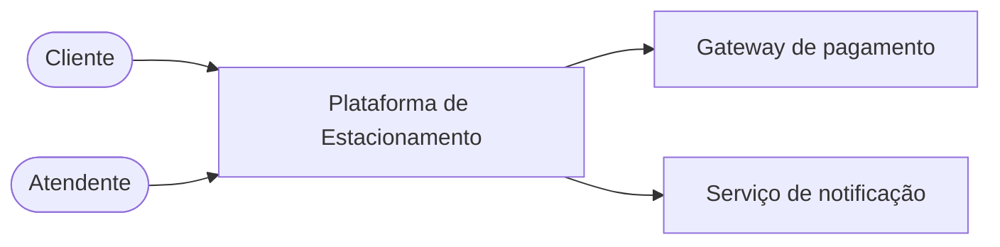
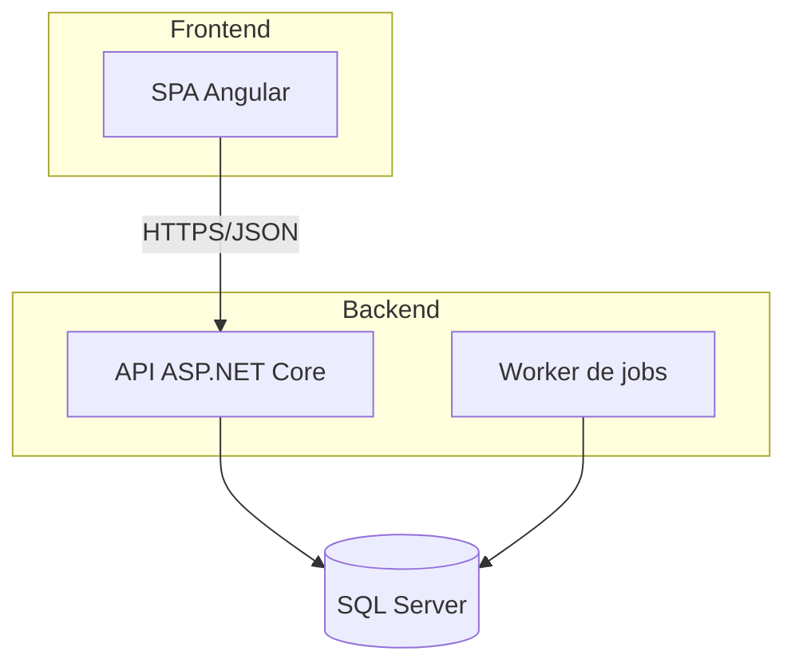
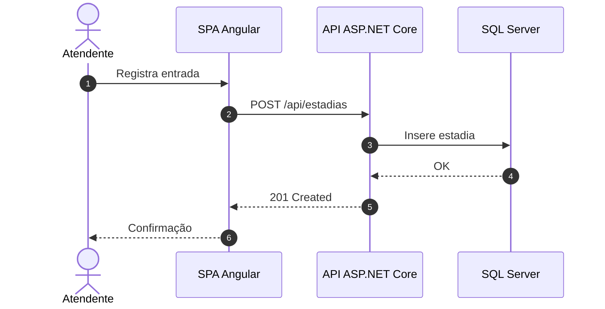
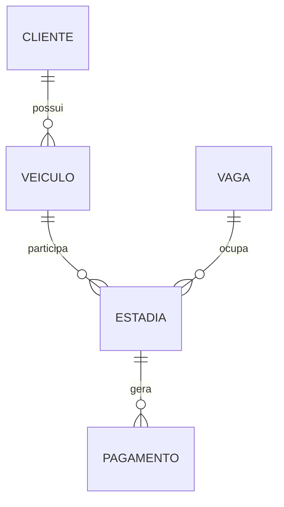
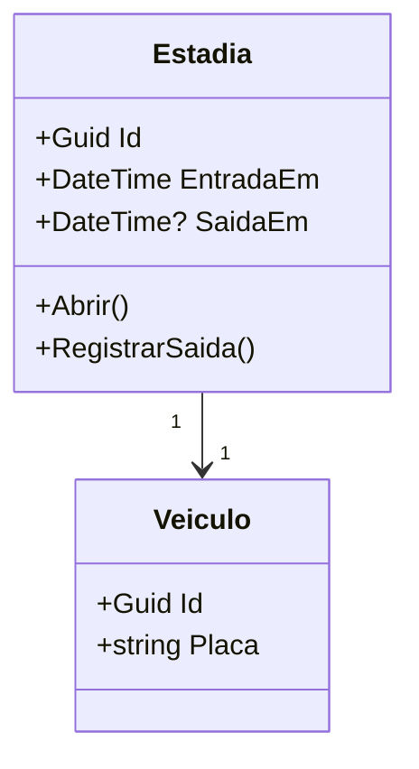
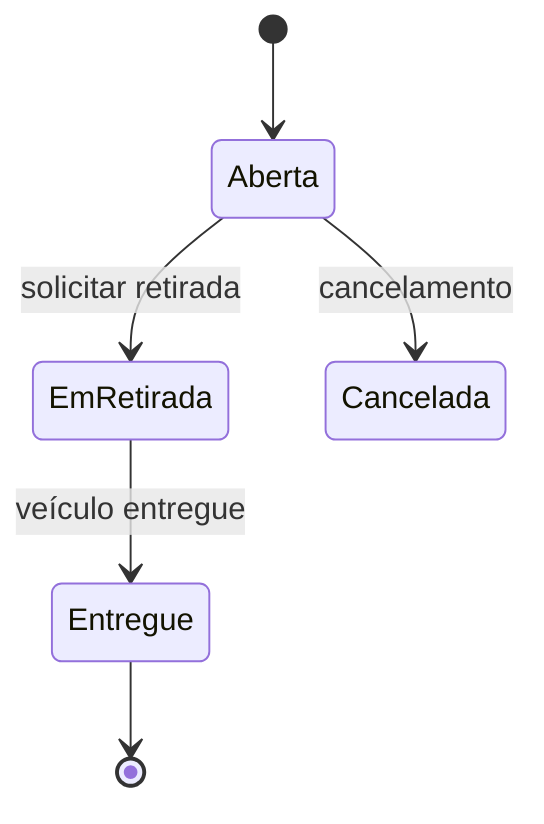
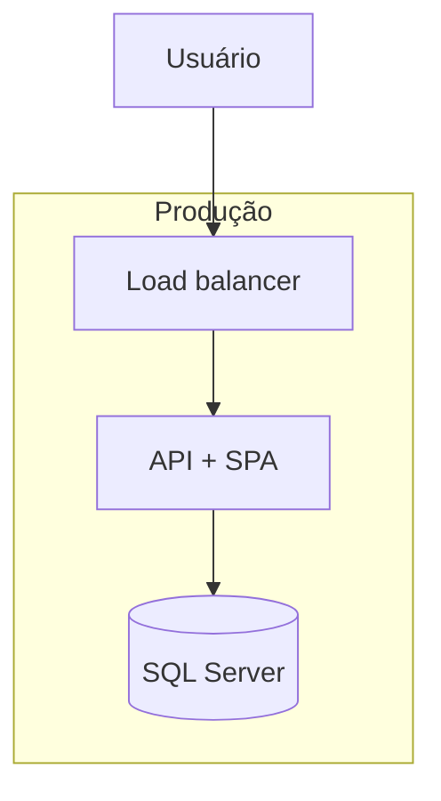

# Guia de diagramas Mermaid para o TDD

Use este guia para escolher, escrever e revisar os diagramas do TDD. Diagramas
existem para explicar relações, sequências, estados e dependências que seriam
mais difíceis de entender apenas em texto ou tabelas.

## Princípios

- **Um diagrama, uma ideia.** Não misture contexto, classes e deploy no mesmo
  desenho.
- **Sempre contextualize.** Todo diagrama deve ter um título ou legenda e um
  parágrafo curto dizendo o que ele mostra e por que importa.
- **Consistência.** Use os mesmos nomes de componentes, entidades e atores do
  restante do documento.
- **Legibilidade.** Prefira até ~15 nós por diagrama. Se ficar grande, divida
  por assunto ou por fluxo.
- **Código versionável.** Mantenha Mermaid dentro de blocos de código com a
  linguagem `mermaid`, nunca como imagem externa.
- **Sem duplicação.** O diagrama deve acrescentar informação; não repita uma
  tabela inteira em forma de desenho.
- **Fonte da verdade.** O diagrama deve refletir as decisões `DEC-XXX` e os
  requisitos; se houver divergência, corrija o diagrama ou registre a mudança.

## Quando usar cada tipo

| Necessidade | Tipo | Exemplo de uso |
| --- | --- | --- |
| Atores, sistemas externos e fronteiras | `flowchart` | Visão de contexto |
| Containers, componentes e dependências | `flowchart` + `subgraph` | Arquitetura da solução |
| Relacionamentos entre entidades | `erDiagram` | Modelo de dados |
| Estrutura de classes/domínio | `classDiagram` | Agregados e serviços de domínio |
| Ordem de chamadas em um fluxo | `sequenceDiagram` | Entrada, retirada, pagamento |
| Ciclo de vida de uma entidade | `stateDiagram-v2` | Estados de veículo, estadia ou pagamento |
| Ambientes e infraestrutura | `flowchart` | Implantação por ambiente |
| Cronograma de fases | `gantt` | Roadmap, quando ajudar |

## Exemplos

### Visão de contexto

### Containers e componentes

### Sequência de um fluxo crítico

### Relacionamentos entre entidades

### Classes de domínio

### Estados e transições

### Implantação

## Boas práticas de sintaxe

- Coloque rótulos com espaços, acentos, parênteses ou barras entre aspas:
  `A["API (produção)"]`.
- Evite acentos e espaços em IDs de nós; use rótulos para o texto visível:
  `api["API de Estacionamento"]`.
- Use `subgraph id["Título"]` para nomear agrupamentos.
- Quebre linhas de rótulos longos com ` `.
- Evite recursos experimentais ou específicos de uma versão do Mermaid.
- Valide o diagrama renderizando-o antes de considerar o TDD concluído.
- Se a sintaxe falhar, simplifique o diagrama; não entregue código quebrado.

## Checklist de revisão

- [ ] O diagrama responde a uma pergunta concreta do TDD.
- [ ] Há um título/legenda e uma explicação curta.
- [ ] Os nomes batem com o texto, as tabelas e as decisões `DEC-XXX`.
- [ ] O diagrama está legível e não excessivamente grande.
- [ ] As relações, setas e cardinalidades estão corretas.
- [ ] O fluxo/estado tem início, fim e tratamento de erro quando aplicável.
- [ ] O código Mermaid renderiza sem erros.
- [ ] O diagrama não duplica desnecessariamente outra seção.
