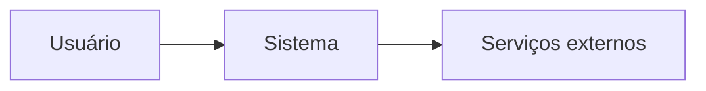
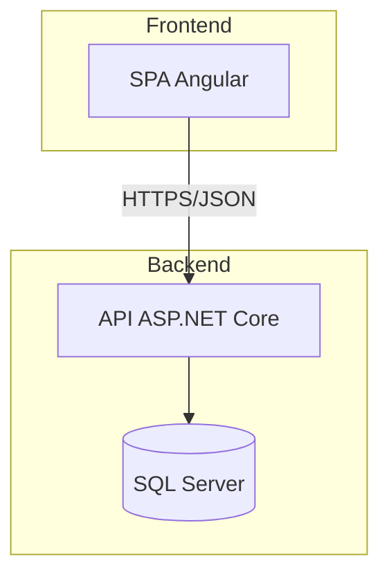
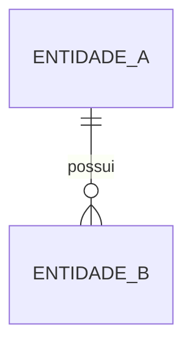
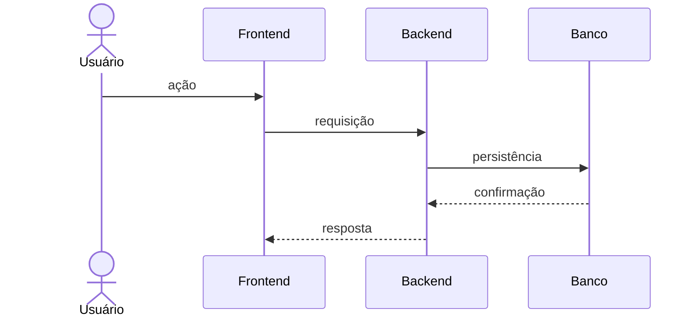
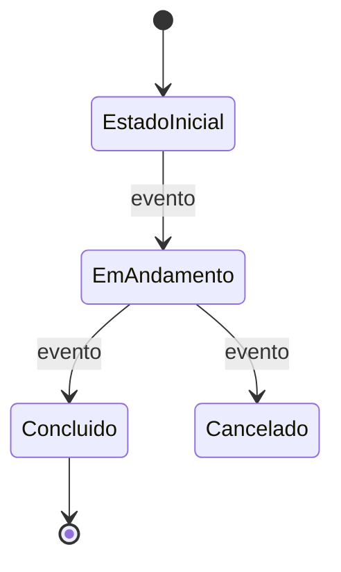
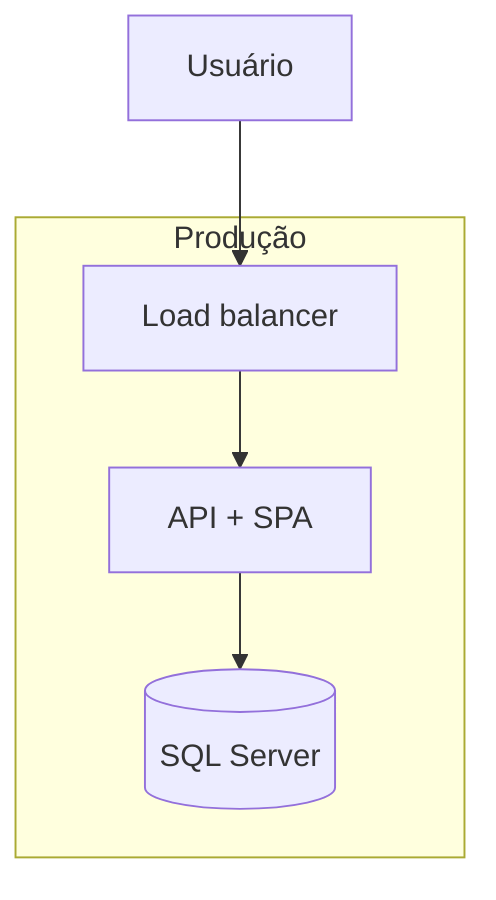

# Template de TDD

Ajuste o nível de detalhe ao porte do projeto. Quando uma seção não se
aplicar, mantenha o título e registre "Não aplicável" com uma justificativa
curta; não deixe placeholders vazios.

---

# TDD - <Nome do sistema ou escopo>

| Campo | Valor |
| --- | --- |
| Versão | 1.0 |
| Status | Rascunho / Em revisão / Aprovado |
| Autor | <autor> |
| Data | <AAAA-MM-DD> |
| PRD de referência | [PRD](../prd/prd.md) |
| Stakeholders | <nomes/papéis> |
| Links | <entrevista, OpenSpec, repositório, diagramas> |

## Sumário

<sumário navegável>

## 1. Resumo executivo

<O que será construído, com qual abordagem técnica e por quê, em 1-3 parágrafos.>

## 2. Contexto e objetivos

### 2.1 Problema e oportunidade

<Resumo do problema de negócio e do resultado esperado.>

### 2.2 Escopo técnico

<O que este TDD cobre.>

### 2.3 Fora de escopo

<O que não será tratado e por quê.>

### 2.4 Requisitos arquiteturalmente significativos

| ID | Requisito (RF/RNF) | Impacto arquitetural | Seção/Decisão |
| --- | --- | --- | --- |
| RF-001 | <descrição> | <impacto> | DEC-001 |

### 2.5 Restrições e premissas

- <Restrição de stack, infraestrutura, prazo, conformidade ou equipe.>
- <Premissa assumida e o que acontece se ela for falsa.>

## 3. Decisões técnicas

### 3.1 Registro de decisões

| ID | Tema | Decisão | Status | Requisitos |
| --- | --- | --- | --- | --- |
| DEC-001 | Arquitetura | <decisão> | Aceita | RF-001, RNF-002 |
| DEC-002 | Linguagem/runtime | <decisão> | Aceita | RNF-001 |
| DEC-003 | Biblioteca | <decisão> | Em aberto | RNF-003 |

### 3.2 Detalhamento das decisões

#### DEC-001 - <Título>

- **Status:** Aceita / Proposta / Em aberto / Substituída por DEC-XXX
- **Contexto:** <força, restrição ou problema que exige a decisão.>
- **Decisão:** <o que foi decidido, de forma normativa.>
- **Alternativas consideradas:**

| Alternativa | Prós | Contras | Motivo do descarte |
| --- | --- | --- | --- |
| <opção A> | <prós> | <contras> | <motivo> |

- **Justificativa:** <por que esta opção venceu.>
- **Consequências:** <positivas, negativas, custos e dívidas assumidas.>
- **Requisitos relacionados:** <RF/RNF.>

<Repita para cada decisão.>

## 4. Arquitetura da solução

> **Diagramas:** sempre que houver relacionamentos, fluxos, estados ou
> dependências relevantes, represente-os com Mermaid. Use
> `references/mermaid-guide.md` como apoio e mantenha o diagrama próximo da
> explicação textual.

| Diagrama | Seção | Pergunta que responde |
| --- | --- | --- |
| Contexto | 4.1 | Quem usa e quais sistemas externos participam? |
| Containers/componentes | 4.2 | Quais partes compõem a solução e como se comunicam? |
| Entidades | 5.1 | Como os dados se relacionam? |
| Sequência | 7.x | Qual a ordem das chamadas em cada fluxo crítico? |
| Estados | 7.3 | Quais estados e transições existem? |
| Implantação | 12 | Onde cada componente roda em cada ambiente? |

### 4.1 Visão de contexto



<Atores, sistemas externos e fronteiras.>

### 4.2 Visão de containers/componentes



<Responsabilidades, protocolos e dependências entre containers/componentes.>

### 4.3 Estilo arquitetural e camadas

<Monolito modular, camadas, DDD, CQRS etc. Descreva as camadas, suas
responsabilidades e as dependências permitidas/proibidas. Referencie DEC-XXX.>

### 4.4 Organização do código e do repositório

```text
src/
  Backend/
    <Projeto>.Api/
    <Projeto>.Application/
    <Projeto>.Domain/
    <Projeto>.Infrastructure/
  Frontend/
    <app>/
tests/
  <Projeto>.UnitTests/
  <Projeto>.IntegrationTests/
```

<Convenções de nome, limites de módulo e regras de dependência.>

### 4.5 Padrões e convenções

<Padrões de projeto adotados, tratamento de erros, validação, logging,
transações, nomenclatura e padrões de código.>

## 5. Modelo de dados

### 5.1 Visão geral



### 5.2 Entidades e relacionamentos

| Entidade | Descrição | Campos principais | Índices/restrições |
| --- | --- | --- | --- |
| <Entidade> | <descrição> | <campos> | <índices, unique keys> |

### 5.3 Persistência e migrações

<Banco, ORM, abordagem de migração, versionamento, seed e rollback.>

### 5.4 Auditoria, histórico e retenção

<Como registrar who/when/what, soft delete, histórico e retenção/LGPD.>

### 5.5 Concorrência e consistência

<Controle de concorrência, transações, locks, idempotência e consistência
aceitável. Referencie DEC-XXX.>

## 6. Interfaces e contratos

### 6.1 API

| Método | Rota | Descrição | Autenticação | Requisitos |
| --- | --- | --- | --- | --- |
| GET | /api/recurso | <descrição> | <perfil> | RF-001 |

### 6.2 Convenções de contrato

<Formato de erro, paginação, filtros, versionamento, idempotência e status
codes. O contrato OpenAPI é a fonte de verdade.>

### 6.3 Exemplos de payload

```json
{
  "exemplo": "curto e normativo"
}
```

### 6.4 Integrações externas

| Integração | Protocolo | Autenticação | Falha/retry | Requisitos |
| --- | --- | --- | --- | --- |
| <serviço> | <REST/evento> | <auth> | <estratégia> | RF-010 |

## 7. Fluxos principais

### 7.1 <Fluxo crítico 1>



<Passos, regras, validações, erros e compensações. Referencie decisões.>

### 7.2 <Fluxo crítico 2>

<Repita para entrada, retirada, pagamento, fechamento, autenticação etc.>

### 7.3 Estados e transições



<Explique os estados relevantes (ex.: veículo, estadia, pagamento), quem pode
disparar cada transição e quais regras/erros se aplicam.>

## 8. Segurança

- **Autenticação:** <mecanismo, sessão/token, expiração.>
- **Autorização:** <perfis, policies, permissões por recurso.>
- **Multi-tenancy:** <isolamento, se aplicável.>
- **Segredos:** <gestão por ambiente.>
- **Dados sensíveis:** <criptografia, mascaramento, LGPD.>
- **Auditoria:** <eventos e retenção.>
- **Ameaças e mitigações:** <tabela ou lista.>

## 9. Requisitos não funcionais

| RNF | Meta | Estratégia técnica | Como verificar |
| --- | --- | --- | --- |
| Desempenho | <meta> | <índices, cache, paginação> | <teste de carga> |
| Concorrência | <meta> | <transações, unique key> | <teste concorrente> |
| Disponibilidade | <meta> | <deploy, health check> | <monitoração> |
| Escalabilidade | <meta> | <horizontal, stateless> | <teste de carga> |
| Acessibilidade | <meta> | <padrão, componentes> | <checklist> |
| Segurança | <meta> | <controles> | <teste/revisão> |

## 10. Observabilidade e operação

- **Logs:** <formato, níveis, correlação, retenção.>
- **Métricas:** <principais indicadores e alertas.>
- **Tracing:** <propagação e amostragem.>
- **Health checks:** <liveness/readiness.>
- **Backup e restauração:** <frequência, RPO/RTO, teste.>
- **Runbook:** <procedimentos operacionais críticos.>

## 11. Estratégia de testes

| Camada | Ferramentas | Escopo | Critério de saída |
| --- | --- | --- | --- |
| Unitário | <ferramenta> | <regras de domínio> | <cobertura/qualidade> |
| Integração | <ferramenta> | <API, banco, integrações> | <cenários críticos> |
| E2E | <ferramenta> | <fluxos de negócio> | <fluxos críticos verdes> |
| Carga | <ferramenta> | <RNFs de desempenho> | <metas atingidas> |

<Dados de teste, isolamento, ambientes e política de flaky tests.>

## 12. Build, deploy e ambientes

- **Ambientes:** <dev, teste, homologação, produção.>
- **CI/CD:** <ferramenta, etapas, gates.>
- **Containerização:** <imagens, orquestração.>
- **Configuração:** <appsettings, variáveis, segredos.>
- **Migrações:** <quando e como executar.>
- **Rollout/rollback:** <estratégia e critérios.>



<Descreva onde cada componente roda, réplicas, rede, volumes e dependências
externas por ambiente.>

## 13. Dependências e bibliotecas

| Dependência | Versão | Finalidade | Justificativa | Licença |
| --- | --- | --- | --- | --- |
| <pacote> | <versão> | <uso> | <DEC-XXX> | <licença> |

<Política de atualização, vulnerabilidades e dependências transitivas.>

## 14. Riscos técnicos

| ID | Risco | Probabilidade | Impacto | Mitigação | Contingência |
| --- | --- | --- | --- | --- | --- |
| R-001 | <risco> | Média | Alto | <ação> | <plano B> |

## 15. Rastreabilidade PRD → TDD

| Requisito | Seção do TDD | Decisão | Status |
| --- | --- | --- | --- |
| RF-001 | 4.2, 6.1 | DEC-001 | Coberto |
| RNF-002 | 9 | DEC-004 | Em aberto |

## 16. Questões em aberto

| ID | Questão | Opções | Responsável | Critério de decisão |
| --- | --- | --- | --- | --- |
| QA-001 | <questão> | <opções> | <responsável> | <critério> |

## 17. Roadmap de implementação

| Fase | Entregável | Dependências | Critérios de aceite |
| --- | --- | --- | --- |
| 1 | <fundação técnica> | <DECs aceitas> | <critérios verificáveis> |
| 2 | <fluxo crítico> | <fase 1> | <critérios verificáveis> |

## 18. Glossário

| Termo | Definição |
| --- | --- |
| <termo> | <definição> |

## 19. Anexo A - Registro da entrevista

Registre as perguntas de decisão feitas com a ferramenta `question` (sistema de questões do ambiente) e as decisões resultantes. Se a entrevista não foi realizada, registre o motivo e as lacunas pendentes.

| ID | Pergunta | Resposta / Decisão | Decisão gerada | Status |
| --- | --- | --- | --- | --- |
| ENT-001 | <pergunta> | <resposta> | DEC-001 | Confirmada / Pendente |

## 20. Referências

- <PRD, entrevista, specs do OpenSpec, documentação externa, spikes.>

## 21. Changelog

| Versão | Data | Autor | Mudança |
| --- | --- | --- | --- |
| 1.0 | <AAAA-MM-DD> | <autor> | Criação do documento |
