# TDD - Plataforma de Gestão de Estacionamento e Valet

| Campo | Valor |
| --- | --- |
| Versão | 1.4 |
| Status | Em revisão |
| Autor | Agente OpenCode |
| Data | 2026-11-08 |
| PRD de referência | [PRD](../prd/prd.md) v1.1 (Aprovado) |
| Stakeholders | Alexandre Rech (proprietário); gestão/financeiro; operação (atendentes e manobristas); Tiago Santini (requisitos) |
| Links | [Entrevista de requisitos](../entrevista.md) · OpenSpec (`openspec/config.yaml`) · Repositório (`README.md`) |

## Sumário

1. [Resumo executivo](#1-resumo-executivo)
2. [Contexto e objetivos](#2-contexto-e-objetivos)
3. [Decisões técnicas](#3-decisões-técnicas)
4. [Arquitetura da solução](#4-arquitetura-da-solução)
5. [Modelo de dados](#5-modelo-de-dados)
6. [Interfaces e contratos](#6-interfaces-e-contratos)
7. [Fluxos principais](#7-fluxos-principais)
8. [Segurança](#8-segurança)
9. [Requisitos não funcionais](#9-requisitos-não-funcionais)
10. [Observabilidade e operação](#10-observabilidade-e-operação)
11. [Estratégia de testes](#11-estratégia-de-testes)
12. [Build, deploy e ambientes](#12-build-deploy-e-ambientes)
13. [Dependências e bibliotecas](#13-dependências-e-bibliotecas)
14. [Riscos técnicos](#14-riscos-técnicos)
15. [Rastreabilidade PRD → TDD](#15-rastreabilidade-prd--tdd)
16. [Questões em aberto](#16-questões-em-aberto)
17. [Roadmap de implementação](#17-roadmap-de-implementação)
18. [Glossário](#18-glossário)
19. [Anexo A - Registro da entrevista](#19-anexo-a---registro-da-entrevista)
20. [Referências](#20-referências)
21. [Changelog](#21-changelog)

## 1. Resumo executivo

A Plataforma de Gestão de Estacionamento e Valet será construída como um **monólito modular** com backend em **.NET 10 (LTS)**, organizado em **Clean Architecture + DDD**, e frontend em **Angular 22** com componentes standalone, **zoneless change detection** e **signals**. O backend expõe uma API REST versionada (`/api/v1`) documentada por OpenAPI, autentica pela combinação **ASP.NET Core Identity + cookie same-site** e persiste em **SQL Server 2022** com **EF Core 10**.

A arquitetura é deliberadamente simples para uma única unidade e até 50 usuários: sem mensageria, sem múltiplos bancos e sem microsserviços. As garantias críticas do produto são resolvidas no banco e no domínio — **uma estadia ativa por placa** e **uma estadia ativa por vaga** são índices únicos filtrados, o cálculo de diárias é um serviço de domínio determinístico e a trilha de auditoria é append-only com bloqueio de `UPDATE`/`DELETE` no banco. A atualização do painel em até 10 segundos (RF-019, RF-040) é feita por **polling de 5 segundos com ETag**, evitando a complexidade operacional de push em tempo real.

O resultado esperado é uma operação de balcão rápida, com cobrança padronizada, rastreabilidade das ações sensíveis e fechamento de caixa conciliável, implantada em uma VM Linux com Docker Compose, pipeline GitHub Actions e observabilidade por Serilog + OpenTelemetry.

## 2. Contexto e objetivos

### 2.1 Problema e oportunidade

O PRD descreve uma operação de valet sustentada por tickets de papel, memória da equipe e planilhas: não há visão confiável de vagas, os pedidos de retirada se perdem, o cálculo de diárias varia por operador e o fechamento financeiro é manual. A oportunidade é centralizar a operação em uma plataforma única, com regras de cobrança determinísticas, ocupação consistente e auditoria das ações sensíveis.

Este TDD traduz os requisitos aprovados em decisões técnicas verificáveis. Ele não altera o escopo do PRD; quando uma decisão depende de informação ainda não disponível (por exemplo, modelo da impressora ou limite de desconto), o ponto é registrado em [Questões em aberto](#16-questões-em-aberto) e não é inventado.

### 2.2 Escopo técnico

Cobre o MVP restrito do PRD (§15) — RF-001 a RF-010, RF-012 a RF-017, RF-019 a RF-023, RF-025 a RF-027, RF-029 a RF-038, RF-040 a RF-043 — e a infraestrutura necessária para operá-lo:

- Solução .NET 10 no formato `.slnx`, com projetos de domínio, aplicação, infraestrutura, API e testes.
- SPA Angular 22 consumindo a API, com autorização por perfil e comportamento responsivo a partir de 360 px.
- Modelo de dados relacional, migrações versionadas, índices, restrições de concorrência e retenção.
- Contratos REST, tratamento de erros, idempotência e versionamento.
- Autenticação, autorização, auditoria, LGPD e mascaramento de dados pessoais.
- Estratégia de testes unitários, de integração, E2E, contrato e carga.
- Pipeline, ambientes, implantação, observabilidade, backup e restauração.
- Fases 2 e 3 do PRD (RF-011, RF-018, RF-024, RF-028, RF-039, RF-044) **fora do MVP** (D-02): serão entregues nas Fases 4 e 5 do roadmap (§17); nesta versão apenas o modelo não deve bloqueá-las, sem endpoints/fluxos entregues no MVP.

### 2.3 Fora de escopo

Não são tratados neste TDD, por estarem fora do MVP no PRD:

- Aplicativo do cliente, autoatendimento, notificações por WhatsApp/SMS/e-mail e múltiplas unidades.
- Integração com adquirente, gateway de pagamento, Pix automático, NFS-e, ERP ou conciliação bancária.
- Fotografias, LPR, cancela automática, sensores de vaga, CFTV e operação offline com sincronização.
- Migração automática de planilhas históricas (QA-008).
- Reserva de vagas, mensalistas, fidelidade e tarifas dinâmicas.
- Autenticação multifator, federação com provedores externos e login social (não exigidos pelo PRD; ver QTD-04).

### 2.4 Requisitos arquiteturalmente significativos

| ID | Requisito (RF/RNF) | Impacto arquitetural | Seção/Decisão |
| --- | --- | --- | --- |
| RF-004 | Auditoria de ações sensíveis | Trilha append-only, captura de antes/depois e bloqueio de alteração no banco | 5.4, 8, DEC-027 |
| RF-007 | Tarifa com vigência e histórico | Modelo temporal, congelamento de valor na estadia e prevenção de sobreposição | 5.2, 5.5, DEC-007 |
| RF-012 | Ocupação exclusiva de vaga | Índice único filtrado, rowversion e transação de check-in | 5.5, 7.1, DEC-007 |
| RF-019 | Mapa de vagas em até 10 s | Polling com ETag e read model de ocupação | 4.2, 7.1, DEC-004 |
| RF-030 | Cálculo de diárias | Serviço de domínio determinístico com segundos e arredondamento para cima | 4.3, 7.3, DEC-001 |
| RF-038 | Fechamento diário | Agregação por data local, unicidade por data e versionamento | 5.2, 7.4, DEC-026 |
| RF-042 | CSV seguro | Geração server-side, UTF-8 com BOM e neutralização de fórmulas | 6.1, DEC-011 |
| RF-043 | Contingência com aprovação | Entidade de contingência, materialização idempotente e filtro em relatórios | 7.6, DEC-025 |
| RNF-001 | p95 ≤ 2 s com 20 usuários | Índices, projeções `AsNoTracking` e paginação | 9, DEC-031 |
| RNF-003 | Concorrência sem dupla ocupação | Restrições no banco + teste concorrente automatizado | 5.5, 11 |
| RNF-004 | Disponibilidade de 99,5% | Health checks, restart policy, janela de manutenção e backup | 10, 12 |
| RNF-005 | RPO 1 h e RTO 4 h | Backup full diário + log horário para storage externo | 10, DEC-020 |
| RNF-007 | Autorização no servidor | Policies por permissão e negação por padrão | 8, DEC-016 |
| RNF-008 | Auditoria íntegra por 5 anos | Permissões de banco, trigger e ausência de delete na aplicação | 5.4, DEC-027 |
| RNF-010 | Retenção e anonimização | Worker diário, pseudônimo e purga após 5 anos | 5.4, DEC-028 |
| RNF-014 | Observabilidade | Serilog JSON, OpenTelemetry, métricas e alertas | 10, DEC-017 |
| RNF-018 | 500 vagas / 5.000 estadias/mês | Índices, paginação e volume validado em teste de carga | 9, 11 |
| RNF-019 | UTC e America/Sao_Paulo | `TimeProvider`, `datetime2` UTC e conversão na borda | 4.5, DEC-026 |
| RNF-020 | CSV compatível com planilhas | UTF-8 BOM, `;`, colunas estáveis e antídoto de fórmulas | 6.1, DEC-011 |

### 2.5 Restrições e premissas

**Restrições confirmadas**

- Stack obrigatória: .NET 10, SQL Server, EF Core, ASP.NET Core Identity, Angular 22, Tailwind CSS, Lucide Icons e OpenAPI.
- Arquitetura single-tenant, uma unidade e um pátio; nenhuma preparação para multiempresa.
- Interface em pt-BR, moeda BRL, fuso America/Sao_Paulo e armazenamento em UTC.
- Sem integração externa de pagamento, fiscal ou hardware além da impressora térmica local.
- Retenção: 5 anos para registros financeiros e de auditoria; 2 anos para operacionais, com anonimização. **Ativação condicionada a QA-007; flag desligada no MVP (D-03b).**

**Premissas assumidas**

| ID | Premissa | Se for falsa |
| --- | --- | --- |
| PRE-01 | A operação tem no máximo 50 usuários cadastrados e 20 simultâneos. | Revisar dimensionamento, pool de conexões e teste de carga (QTD-06). |
| PRE-02 | O volume é de até 5.000 estadias/mês e 500 vagas ativas. | Reavaliar índices, particionamento de relatórios e retenção. |
| PRE-03 | O navegador do balcão é Chrome ou Edge atualizado e permite `window.print`. | Adotar agente local ESC/POS (alternativa descartada em DEC-009). |
| PRE-04 | Existe um único domínio DNS com TLS válido para SPA e API (mesma origem). | Ajustar cookies `SameSite`, CORS e o proxy do nginx (DEC-003). |
| PRE-05 | A impressora aceita impressão via driver do sistema em 80 mm. | Reavaliar DEC-009 e o fallback de ticket em tela (QA-004). |
| PRE-06 | O servidor terá relógio sincronizado por NTP. | Horários de entrada e fechamento podem divergir; habilitar alerta de drift. |
| PRE-07 | Não haverá múltiplas instâncias da API em hosts distintos. | Data Protection e rate limiting distribuído precisam de storage compartilhado. |
| PRE-08 | A validação jurídica da retenção (QA-007) ocorrerá antes do go-live. | A rotina de anonimização permanece desligada por default (`Retention:Enabled=false`, D-03b) e só é ativada com parecer jurídico. |
| PRE-09 | Janela de operação definida pela operação (QA-002). | SLA de 99,5% só faz sentido dentro da janela; sem ela, mede-se `uptime` e health sem SLA formal (D-03a). |

## 3. Decisões técnicas

### 3.1 Registro de decisões

| ID | Tema | Decisão | Status | Requisitos |
| --- | --- | --- | --- | --- |
| DEC-001 | Arquitetura backend | Monólito modular em Clean Architecture + DDD com casos de uso explícitos, sem MediatR | Aceita | RF-008, RF-030, RNF-015 |
| DEC-002 | Estilo de API | Controllers MVC com OpenAPI nativo e ProblemDetails | Aceita | RF-014, RF-044, RNF-015 |
| DEC-003 | Autenticação | ASP.NET Core Identity com cookie same-site HttpOnly e antiforgery | Aceita | RF-001, RF-003, RNF-006 |
| DEC-004 | Atualização do painel | Polling HTTP a cada 5 s com ETag e resposta 304 | Aceita | RF-019, RF-040 |
| DEC-005 | Frontend | Angular 22 standalone, zoneless e signals com Material + Tailwind + Lucide | Aceita | RNF-011, RNF-012, RNF-013 |
| DEC-006 | Identificadores | GUID v7 como PK e código público curto para ticket e comprovante | Aceita | RF-010, RF-034 |
| DEC-007 | Concorrência | Índices únicos filtrados, rowversion e transação nas invariantes de ocupação | Aceita | RF-007, RF-012, RNF-003 |
| DEC-008 | Migrações e seed | EF migration bundle aplicado no deploy e seeder idempotente | Aceita | RNF-005, RNF-015 |
| DEC-009 | Impressão térmica | `window.print` com folha de estilo de 80 mm e fallback na tela | Aceita | RF-010, RNF-016 |
| DEC-010 | QR e comprovante | QRCoder no servidor e QuestPDF para comprovante em PDF | Aceita | RF-010, RF-034, RNF-021 |
| DEC-011 | Exportação CSV | Geração server-side em streaming com neutralização de fórmulas | Aceita | RF-042, RNF-020 |
| DEC-012 | Versionamento de API | Prefixo de rota `/api/v1` | Aceita | RNF-015 |
| DEC-013 | Banco de dados | SQL Server 2022 Developer em container (dev/teste; produção comercial exige Standard licenciada) | Aceita | RNF-005, RNF-018 |
| DEC-014 | Hospedagem | VM Linux com Docker Compose, nginx e dois containers de API | Aceita | RNF-004, RNF-005 |
| DEC-015 | CI/CD | GitHub Actions com build, testes, imagem e deploy por SSH | Aceita | RNF-015 |
| DEC-016 | Autorização | Permissões fixas por perfil em código, aplicadas por policies | Aceita | RF-002, RNF-007 |
| DEC-017 | Observabilidade | Serilog estruturado + OpenTelemetry com exportação OTLP | Aceita | RNF-014 |
| DEC-018 | Testes de integração | MSTest + WebApplicationFactory + Testcontainers SQL Server | Aceita | RNF-003, RNF-015 |
| DEC-019 | Testes de frontend | Vitest + Testing Library para unidade e Playwright para E2E | Aceita | RNF-011, RNF-012 |
| DEC-020 | Backup | Backup full diário e log horário via backup-worker (sqlcmd+cron, sem SQL Server Agent) com cópia externa e arquivo mensal para retenção histórica | Aceita | RNF-005, R-008 |
| DEC-021 | Estado no frontend | Signals e serviços de feature, sem store global | Aceita | RF-019, RF-040 |
| DEC-022 | Validação de entrada | FluentValidation por caso de uso na camada Application | Aceita | RF-008, RNF-007 |
| DEC-023 | Repositório | Monorepo com `Estacionamento.slnx`, `src/`, `tests/` e `deploy/` | Aceita | RNF-015 |
| DEC-024 | Versões de runtime | .NET 10 LTS, C# 14, Angular 22, Node 24 LTS com versões fixadas | Aceita | RNF-015 |
| DEC-025 | Erros e idempotência | ProblemDetails com código de erro e `Idempotency-Key` em comandos críticos | Aceita | RF-043, RNF-011 |
| DEC-026 | Tempo e fuso | `TimeProvider`, UTC no banco e conversão para America/Sao_Paulo na borda | Aceita | RNF-019, RN-019 |
| DEC-027 | Auditoria | Tabela append-only com trigger, permissões restritas e snapshot antes/depois | Aceita | RF-004, RNF-008 |
| DEC-028 | Retenção e LGPD | Worker diário de anonimização e purga com pseudônimo | Aceita | RNF-009, RNF-010, RN-024 |
| DEC-029 | Renderização | SPA em CSR, sem SSR, servida como estático pelo nginx | Aceita | RNF-013 |
| DEC-030 | Cliente HTTP | Interfaces TypeScript mantidas no repositório e teste de contrato OpenAPI | Aceita | RNF-015 |
| DEC-031 | Persistência | Repositórios por agregado na escrita e read models projetados com EF Core | Aceita | RNF-001, RNF-015 |

### 3.2 Detalhamento das decisões

#### DEC-001 - Monólito modular em Clean Architecture + DDD com casos de uso explícitos

- **Status:** Aceita
- **Contexto:** O produto tem 44 requisitos funcionais, forte carga de regras de negócio (cálculo de diárias, transições de status, autorizações, fechamento) e um único contexto operacional. O time é pequeno e o prazo do MVP ainda não foi definido (QA-015). Era necessário escolher como organizar os casos de uso sem introduzir infraestrutura de mensageria.
- **Decisão:** O backend é um **monólito modular** dividido em quatro projetos (`Domain`, `Application`, `Infrastructure`, `Api`) com módulos internos `Operacao`, `Faturamento`, `Identidade`, `Auditoria` e `Contingencia`. Cada caso de uso é uma classe `XxxHandler` na camada Application, injetada diretamente no controller, com dependências explícitas de repositórios, `IUnitOfWork`, `TimeProvider` e serviços de domínio. Não há mediador, barramento de comandos nem pipeline mágico. Regras de negócio ficam em agregados e serviços de domínio; a Application orquestra; a Infrastructure implementa persistência e integrações; a Api expõe o contrato.
- **Alternativas consideradas:**

| Alternativa | Prós | Contras | Motivo do descarte |
| --- | --- | --- | --- |
| CQRS com MediatR | Pipeline único para validação, log e transação | Indireção, handlers dispersos e stack traces longos | O ganho não compensa a cerimônia em 44 casos de uso |
| Vertical slices por feature | Código de uma feature em um só lugar | Conflita com a separação em projetos exigida pela Clean Architecture | Mistura de camadas dificultaria a regra de dependência |
| Serviços anêmicos + repositório único | Menos classes | Regras vazam para controllers e duplicam | Não sustenta DDD nem testabilidade das invariantes |

- **Justificativa:** Casos de uso explícitos tornam o fluxo de dependências legível, facilitam o teste unitário com dublês simples e permitem revisar cada operação sensível sem navegar por behaviors. A separação em projetos preserva a regra de dependência e permite testar o domínio sem banco.
- **Consequências:** Cada caso de uso exige uma classe e um método de controller, gerando mais arquivos que uma abordagem minimalista. Validação, transação e auditoria precisam ser aplicadas explicitamente em cada handler; para evitar esquecimento, a classe base `CommandHandler` concentra o padrão `validar → executar → auditar → commit`. Não há eventos de domínio publicados fora do processo.
- **Requisitos relacionados:** RF-008, RF-012, RF-016, RF-023, RF-025, RF-030, RF-035, RF-036, RF-038, RF-043, RNF-015.

#### DEC-002 - Controllers MVC com OpenAPI nativo

- **Status:** Aceita
- **Contexto:** A SPA consome aproximadamente 40 rotas, agrupadas por módulo, com requisitos de autorização, paginação, ETag e respostas de erro padronizadas.
- **Decisão:** Usar `ControllerBase` com atributos de rota, um controller por módulo (`AuthController`, `EstadiasController`, `RetiradasController`, `CobrancasController`, `CaixaController`, `RelatoriosController`, `VagasController`, `TarifasController`, `UsuariosController`, `AuditoriaController`, `ContingenciasController`, `PainelController`, `TelemetriaController`, `HealthController`). O documento OpenAPI é gerado por `Microsoft.AspNetCore.OpenApi` em tempo de build e versionado como artefato; a UI de exploração é o Scalar em ambientes não produtivos.
- **Alternativas consideradas:**

| Alternativa | Prós | Contras | Motivo do descarte |
| --- | --- | --- | --- |
| Minimal APIs | Menos código por endpoint | Agrupamento, filtros e documentação exigem disciplina manual | 40+ rotas se beneficiam de convenções de controller |
| Híbrido | Minimal para health e streaming | Duas convenções e dois estilos de filtro | Custo de manutenção sem ganho relevante |

- **Justificativa:** Controllers oferecem model binding, filtros globais, `ProducesResponseType` e agrupamento natural por módulo, que combinam com a matriz de permissões do PRD. O OpenAPI nativo do .NET 10 elimina a dependência de Swashbuckle.
- **Consequências:** Controllers ficam finos: apenas traduzem HTTP para o caso de uso e o resultado para `IActionResult`. Filtros globais tratam `ProblemDetails`, antiforgery, autorização e correlação.
- **Requisitos relacionados:** RF-014, RF-037, RF-041, RF-044, RNF-015.

#### DEC-003 - Identity com cookie same-site e antiforgery

- **Status:** Aceita
- **Contexto:** Apenas equipe interna usa o sistema, em navegador, na mesma origem da API. O PRD exige sessão expirada após 30 minutos de inatividade, bloqueio após 5 tentativas por 15 minutos e nenhum dado sensível exposto ao JavaScript.
- **Decisão:** Autenticação com `ASP.NET Core Identity` e `AddIdentityCookies` (sem JWT). Cookie `__Host-estacionamento.auth` com `HttpOnly`, `Secure`, `SameSite=Lax`, `Path=/`, expiração deslizante de 30 minutos (`SlidingExpiration=true`). Bloqueio de 5 tentativas por 15 minutos, senha mínima de 12 caracteres com complexidade, e-mail único e confirmação obrigatória de troca no primeiro acesso. Antiforgery por double-submit: cookie `XSRF-TOKEN` legível pelo Angular e header `X-XSRF-TOKEN`, validado globalmente por `AutoValidateAntiforgeryTokenAttribute`. Chaves de Data Protection persistidas em volume compartilhado entre as réplicas.
- **Alternativas consideradas:**

| Alternativa | Prós | Contras | Motivo do descarte |
| --- | --- | --- | --- |
| JWT access + refresh | Desacopla clientes externos | Tokens no navegador, rotação, revogação e storage seguro | Não há cliente externo no MVP |
| BFF com cookie | Maior proteção de tokens | Componente extra, latência e mais deploy | Cookie direto já é same-origin |
| Sessão em cache distribuído | Escala horizontal simples | Dependência de Redis para 20 usuários | Volume não justifica |

- **Justificativa:** Cookie `HttpOnly` não é acessível a XSS, a sessão é revogável no servidor e a mesma origem elimina CORS. O custo é a proteção antiforgery, resolvida por header e validada globalmente.
- **Consequências:** A SPA precisa enviar `withCredentials` e o header `X-XSRF-TOKEN` em métodos mutantes. Qualquer mudança para domínios separados exige revisar `SameSite` e CORS. Logout invalida o cookie e registra evento de segurança.
- **Requisitos relacionados:** RF-001, RF-002, RF-003, RNF-006, RNF-007.

#### DEC-004 - Polling de 5 segundos com ETag

- **Status:** Aceita
- **Contexto:** RF-019 e RF-040 exigem refletir mudanças de ocupação e fila em até 10 segundos para até 20 usuários simultâneos. Não há requisito de colaboração em tempo real nem de notificação instantânea.
- **Decisão:** A SPA consulta `GET /api/v1/painel/operacional` e `GET /api/v1/retiradas` a cada 5 segundos enquanto a aba estiver visível (`Page Visibility API`). O servidor calcula um ETag a partir da versão de ocupação e da fila (hash do read model) e responde `304 Not Modified` sem corpo quando nada mudou. O polling pausa com a aba oculta e retoma ao focar.
- **Alternativas consideradas:**

| Alternativa | Prós | Contras | Motivo do descarte |
| --- | --- | --- | --- |
| SignalR | Latência de milissegundos e push real | Hub, reconexão, grupos, sticky sessions e mais testes | Meta é 10 s, não tempo real |
| SSE | Stream simples sobre HTTP | Suporte irregular em proxies e reconexão manual | Sem ganho sobre polling para 20 usuários |
| Polling de 1 s | Menor latência | 20× mais requisições sem necessidade | Custo de banco e rede desproporcional |

- **Justificativa:** Com 20 usuários, o polling a cada 5 s gera ~4 req/s, atendido com folga por índices e projeções. ETag reduz o custo do caso comum (nada mudou) a uma resposta 304.
- **Consequências:** A latência máxima percebida é de ~5 s, dentro do limite de 10 s. O endpoint de painel precisa ser barato e não pode disparar cálculos pesados; relatórios e fechamento ficam fora do polling. Em caso de erro, a SPA mantém o último estado e exibe indicador de desatualização.
- **Requisitos relacionados:** RF-019, RF-022, RF-040, RNF-001, RNF-003.

#### DEC-005 - Angular 22 standalone, zoneless e signals com Material + Tailwind

- **Status:** Aceita
- **Contexto:** O frontend precisa ser rápido no balcão, responsivo a partir de 360 px, acessível em WCAG 2.1 AA e operável por usuários com pouca familiaridade técnica.
- **Decisão:** Angular 22 com `provideZonelessChangeDetection()`, sem `zone.js`, componentes standalone e estado por signals. Angular Material 22 + CDK para formulários, diálogos, tabelas e acessibilidade; Tailwind CSS 4 para layout e espaçamento; `lucide-angular` para ícones. Tipografia e tokens de cor definidos em CSS custom properties. Formulários reativos tipados; validação espelhada do servidor.
- **Alternativas consideradas:**

| Alternativa | Prós | Contras | Motivo do descarte |
| --- | --- | --- | --- |
| Tailwind + CDK custom | Visual sob medida e bundle menor | Acessibilidade artesanal em cada componente | Custo alto para WCAG AA |
| PrimeNG | Suite completa | Tema próprio, peso e padrões divergentes | Menor alinhamento com Angular |
| Bootstrap | Conhecido | Sem componentes Angular nativos | Não atende acessibilidade e estado |

- **Justificativa:** Material entrega base acessível e testada; Tailwind acelera layout responsivo; signals e zoneless reduzem change detection desnecessária em telas com polling.
- **Consequências:** É necessário tema customizado para evitar aparência genérica e conflitos entre utilitários Tailwind e estilos do Material (resolvido com camadas CSS e `@layer`). A equipe precisa conhecer signals; não há NgRx.
- **Requisitos relacionados:** RNF-011, RNF-012, RNF-013, RF-019, RF-040.

#### DEC-006 - GUID v7 como chave e código público curto

- **Status:** Aceita
- **Contexto:** Identificadores aparecem em URLs, tickets, comprovantes e relatórios. O ticket não pode ser previsível (R-014) e o comprovante precisa de numeração sequencial própria (RN-025).
- **Decisão:** Chaves primárias `uniqueidentifier` geradas como **UUID v7** (ordenáveis por tempo), expostas na API. Ticket usa código público de 10 caracteres em Crockford Base32 com dígito verificador, gerado aleatoriamente e protegido por índice único, sem relação com a PK. Comprovante usa `bigint` de uma `SEQUENCE` do SQL Server, com índice único.
- **Alternativas consideradas:**

| Alternativa | Prós | Contras | Motivo do descarte |
| --- | --- | --- | --- |
| BIGINT identity | Índices compactos | Expõe volume e exige código público adicional | URLs previsíveis |
| BIGINT + GUID público | Chave interna eficiente | Duas colunas e joins mais complexos | Custo de mapeamento sem ganho |
| GUID v4 | Simples | Índices fragmentados em inserções | v7 mantém ordenação temporal |

- **Justificativa:** GUID v7 evita enumeração, mantém localidade de índice e simplifica a geração no domínio. O código de ticket separa a identificação pública da chave interna, atendendo R-014 sem criar numeração sequencial.
- **Consequências:** O índice clusterizado usa a PK; em tabelas de alto volume (`Auditoria`, `Pagamento`), a ordenação por tempo do v7 favorece inserts. Colisão de código de ticket é tratada por retry (até 3 tentativas) e índice único.
- **Requisitos relacionados:** RF-010, RF-034, RN-012, RN-025, R-014.

#### DEC-007 - Índices únicos filtrados, rowversion e transação

- **Status:** Aceita
- **Contexto:** RF-012 exige que dois atendentes não ocupem a mesma vaga; RN-005 exige uma única estadia ativa por placa; RF-007 exige vigência de tarifa sem sobreposição (C-02); RF-033 exige novo pagamento após estorno como evento distinto (C-03). Validação apenas na aplicação não resiste a concorrência (R-012).
- **Decisão:** As invariantes são garantidas no banco:

| Invariante | Mecanismo |
| --- | --- |
| Uma estadia ativa por placa | Índice único filtrado `UX_Estadia_PlacaAtiva` em `PlacaNormalizada` com `WHERE Ativa = 1` |
| Uma estadia ativa por vaga | Índice único filtrado `UX_Estadia_VagaAtiva` em `VagaId` com `WHERE Ativa = 1` |
| Uma solicitação ativa por estadia | Índice único filtrado `UX_Solicitacao_Ativa` em `EstadiaId` com `WHERE Status IN (1,2)` |
| Uma cobrança por estadia | Índice único em `Cobranca.EstadiaId` |
| Um pagamento ativo por cobrança | Índice único filtrado `UX_Pagamento_Ativo` em `Pagamento.CobrancaId` com `WHERE Status = 'Ativo'`; pagamentos históricos `Estornado` são preservados; novo pagamento após estorno insere nova linha `Ativo` (C-03) |
| Um fechamento por data | Índice único em `FechamentoCaixa.Data` |
| Tarifa sem sobreposição (intervalos `[InicioVigencia, FimVigencia)`) | Trigger `TR_Tarifa_Sobreposicao` (INSERT/UPDATE) que aborta se intervalos se cruzarem + transação `SERIALIZABLE` na gravação + índice único em `InicioVigencia` como barreira secundária + `CHECK` de fim maior que início; sobreposição parcial (ex.: `[01/01,10/01)` × `[05/01,15/01)`) retorna `409 CONFLITO_VIGENCIA` (C-02) |

Operações que mudam ocupação usam transação `READ COMMITTED` com `UPDATE` condicional na vaga (`WHERE Id = @vaga AND Estado = 'Livre' AND RowVersion = @rv`) e `RowVersion` (`rowversion`) nos agregados `Estadia`, `Vaga`, `Cobranca`, `SolicitacaoRetirada` e `FechamentoCaixa`. Gravações de tarifa usam `SERIALIZABLE` para excluir corrida de intervalos. Violação de unicidade, de trigger ou `DbUpdateConcurrencyException` é traduzida para `409` com código específico, nunca para `500`.
- **Alternativas consideradas:**

| Alternativa | Prós | Contras | Motivo do descarte |
| --- | --- | --- | --- |
| Transação SERIALIZABLE em todo check-in | Correção ampla | Bloqueios e deadlocks sob carga | Índices filtrados resolvem com menos contenção |
| Lock em memória | Simples | Não sobrevive a reinício nem múltiplas réplicas | Não é garantia durável |
| Validação apenas na aplicação | Sem erro de banco | Janela de corrida real entre dois atendentes | Não atende RF-012 |
| `UNIQUE(InicioVigencia)` isolado para tarifa | Simples | Não impede sobreposição parcial com inícios distintos | Viola RF-007 (C-02) |
| `UNIQUE(Pagamento.CobrancaId)` simples | Impede duplo pagamento | Impede novo pagamento após estorno, exigido por RF-033 | Viola RF-033 (C-03) |

- **Justificativa:** O banco é a última linha de defesa; a aplicação valida antes para dar mensagem amigável e o índice/trigger garante a invariante mesmo com duas réplicas. `rowversion` cobre conflitos de edição concorrente não cobertos por unicidade. Tarifa sem trigger não tem barreira contra intervalos parciais; pagamento sem filtro não tem como representar o histórico pós-estorno.
- **Consequências:** É obrigatório manter a coluna `Ativa` sincronizada com o status (entregue/cancelada = 0) na mesma transação. Testes de concorrência com duas conexões são parte do aceite (seção 11), incluindo sobreposição parcial de tarifa e estorno+novo pagamento. Erros de índice/trigger precisam ser mapeados por nome de constraint, não por mensagem textual. Migrações devem criar `UX_Pagamento_Ativo`, `TR_Tarifa_Sobreposicao` e migrar dados de `UNIQUE(Pagamento.CobrancaId)`/`UNIQUE(Comprovante.CobrancaId)` legados para o novo modelo filtrado.
- **Requisitos relacionados:** RF-007, RF-009, RF-012, RF-021, RF-033, RF-038, RN-005, RN-006, RNF-003, R-012.

#### DEC-008 - Migration bundle no deploy e seeder idempotente

- **Status:** Aceita
- **Contexto:** O banco evolui durante o MVP e a aplicação roda em dois containers. Migração automática no startup pode correr em paralelo e falhar no meio.
- **Decisão:** O pipeline gera um **EF migration bundle** (`dotnet ef migrations bundle --self-contained`) como artefato da versão. O deploy executa o bundle em um container efêmero antes de subir a nova versão da API. O seed roda pelo comando `api --seed`, idempotente, criando unidade, vagas iniciais (quando informadas), tarifa inicial e usuário administrador com senha temporária. Rollback de schema segue o padrão expand/contract: migrações aditivas por versão, remoção de colunas apenas em versão posterior.
- **Alternativas consideradas:**

| Alternativa | Prós | Contras | Motivo do descarte |
| --- | --- | --- | --- |
| `Database.Migrate()` no startup | Uma etapa a menos | Corrida entre réplicas e falha parcial | Já há duas réplicas |
| Scripts SQL manuais | Controle total | Sem diff de modelo nem rastreabilidade | Perde o valor do EF Core |
| DACPAC | Comparação de schema | Tooling extra e pouco comum no stack | Complexidade desnecessária |

- **Justificativa:** O bundle é determinístico, versionado junto com a imagem e executado uma única vez por deploy, com falha explícita antes de trocar o tráfego.
- **Consequências:** O pipeline precisa de acesso ao banco no momento do deploy. Migrações devem ser compatíveis com a versão anterior da API durante a janela de rollback. Seeds de vagas e tarifa dependem de dados reais (QA-003) e não podem ser inventados.
- **Requisitos relacionados:** RNF-005, RNF-015, RF-005, RF-007, RF-003.

#### DEC-009 - Impressão térmica pelo navegador com CSS de 80 mm

- **Status:** Aceita
- **Contexto:** RF-010 exige ticket impresso em impressora térmica de 80 mm, com fallback quando a impressão falhar. Não há requisito de impressão silenciosa nem de agente instalado.
- **Decisão:** A API devolve o payload do ticket com código, QR em PNG (base64) e dados formatados. A SPA renderiza um componente oculto de 80 mm e dispara `window.print()` em um iframe isolado, com `@page { size: 80mm auto; margin: 3mm; }` e fonte monoespaçada. O check-in é concluído independentemente do resultado da impressão; se `window.print` falhar ou o usuário cancelar, a tela exibe código e QR em tamanho legível e oferece reimpressão. Falhas são reportadas a `POST /api/v1/telemetria/eventos` para métrica e alerta (RNF-014).
- **Alternativas consideradas:**

| Alternativa | Prós | Contras | Motivo do descarte |
| --- | --- | --- | --- |
| PDF server-side | Layout estável | Abre visualizador e ainda depende do driver | Etapa extra no balcão |
| Agente ESC/POS | Impressão silenciosa e rápida | Software instalado e mantido em cada máquina | Custo operacional e de suporte |
| Impressão direta na rede | Sem diálogo | Requer IP fixo, protocolo e firewall | Fora do escopo e frágil |

- **Justificativa:** `window.print` usa o driver já instalado, não adiciona software e funciona com qualquer impressora configurada no sistema. O fallback em tela garante que o check-in nunca fique bloqueado.
- **Consequências:** O layout depende do navegador e do driver; precisa de homologação com a impressora real (QA-004) e de um teste manual no aceite. O QR precisa ser grande o suficiente para leitura em papel térmico.
- **Requisitos relacionados:** RF-010, RF-011, RNF-016, R-002, QA-004.

#### DEC-010 - QR com QRCoder e comprovante com QuestPDF

- **Status:** Aceita
- **Contexto:** O ticket precisa de QR confiável e o comprovante precisa ser imprimível ou exportável em PDF, com número sequencial e conteúdo não fiscal (RF-034, RNF-021).
- **Decisão:** O servidor gera o QR como PNG usando **QRCoder** (correção de erro M, 4 módulos de margem) e o comprovante como PDF usando **QuestPDF** (A4 e layout de 80 mm), com fontes embutidas e numeração obtida da `SEQUENCE` na mesma transação da emissão. O comprovante armazena um snapshot JSON dos dados impressos para reimpressão fiel, mesmo que a estadia mude depois.
- **Alternativas consideradas:**

| Alternativa | Prós | Contras | Motivo do descarte |
| --- | --- | --- | --- |
| Bibliotecas JS no cliente | Sem carga no servidor | Layout varia por navegador e não é auditável | Consistência e auditoria |
| iTextSharp | Maduro | Licença AGPL/comercial | Restrição de licença |
| HTML → PDF via navegador | Flexível | Depende de Chromium e é lento | Complexidade operacional |

- **Justificativa:** Saída determinística, testável por snapshot e independente do dispositivo. O snapshot garante que a reimpressão preserve o número e os valores originais (RN-025).
- **Consequências:** QuestPDF usa a licença Community (gratuita sob limite de receita anual; validar com o cliente — QTD-02). Os PDFs são gerados sob demanda, sem armazenamento permanente; o snapshot fica no banco.
- **Requisitos relacionados:** RF-010, RF-034, RN-025, RNF-016, RNF-021.

#### DEC-011 - CSV gerado no servidor em streaming

- **Status:** Aceita
- **Contexto:** RF-042 e RNF-020 exigem CSV em UTF-8 com BOM, separador `;`, colunas estáveis e proteção contra injeção de fórmulas, respeitando as permissões do usuário.
- **Decisão:** Endpoints `GET /api/v1/relatorios/{tipo}/csv` e `GET /api/v1/caixa/fechamentos/{id}/csv` produzem `text/csv` em streaming (`IAsyncEnumerable`), com **CsvHelper** para escaping e uma etapa de neutralização que prefixa `'` em células iniciadas por `=`, `+`, `-`, `@`, tabulação ou CR. Datas em `dd/MM/yyyy HH:mm`, decimais com vírgula e `CultureInfo("pt-BR")`. Nome do arquivo inclui tipo e período. A autorização é aplicada antes de iniciar o stream.
- **Alternativas consideradas:**

| Alternativa | Prós | Contras | Motivo do descarte |
| --- | --- | --- | --- |
| Geração no cliente | Menos carga no servidor | Regra de segurança e formatação duplicadas | Permissões e consistência |
| Arquivo assíncrono | Suporta volumes grandes | Job, storage e notificação | Volume do MVP não exige |
| CSV manual com `StringBuilder` | Sem dependência | Escaping e BOM fáceis de errar | CsvHelper é consolidado |

- **Justificativa:** Centralizar no servidor garante que nenhum perfil exporte dados que não pode ver e que a neutralização seja aplicada de forma uniforme.
- **Consequências:** O streaming precisa de `Response.BodyWriter` e não pode ser bufferizado por compression middleware sem cuidado. Testes verificam BOM, separador, cabeçalho e célula maliciosa.
- **Requisitos relacionados:** RF-042, RNF-020, RF-041.

#### DEC-012 - Versionamento por prefixo `/api/v1`

- **Status:** Aceita
- **Contexto:** A SPA é o único consumidor no MVP, mas o OpenAPI é declarado como base para integrações futuras.
- **Decisão:** Todas as rotas ficam sob `/api/v1`. A versão é um segmento de rota, refletido no OpenAPI e nos logs. Mudanças incompatíveis geram `/api/v2` com período de convivência; mudanças compatíveis (campos opcionais, novos endpoints) não incrementam versão.
- **Alternativas consideradas:**

| Alternativa | Prós | Contras | Motivo do descarte |
| --- | --- | --- | --- |
| Sem versão | URL curta | Quebra coordenada de SPA e integrações | Sem margem de evolução |
| Header `api-version` | URL limpa | Menos descobrível, pior cache e logs | Operação mais difícil |
| Query string | Fácil de testar | Polui URLs e cache | Menos convencional |

- **Justificativa:** Prefixo é explícito, trivial de rotear no nginx e de documentar. O custo de mudar depois seria maior.
- **Consequências:** O cliente Angular centraliza a base URL em `environment.apiBaseUrl`. Nenhuma rota fica fora do prefixo, exceto `/health/*`.
- **Requisitos relacionados:** RNF-015.

#### DEC-013 - SQL Server 2022 Developer em container no desenvolvimento e nos testes

- **Status:** Aceita
- **Contexto:** O PRD fixa SQL Server. O time desenvolve em Windows e a produção será Linux. Divergências entre LocalDB e produção (índices filtrados, `rowversion`, `SEQUENCE`, locking) invalidam testes de concorrência. A imagem oficial `mcr.microsoft.com/mssql/server:2022-latest` é licenciada como **Developer**, permitida apenas para desenvolvimento/teste e **não para produção comercial**. Express é Windows-only, não roda no topo Linux+container do DEC-014, não possui SQL Server Agent, não possui TDE e tem limite de 10 GB por banco — incompatível com índices filtrados de grande volume, TDE (RNF-009) e retenção de 5 anos (RNF-010).
- **Decisão:** Usar a imagem oficial `mcr.microsoft.com/mssql/server:2022-latest` (edição **Developer**) no Docker Compose de desenvolvimento e via **Testcontainers.MsSql** nos testes de integração, fixada por digest no momento do deploy. Connection string por variável de ambiente, com `Encrypt=True;TrustServerCertificate=False` em produção e certificado válido. **Produção comercial real exigirá SQL Server Standard licenciada** (QTD-13); a Developer não é licenciada para esse uso. Não adotar Express em nenhuma ambiente deste projeto (D-01).
- **Alternativas consideradas:**

| Alternativa | Prós | Contras | Motivo do descarte |
| --- | --- | --- | --- |
| LocalDB/Express | Instalação simples | Windows-only, sem Agent, sem TDE, limite de 10 GB, recursos diferentes | Incompatível com DEC-014, RNF-009 e RNF-010; testes não representativos |
| Azure SQL | Gerenciado | Custo e dependência de nuvem no dev | Não há requisito de nuvem |
| PostgreSQL | Licença e portabilidade | Fora da stack declarada | Divergência explícita sem justificativa |
| Standard licenciada no MVP acadêmico | Correta para produção comercial | Custo de licença sem benefício acadêmico | Adiada para produção comercial (QTD-13) |

- **Justificativa:** Mesmo motor em todos os ambientes elimina surpresas de SQL, collation e locking. Testcontainers garante banco limpo por execução. Developer dá paridade de recursos com Standard para validar índices, `rowversion`, `SEQUENCE` e TDE sem custo no acadêmico.
- **Consequências:** Desenvolvedores precisam de Docker Desktop ou engine compatível. O container consome ~2 GB de RAM. Collation padrão definida como `Latin1_General_100_CI_AS_SC_UTF8` para suportar acentos e nomes. Deploy commercial deve ser revalidado com Standard licenciada antes do go-live; a troca não exige mudança de código se a imagem e connection string forem apenas substituídas.
- **Requisitos relacionados:** RNF-005, RNF-009, RNF-010, RNF-018, RF-012.

#### DEC-014 - VM Linux com Docker Compose, nginx e duas réplicas de API

- **Status:** Aceita
- **Contexto:** RNF-004 exige 99,5% de disponibilidade no horário de operação (janela a confirmar em QA-002; manutenção programada excluída) e RNF-005 RPO de 1 h e RTO de 4 h. Não há orçamento definido (QA-015) nem requisito de nuvem. **MVP acadêmico: apenas registro de `uptime`/health, sem SLA formal (D-03a).**
- **Decisão:** Uma VM Linux (mínimo 4 vCPU/8 GB; recomendado 8 vCPU/16 GB) com Docker Compose: `nginx` (TLS, estáticos da SPA e proxy `/api`), duas réplicas de `api`, `sqlserver`, `backup-worker`, `otel-collector`, `loki`, `tempo`, `prometheus` e `grafana`. Volumes nomeados para dados do SQL Server, chaves de Data Protection e backups locais temporários. `restart: unless-stopped` e health checks em todos os serviços. TLS terminado no nginx com certificado renovado por cron. **Disponibilidade é medida apenas dentro da janela de operação (QA-002), excluindo janelas de manutenção programada — sem janela confirmada, coleta-se `uptime` e não se computa SLA formal.** O ponto único de falha do host é **documentado e aceito no MVP acadêmico (RT-01, D-03a)**; segunda VM só em decisão de produção comercial (QTD-09).
- **Alternativas consideradas:**

| Alternativa | Prós | Contras | Motivo do descarte |
| --- | --- | --- | --- |
| Windows Server + IIS | Familiar para .NET | Licença, menos portável, backup manual | Custo e operação |
| Azure App Service + SQL | Gerenciado e escalável | Custo recorrente e acoplamento | Orçamento não definido |
| Kubernetes | Escala e resiliência | Complexidade operacional desproporcional | Uma unidade e 20 usuários |

- **Justificativa:** Um host bem configurado atende ao volume e ao RTO, com custo previsível. A separação em containers permite evoluir para outro orquestrador sem reescrever a aplicação. Cálculo de 99,5% — o orçamento mensal de indisponibilidade dentro da janela (≈43 h/mês) é compatível com RTO de 4 h; o risco residual é a queda do host dentro da janela, aceito no acadêmico até decisão de segunda VM (QTD-09).
- **Consequências:** Há um ponto único de falha no host (R-013 e RT-01), **aceito formalmente no MVP acadêmico (D-03a)**, mitigado por backup externo e runbook de reconstrução em até 4 h. Duas réplicas exigem Data Protection compartilhado e health check de readiness no nginx. Janelas de manutenção programada são comunicadas com antecedência e excluídas do cálculo de disponibilidade.
- **Requisitos relacionados:** RNF-004, RNF-005, RNF-018, R-013.

#### DEC-015 - GitHub Actions como pipeline único

- **Status:** Aceita
- **Contexto:** O repositório já está em Git e não há ferramenta de CI definida. O pipeline precisa construir .NET e Angular, rodar testes com banco real, publicar imagens e aplicar migrações.
- **Decisão:** GitHub Actions com um workflow `ci.yml` (pull request) e `release.yml` (tag). Etapas: restore/build .NET, testes unitários e de arquitetura, testes de integração com Testcontainers, lint/test/build Angular, E2E Playwright contra `docker compose`, build e push de imagens para GHCR, deploy por SSH na VM executando `docker compose pull`, migration bundle e `up -d`. Gates obrigatórios: build, testes e análise de vulnerabilidades.
- **Alternativas consideradas:**

| Alternativa | Prós | Contras | Motivo do descarte |
| --- | --- | --- | --- |
| Azure DevOps | Boards e pipelines integrados | Configuração e licenças adicionais | Sem ganho para o time atual |
| GitLab CI | Bom suporte a containers | Exigiria migrar o repositório | Custo de migração |
| Deploy manual | Imediato | Erro humano e falta de reprodutibilidade | Contraria RNF-015 |

- **Justificativa:** Integração nativa com o repositório, runners com Docker para Testcontainers e bom suporte a .NET e Node. O deploy por SSH mantém a operação simples na VM única.
- **Consequências:** Segredos (SSH, connection string, storage) ficam em GitHub Environments. Pull requests de fork não recebem segredos. O tempo de pipeline deve ficar abaixo de 15 minutos.
- **Requisitos relacionados:** RNF-015, RNF-005.

#### DEC-016 - Permissões fixas por perfil em código

- **Status:** Aceita
- **Contexto:** A matriz da seção 12.1 do PRD distingue Ver, Operar e Autorizar por módulo para quatro perfis fixos. RF-002 e RNF-007 exigem autorização no servidor, com negação por padrão, e acesso direto por URL negado.
- **Decisão:** Quatro roles do Identity (`Administrador`, `GestorFinanceiro`, `AtendenteCaixa`, `Manobrista`) e um mapa estático `PermissionMap` que traduz role → permissões (`Operacao.Visualizar`, `Operacao.CheckIn`, `Operacao.MovimentarVaga`, `Retirada.Operar`, `Retirada.Autorizar`, `Financeiro.Operar`, `Financeiro.Autorizar`, `Financeiro.VerValores`, `Caixa.Fechar`, `Caixa.Reabrir`, `Relatorios.Visualizar`, `Relatorios.Exportar`, `Auditoria.Visualizar`, `Usuarios.Gerenciar`, `Configuracao.Gerenciar`, `Contingencia.Registrar`, `Contingencia.Aprovar`). Policies exigem a permissão e são aplicadas por `[Authorize(Policy = ...)]` em cada action; o frontend consome as permissões de `GET /api/v1/auth/me` apenas para esconder UI, nunca como barreira. Dados financeiros são omitidos dos DTOs quando o perfil não tem `Financeiro.VerValores`. Busca por nome/documento (RF-014) exige `Financeiro.VerValores` (com mascaramento sem ele) e detalhe da estadia (RF-015) usa `Operacao.Visualizar` para todos, omitindo o bloco financeiro sem `Financeiro.VerValores` (A-02); ticket (RF-010) exige `Operacao.CheckIn`.
- **Alternativas consideradas:**

| Alternativa | Prós | Contras | Motivo do descarte |
| --- | --- | --- | --- |
| Permissões no banco | Configurável pelo Administrador | Tabelas, tela de administração e risco de configuração incorreta | Perfis são fixos por decisão do PRD |
| Apenas `[Authorize(Roles)]` | Menos código | Não expressa Ver/Operar/Autorizar por módulo | Insuficiente para a matriz |
| Permissões em claims do token | Flexível | Exigiria JWT e invalidação de sessão | Cookie já resolve |

- **Justificativa:** Perfis fixos não exigem configuração dinâmica. Centralizar o mapa em código deixa a matriz auditável em revisão e testável por teste de unidade.
- **Consequências:** Qualquer ajuste de permissão exige deploy. Testes de autorização cobrem cada combinação perfil × permissão da matriz. O mascaramento de documento e a omissão de valores são feitos no servidor, por projeção, não no cliente.
- **Requisitos relacionados:** RF-002, RF-003, RF-014, RF-016, RF-035, RF-036, RF-039, RF-043, RNF-007, RNF-009.

#### DEC-017 - Serilog + OpenTelemetry

- **Status:** Aceita
- **Contexto:** RNF-014 exige logs estruturados com correlação, health check, métricas de erro e alertas para indisponibilidade e falha de impressão, em ambiente on-premise.
- **Decisão:** **Serilog** com sinks console (JSON compacto) e arquivo rotativo diário; enriquecimento com `TraceId`, `SpanId`, `UserId`, `CorrelationId` e `MachineName`. **OpenTelemetry** para traces (ASP.NET Core, HttpClient, EF Core), métricas (runtime, HTTP, pool) e métricas de negócio (`checkins_total`, `entregas_total`, `tempo_retirada_segundos`, `impressao_falha_total`, `caixa_divergencia_total`). Exportação OTLP para collector local, com Loki, Tempo, Prometheus e Grafana no mesmo Compose.
- **Alternativas consideradas:**

| Alternativa | Prós | Contras | Motivo do descarte |
| --- | --- | --- | --- |
| Azure Monitor | Gerenciado e integrado | Custo por volume e acoplamento à nuvem | Hospedagem on-premise |
| Apenas arquivo + health | Simples | Sem métricas, traces ou alertas | Não atende RNF-014 |
| ELK | Busca poderosa | Consome mais memória no host único | Loki é mais leve |

- **Justificativa:** Padrão aberto, portátil e com stack leve o suficiente para rodar no mesmo host. A instrumentação automática cobre HTTP e EF sem código manual.
- **Consequências:** Logs não podem conter documento, nome completo ou payload de pagamento; uma política de destructuring remove propriedades sensíveis. Retenção de logs de 30 dias (não confundir com auditoria de 5 anos). Alertas exigem configuração no Grafana e teste de disparo.
- **Requisitos relacionados:** RNF-014, RNF-006, RNF-009.

#### DEC-018 - MSTest + WebApplicationFactory + Testcontainers

- **Status:** Aceita
- **Contexto:** O prompt exige testes com MSTest. É necessário validar índices filtrados, concorrência, migrações e transações, o que um provider in-memory não faz.
- **Decisão:** Testes de integração em `Estacionamento.Api.IntegrationTests` com **MSTest**, **`WebApplicationFactory<Program>`** e **Testcontainers.MsSql**. Cada classe de teste sobe um container por coleção, aplica o migration bundle e limpa dados com **Respawn** entre testes. Autenticação é simulada por um handler de teste que injeta o principal do perfil desejado, mantendo as policies reais. Testes de concorrência abrem duas conexões e disparam check-ins simultâneos na mesma vaga e na mesma placa.
- **Alternativas consideradas:**

| Alternativa | Prós | Contras | Motivo do descarte |
| --- | --- | --- | --- |
| Banco dedicado no pipeline | Sem containers | Estado compartilhado e limpeza manual | Flakiness e isolamento |
| EF InMemory | Muito rápido | Não valida índices, SQL, transações ou locking | Não cobre RNF-003 |
| SQLite in-memory | Mais fiel que InMemory | Dialeto diferente e sem `rowversion` | Divergência de comportamento |

- **Justificativa:** SQL Server real é a única forma de testar as invariantes de concorrência que sustentam RF-012 e RNF-003. Testcontainers torna o teste reprodutível na máquina e no CI.
- **Consequências:** Testes de integração são mais lentos (~30 s de startup por coleção) e exigem Docker no runner. O suite é paralelizado por coleção, não por teste, para limitar containers.
- **Requisitos relacionados:** RNF-003, RNF-015, RF-012, RF-009.

#### DEC-019 - Vitest + Testing Library e Playwright

- **Status:** Aceita
- **Contexto:** O frontend precisa de feedback rápido em componentes com signals e de validação dos fluxos críticos no navegador, incluindo acessibilidade.
- **Decisão:** Testes unitários e de componente com **Vitest** via builder `@angular/build:unit-test` e **@testing-library/angular** com jsdom. E2E com **Playwright** (Chromium e WebKit) contra a stack do Docker Compose, cobrindo login, check-in, retirada, checkout, ticket perdido e fechamento. Verificação de acessibilidade com **@axe-core/playwright** nas telas principais e teste de teclado nos fluxos de check-in e checkout.
- **Alternativas consideradas:**

| Alternativa | Prós | Contras | Motivo do descarte |
| --- | --- | --- | --- |
| Karma/Jasmine + Cypress | Padrão histórico | Runner mais lento e em transição | Ecossistema atual do Angular |
| Somente Playwright | Cobre o fluxo completo | Feedback unitário lento e caro | Baixa granularidade |
| Jest | Popular | Configuração extra com ESM/Angular | Vitest é integrado ao builder |

- **Justificativa:** Vitest roda em milissegundos e entende o build do Angular; Playwright cobre o que só o navegador revela, inclusive impressão e foco.
- **Consequências:** Testes de componente precisam evitar dependência de `zone.js`. E2E usa dados semeados por API e banco limpo por execução. Flaky tests são colocados em quarentena por até 7 dias.
- **Requisitos relacionados:** RNF-011, RNF-012, RNF-013.

#### DEC-020 - Backup full diário e log horário com cópia externa (sem SQL Server Agent)

- **Status:** Aceita
- **Contexto:** RNF-005 exige backup completo diário, log horário, RPO de 1 h, RTO de 4 h e teste de restauração trimestral. O banco roda em container na VM com edição Developer (DEC-013). **SQL Server Express não possui SQL Server Agent** — qualquer rotina que dependa de Agent Jobs ou Maintenance Plans falha no Express. Mesmo na edição Developer/Standard em container Linux, o Agent embutido é frágil e desabilitado por padrão; o agendamento deve ser externo. RNF-010 exige ainda retenção de dados financeiros por 5 anos, distinta da retenção curta de backups operacionais.
- **Decisão:** Banco em `FULL RECOVERY`. Container `backup-worker` executa, via `sqlcmd` e cron **externo**, sem uso de SQL Server Agent: `BACKUP DATABASE` diário às 02:00 (America/Sao_Paulo) e `BACKUP LOG` a cada hora. Arquivos são comprimidos, cifrados e enviados por `rclone` para storage S3-compatible fora do host. **Retenção operacional:** local 7 dias e externa 30 dias para RPO 1h/RTO 4h. **Arquivo histórico (C-04):** um `BACKUP DATABASE` completo mensal é arquivado por 5 anos em storage externo frio, para permitir restore de referência histórica financeira; a retenção de 5 anos dos dados permanece no banco ativo (DEC-028), e o backup de 30 dias, isolado, não substitui essa obrigação legal. Um verificador semanal executa `RESTORE VERIFYONLY`; trimestralmente o runbook executa restauração completa em ambiente de teste e registra o RTO obtido.
- **Alternativas consideradas:**

| Alternativa | Prós | Contras | Motivo do descarte |
| --- | --- | --- | --- |
| SQL Server Agent Jobs / Maintenance Plans | Nativo no SQL Server Standard | Inexistente no Express; frágil e desabilitado no container Linux | Viola compatibilidade e D-01 |
| Snapshot da VM | Simples | Granularidade pior que 1 h e restore amplo | Não atende RPO |
| Backup gerenciado | Automatizado | Exige nuvem e custo adicional | Hospedagem on-premise |
| Apenas backup diário | Menos storage | Perda de até 24 h | Viola RPO de 1 h |

- **Justificativa:** Log backups horários são a única forma de atingir RPO de 1 h com SQL Server. Cron externo + `sqlcmd` funciona em qualquer edição (Developer/Standard/Express) sem Agent, e a cópia externa protege contra perda do host (R-008). O arquivo mensal é a única garantia de ainda poder restaurar um ponto histórico após 30 dias, sem confundir backup operacional com retenção legal de 5 anos.
- **Consequências:** O volume de log cresce; monitoramento de espaço em disco é obrigatório. A chave de criptografia do backup precisa estar em local separado do backup. O restore é documentado passo a passo no runbook. A cadeia de logs só é válida se nenhum `BACKUP LOG` falhar — a métrica `backup_sucesso_timestamp` deve alertar em ausência de Agent (alerta >90 min, seção 10.2). A troca de Developer para Standard licenciada em produção comercial não exige mudança de scripts.
- **Requisitos relacionados:** RNF-005, RNF-010, R-008, R-013.

#### DEC-021 - Estado no frontend com signals e serviços de feature

- **Status:** Aceita
- **Contexto:** As telas compartilham dados (painel, fila, vagas) e o polling precisa atualizar sinais sem re-renderizar a árvore inteira.
- **Decisão:** Cada feature expõe um serviço `providedIn: 'root'` com signals privados (`signal`, `computed`, `linkedSignal`) e métodos que chamam `HttpClient` e atualizam o estado. Componentes consomem signals via `computed` e `effect` apenas para efeitos colaterais. Não há store global, NgRx ou cache HTTP externo. O polling é um serviço `PainelPollingService` que usa `interval(5000)` + `switchMap`, pausa com `document.hidden` e mantém o último estado em caso de erro.
- **Alternativas consideradas:**

| Alternativa | Prós | Contras | Motivo do descarte |
| --- | --- | --- | --- |
| NgRx SignalStore | Estrutura e DevTools | Boilerplate e curva de aprendizado | Estado é local por tela |
| TanStack Query | Cache e revalidação | Dependência extra e sobreposição com signals | Polling já é simples |
| Estado em componentes | Sem serviço | Duplicação e perda ao navegar | Dados compartilhados |

- **Justificativa:** Signals cobrem o volume de estado do MVP com menos código e melhor tipagem. O polling centralizado evita múltiplos intervalos concorrentes.
- **Consequências:** O estado vive em memória e é perdido ao recarregar; dados críticos vêm sempre da API. Testes de serviço usam `HttpTestingController` e `fakeAsync`/`TestScheduler`.
- **Requisitos relacionados:** RF-019, RF-040, RNF-011.

#### DEC-022 - FluentValidation por caso de uso

- **Status:** Aceita
- **Contexto:** RF-008, RF-017, RF-026 e RF-032 exigem bloqueio de campos vazios e valores inválidos com mensagens acionáveis. A validação precisa ser consistente e não depender do cliente.
- **Decisão:** Cada comando tem um `AbstractValidator<TCommand>` na camada Application, registrado por assembly scan. O handler executa a validação antes de qualquer efeito e lança `ValidationException` capturada por filtro que devolve `400` em `ProblemDetails` com dicionário `errors` por campo. Regras de invariante que dependem de estado (vaga ocupada, pagamento pendente) ficam no domínio e retornam `409`/`422`, não no validator.
- **Alternativas consideradas:**

| Alternativa | Prós | Contras | Motivo do descarte |
| --- | --- | --- | --- |
| DataAnnotations | Nativo e simples | Mistura contrato e regra, difícil validar entre campos | Pouco expressivo |
| Validação manual no handler | Sem dependência | Repetitiva e inconsistente | Risco de esquecer regra |
| Validação só no domínio | Regra em um lugar | Erros de formato chegariam ao domínio | Baixa granularidade de mensagem |

- **Justificativa:** Separa validação de formato (Application) de invariante de negócio (Domain), com mensagens por campo e sem duplicar regra no Angular.
- **Consequências:** O Angular replica apenas validações de formato para feedback imediato; o servidor é a fonte de verdade. Mensagens são em pt-BR e não expõem detalhes internos.
- **Requisitos relacionados:** RF-008, RF-017, RF-026, RF-032, RNF-007, RNF-011.

#### DEC-023 - Monorepo com `Estacionamento.slnx`

- **Status:** Aceita
- **Contexto:** O prompt exige o padrão `.slnx` e o frontend e o backend evoluem juntos, com contratos compartilhados e um único pipeline.
- **Decisão:** Um único repositório com a solução `Estacionamento.slnx` na raiz, backend e frontend lado a lado, testes separados e artefatos de deploy versionados. Convenções: domínio e banco em português (linguagem ubíqua do PRD), infraestrutura e nomes técnicos em inglês; nomes de tabelas no singular; schemas `operacao`, `faturamento`, `identidade`, `auditoria`, `contingencia` e `configuracao`.
- **Alternativas consideradas:**

| Alternativa | Prós | Contras | Motivo do descarte |
| --- | --- | --- | --- |
| Dois repositórios | Deploys independentes | Contrato e versionamento cruzado | SPA e API são um produto |
| Monorepo com Nx | Cache e grafo de tarefas | Ferramenta extra para um app Angular | Complexidade desnecessária |
| Solução `.sln` clássica | Compatibilidade ampla | Formato legado e mais ruidoso | Prompt pede `.slnx` |

- **Justificativa:** Um repositório mantém contrato, migração e SPA na mesma revisão; `.slnx` é o formato moderno do .NET 10 e reduz ruído de merge.
- **Consequências:** O pipeline usa filtros de path para evitar rodar tudo em toda mudança. A raiz contém `global.json`, `Directory.Build.props`, `Directory.Packages.props` e `.editorconfig`.
- **Requisitos relacionados:** RNF-015.

#### DEC-024 - Versões de runtime e política de atualização

- **Status:** Aceita
- **Contexto:** O prompt fixa .NET 10, Angular 22 e MSTest. Versões flutuantes quebram builds e dificultam auditoria.
- **Decisão:** Fixar **.NET SDK 10.0.x LTS** em `global.json` (`rollForward: latestPatch`), **C# 14**, **Angular 22.x**, **Node.js 24 LTS** e **npm 11** em `.nvmrc`/`engines`. Pacotes centralizados em `Directory.Packages.props` com versões exatas e lockfiles (`packages.lock.json`, `package-lock.json`) commitados. Atualizações de patch são automatizadas por Dependabot semanal; minor/exotic upgrades exigem PR manual com testes completos. Imagens de container fixadas por digest em produção.
- **Alternativas consideradas:**

| Alternativa | Prós | Contras | Motivo do descarte |
| --- | --- | --- | --- |
| Versões flutuantes (`latest`) | Sempre atualizado | Builds não reprodutíveis e risco de quebra | Contraria RNF-015 |
| Atualização manual | Controle | Atraso de segurança | Dependabot cobre patches |
| Preview/RC | Recursos novos | Instabilidade em produção | MVP exige estabilidade |

- **Justificativa:** Versões fixadas garantem reprodutibilidade e permitem reconstruir uma release antiga. Patches de segurança continuam fluindo.
- **Consequências:** Atualizações de major exigem plano e janela. O Node 24 LTS deve ser confirmado como suportado pela versão exata do Angular 22 no início da implementação (QTD-01).
- **Requisitos relacionados:** RNF-015.

#### DEC-025 - ProblemDetails com código de erro e idempotência

- **Status:** Aceita
- **Contexto:** A SPA precisa reagir a erros de negócio (vaga ocupada, pagamento pendente, documento divergente) de forma distinta de falhas técnicas. Check-in, pagamento e fechamento podem ser reenviados por retry de rede.
- **Decisão:** Erros seguem RFC 9457 (`application/problem+json`) com `type`, `title`, `status`, `detail`, `instance`, `traceId` e o campo extensível `code` (por exemplo `VAGA_OCUPADA`, `PAGAMENTO_PENDENTE`, `DOCUMENTO_DIVERGENTE`, `CONCORRENCIA`). Comandos críticos aceitam header `Idempotency-Key` (UUID); a tabela `IdempotencyRecord` guarda chave, hash do corpo, status e resposta por 24 h. Repetição com mesma chave e mesmo corpo devolve a resposta original; corpo diferente devolve `409 IDEMPOTENCY_CONFLICT`. Casos de uso retornam `Result<T>` para rejeições esperadas; exceções ficam para falhas de programação.
- **Alternativas consideradas:**

| Alternativa | Prós | Contras | Motivo do descarte |
| --- | --- | --- | --- |
| Códigos HTTP apenas | Simples | Cliente não distingue causas | UI não pode orientar o atendente |
| Envelope próprio `{success,data,error}` | Uniforme | Ignora padrão e ferramentas | Menos interoperável |
| Sem idempotência | Menos tabela | Retry pode duplicar pagamento | Risco financeiro |

- **Justificativa:** ProblemDetails é o padrão do ASP.NET Core e permite códigos de negócio estáveis. Idempotência protege operações financeiras de duplo clique e retry.
- **Consequências:** A tabela de idempotência precisa de limpeza periódica (24 h). O Angular mapeia `code` para mensagens e ações. `traceId` aparece na tela de erro para suporte.
- **Requisitos relacionados:** RF-008, RF-012, RF-032, RF-038, RF-043, RNF-011.

#### DEC-026 - TimeProvider, UTC no banco e America/Sao_Paulo na borda

- **Status:** Aceita
- **Contexto:** RN-019 exige UTC no armazenamento e exibição em America/Sao_Paulo; RN-021 exige horário do servidor no check-in; RF-038 e RF-041 agrupam por dia local.
- **Decisão:** Colunas `datetime2(3)` em UTC. Todo acesso a "agora" usa `TimeProvider` injetado (`TimeProvider.System` em produção, `FakeTimeProvider` em testes). A conversão para America/Sao_Paulo ocorre na borda: DTOs expõem ISO 8601 UTC com `Z` e o Angular formata com `Intl.DateTimeFormat` e `timeZone: 'America/Sao_Paulo'`; filtros de data e agrupamentos de relatório convertem o intervalo local para UTC antes da consulta. A unidade armazena `TimeZoneId = "America/Sao_Paulo"`.
- **Alternativas consideradas:**

| Alternativa | Prós | Contras | Motivo do descarte |
| --- | --- | --- | --- |
| `datetimeoffset` | Guarda offset explícito | Ambiguidade em horário de verão e comparações | Fuso é fixo e único |
| Armazenar hora local | Leitura simples | Erros em relatórios e ordenação | Viola RN-019 |
| `DateTime.Now` direto | Menos código | Não testável e depende do host | Testes de diárias e fechamento |

- **Justificativa:** UTC elimina ambiguidade; a conversão na borda mantém a regra de negócio testável e o banco comparável. `TimeProvider` permite testar virada de dia e cálculo de diárias.
- **Consequências:** Nenhum `DateTime.Now` é permitido (verificado por teste de arquitetura). O relatório "do dia" considera 00:00–23:59:59 em São Paulo, não em UTC. A sincronização NTP é pré-requisito (PRE-06).
- **Requisitos relacionados:** RN-019, RN-021, RF-038, RF-041, RNF-019.

#### DEC-027 - Auditoria append-only com trigger e permissões restritas

- **Status:** Aceita
- **Contexto:** RF-004 e RNF-008 exigem trilha com usuário, data, hora, ação, entidade, motivo e valores antes/depois, sem edição ou exclusão pela aplicação, retida por 5 anos.
- **Decisão:** A tabela `auditoria.Auditoria` é gravada na mesma transação da operação, por um `AuditWriter` chamado explicitamente pelos casos de uso sensíveis e por um interceptor de `SaveChanges` que captura alterações de entidades marcadas com `IAuditable`. O usuário de banco da aplicação recebe apenas `INSERT` e `SELECT` na tabela; um trigger `INSTEAD OF UPDATE, DELETE` levanta erro. Não há `DbSet.Remove` para auditoria; um teste de arquitetura proíbe o uso. Cada registro guarda `UsuarioId`, `UsuarioNome` (snapshot), `Acao`, `Entidade`, `EntidadeId`, `Motivo`, `ValoresAntes` (JSON), `ValoresDepois` (JSON), `OcorridoEm` (UTC) e `CorrelationId`.
- **Alternativas consideradas:**

| Alternativa | Prós | Contras | Motivo do descarte |
| --- | --- | --- | --- |
| Log de aplicação como auditoria | Simples | Editável, sem transação, retenção curta | Não atende RNF-008 |
| Tabela com soft delete | Fácil consulta | Permite alteração e exclusão lógica | Contraria append-only |
| Event sourcing completo | Histórico total | Complexidade incompatível com o MVP | Custo desproporcional |

- **Justificativa:** Gravar na mesma transação garante que não exista ação sensível sem rastro. Trigger e permissão impedem alteração mesmo por bug ou script.
- **Consequências:** A tabela cresce continuamente; índices por data, usuário, entidade e ação sustentam consulta. A retenção de 5 anos é preservada mesmo após anonimização dos dados operacionais. Exportação de auditoria não é requisito do MVP.
- **Requisitos relacionados:** RF-004, RF-011, RF-016, RF-018, RF-029, RF-035, RF-036, RF-039, RNF-008.

#### DEC-028 - Worker diário de retenção e anonimização

- **Status:** Aceita
- **Contexto:** RNF-010 e RN-024 exigem 5 anos para financeiro e auditoria, 2 anos para operacional com anonimização, sob LGPD. A base legal e a forma de anonimização ainda serão validadas juridicamente (QA-007). **No MVP acadêmico, `Retention:Enabled=false` por default (D-03b); a rotina só é ativada com parecer.**
- **Decisão:** Um `RetentionWorker` (`BackgroundService`) executa diariamente às 03:00 (America/Sao_Paulo), com feature flag `Retention:Enabled` **desligada por default**. A rotina, quando habilitada após QA-007: (1) para estadias com `SaidaEm` há mais de 2 anos, anonimiza **operacional** mantendo `ResponsavelRef`; (2) para placa, cria `PlacaHash` (HMAC) e substitui a placa exibível por pseudônimo, sem re-identificável; (3) preserva cobranças, pagamentos e comprovantes por 5 anos com dados necessários à obrigação legal (valores, forma, data, `ResponsavelRef`, `PlacaHash`); (4) após 5 anos, purga registros operacionais não financeiros e mantém agregados financeiros; (5) registra cada execução em log e auditoria. Documentos de exclusão por obrigação legal são bloqueados. **Campos operacional × financeiro são tratados separadamente:** operacional anonima aos 2 anos; financeiro só purga aos 5 anos. Dry-run disponível antes da primeira ativação.
- **Alternativas consideradas:**

| Alternativa | Prós | Contras | Motivo do descarte |
| --- | --- | --- | --- |
| Job manual | Controle total | Esquecimento e falta de rastro | RNF-010 exige rotina |
| Purga imediata aos 2 anos | Menos dados | Perde histórico financeiro obrigatório | Viola retenção de 5 anos |
| Sem anonimização | Simples | Viola LGPD e RNF-009 | Inaceitável |

- **Justificativa:** Separa dado pessoal (anonimizável) de dado financeiro (retido por obrigação legal), preservando a conciliação por pseudônimo (`ResponsavelRef` + `PlacaHash`).
- **Consequências:** A rotina é irreversível e precisa de dry-run e backup antes da primeira execução; **permanece desligada no MVP** até o parecer de QA-007 (D-03b), sem impacto em relatórios históricos. A anonimização não pode quebrar relatórios históricos.
- **Requisitos relacionados:** RNF-009, RNF-010, RN-024, QA-007.

#### DEC-029 - SPA em CSR, sem SSR

- **Status:** Aceita
- **Contexto:** O sistema é interno, autenticado, usado em desktop e dispositivos móveis da operação. SEO e primeira renderização pública não são requisitos.
- **Decisão:** Build Angular em modo CSR, com `outputPath` estático servido pelo nginx. Sem Angular SSR, sem hidratação e sem servidor Node em produção. `index.html` recebe headers de cache `no-cache`; assets com hash recebem cache longo e imutável.
- **Alternativas consideradas:**

| Alternativa | Prós | Contras | Motivo do descarte |
| --- | --- | --- | --- |
| SSR | Primeira renderização e SEO | Servidor Node, complexidade e latência | Sistema interno autenticado |
| SSG | Simples | Dados são dinâmicos e autenticados | Sem ganho |
| PWA offline | Resiliência | Conflita com contingência manual e dados sensíveis em cache | Fora do escopo |

- **Justificativa:** CSR reduz a superfície operacional e é adequado a um painel autenticado. O nginx já é necessário para TLS e proxy.
- **Consequências:** O tempo de primeira carga depende do bundle; orçamento de 250 KB gzip para o bundle inicial e lazy loading por feature. Não há cache offline de dados.
- **Requisitos relacionados:** RNF-013, RNF-011.

#### DEC-030 - Interfaces TypeScript manuais com teste de contrato OpenAPI

- **Status:** Aceita
- **Contexto:** O contrato OpenAPI é a fonte de verdade (RNF-015). A geração automática de cliente pode produzir código difícil de customizar e acoplar a SPA a detalhes do gerador.
- **Decisão:** A SPA define interfaces TypeScript por feature em `core/api/contracts`, mantidas manualmente e revisadas junto com a API. Um teste no CI baixa o `openapi.json` publicado pelo build do backend e valida, com um script de contrato, que cada interface usada possui campos compatíveis (nome, tipo e obrigatoriedade) e que nenhuma rota consumida foi removida. Divergência quebra o build.
- **Alternativas consideradas:**

| Alternativa | Prós | Contras | Motivo do descarte |
| --- | --- | --- | --- |
| NSwag/Kiota | Geração automática | Código gerado verboso e difícil de ajustar | Controle e legibilidade |
| Sem verificação | Menos trabalho | Drift silencioso entre SPA e API | Risco de quebra em produção |
| Zod + inferência | Validação em runtime | Dependência extra e duplicação de schema | Contrato já vem do OpenAPI |

- **Justificativa:** Interfaces pequenas e legíveis, com uma rede de segurança automatizada que detecta divergência antes do deploy.
- **Consequências:** Toda mudança de contrato exige atualizar a interface e o teste. O script de verificação é mantido no repositório e executado no pipeline.
- **Requisitos relacionados:** RNF-015.

#### DEC-031 - Repositórios por agregado e read models com EF Core

- **Status:** Aceita
- **Contexto:** A escrita precisa preservar invariantes por agregado; a leitura precisa alimentar painel, fila e relatórios com performance (RNF-001, RNF-002).
- **Decisão:** A Application define interfaces de repositório por agregado (`IEstadiaRepository`, `IVagaRepository`, `ICobrancaRepository`, `IFechamentoRepository`, `ITarifaRepository`), implementadas na Infrastructure com EF Core. Consultas de tela e relatório usam **read services** dedicados que projetam DTOs diretamente com `AsNoTracking`, filtros e paginação, sem carregar agregados. Não há repositório genérico. `IUnitOfWork` expõe `SaveChangesAsync` e a transação é aberta explicitamente nos casos de uso que tocam mais de um agregado.
- **Alternativas consideradas:**

| Alternativa | Prós | Contras | Motivo do descarte |
| --- | --- | --- | --- |
| `DbContext` direto nos handlers | Menos interfaces | Acoplamento da Application ao EF | Testabilidade e regra de dependência |
| Repositório genérico | Menos código | Vaza `IQueryable` e mistura leitura/escrita | Difícil otimizar |
| Dapper para leitura | SQL sob controle | Duas stacks de acesso a dados | EF projetado atende ao volume |

- **Justificativa:** Separa o modelo de escrita (agregados) do de leitura (projeções), evitando consultas pesadas que carregam grafo inteiro e permitindo índices específicos.
- **Consequências:** Há duplicação controlada entre DTOs de leitura e de escrita. Testes de consulta usam o banco real (DEC-018) para validar SQL gerado.
- **Requisitos relacionados:** RNF-001, RNF-002, RNF-015, RF-019, RF-041.

## 4. Arquitetura da solução

| Diagrama | Seção | Pergunta que responde |
| --- | --- | --- |
| Contexto | 4.1 | Quem usa o sistema e quais sistemas externos participam? |
| Containers/componentes | 4.2 | Quais partes compõem a solução e como se comunicam? |
| Dependência entre camadas | 4.3 | Qual a direção permitida das dependências? |
| Entidades | 5.1 | Como os dados operacionais e financeiros se relacionam? |
| Agregados | 5.2 | Quais classes protegem as invariantes? |
| Sequência | 7.1 a 7.6 | Qual a ordem das chamadas em cada fluxo crítico? |
| Estados | 7.7 | Quais estados e transições existem? |
| Implantação | 12 | Onde cada componente roda em cada ambiente? |

### 4.1 Visão de contexto

**Figura 1 - Contexto da plataforma.** Mostra os atores internos da operação, o cliente atendido no balcão (sem acesso ao sistema) e as dependências externas: impressora térmica, banco, storage de backup e stack de observabilidade. Serve para delimitar a fronteira do produto: não há integração com pagamento, fiscal ou hardware de pátio (DEC-014, seção 2.3).

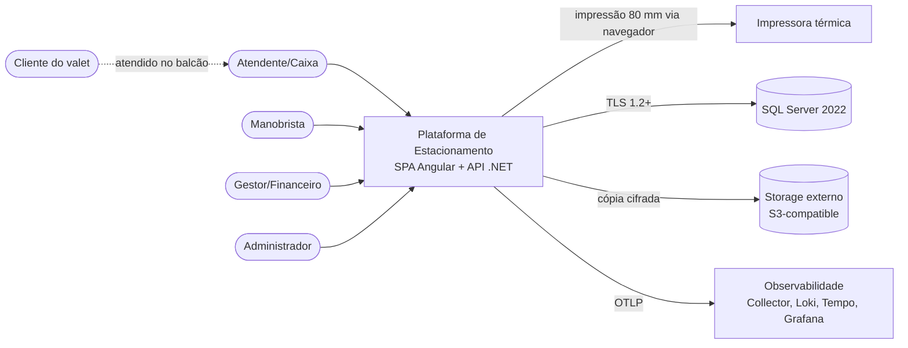

### 4.2 Visão de containers/componentes

**Figura 2 - Containers e componentes.** Detalha o monólito modular: a SPA é servida pelo nginx, que também faz proxy da API; dentro da API, controllers finos delegam para casos de uso, que dependem do domínio e da infraestrutura. O banco, o backup e a observabilidade são containers do mesmo host. A separação explica por que a SPA nunca fala direto com o banco e por que a impressão acontece no navegador (DEC-009, DEC-014, DEC-029).

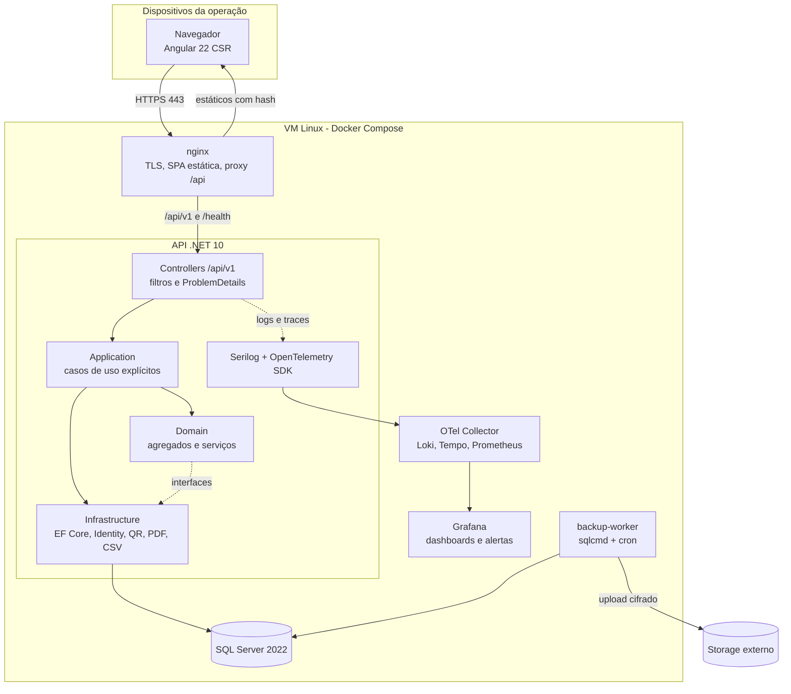

### 4.3 Estilo arquitetural e camadas

O backend é um **monólito modular** com quatro projetos e regra de dependência unidirecional (DEC-001):

- **Domain:** entidades, agregados, value objects, enums, serviços de domínio e interfaces de repositório conceituais. Não referencia EF Core, ASP.NET Core nem bibliotecas de infraestrutura.
- **Application:** casos de uso (`Handler`), comandos e queries, validadores FluentValidation, DTOs de aplicação, interfaces de repositório, `IUnitOfWork`, `IClock` (via `TimeProvider`), `IAuditWriter`, `IDocumentGenerator` e `IIdempotencyStore`.
- **Infrastructure:** `AppDbContext`, configurações de entidade, migrações, repositórios, read services, Identity, geração de QR/PDF/CSV, envio de telemetria, worker de retenção e relógio do sistema.
- **Api:** controllers, contratos HTTP, filtros, composição de DI, autenticação, autorização, rate limiting, health checks e Swagger/Scalar.

**Figura 3 - Regra de dependência.** A figura mostra que Api e Infrastructure podem depender de Application, e Application depende apenas de Domain. A seta pontilhada representa a inversão de controle: a Infrastructure implementa interfaces definidas na Application, e a Api compõe as implementações em tempo de execução. Nenhuma seta aponta de Domain para fora.

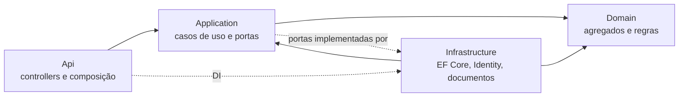

**Módulos internos:** `Operacao` (estadia, vaga, veículo, condição, solicitação de retirada, movimentação), `Faturamento` (tarifa, cobrança, pagamento, evento financeiro, comprovante, fechamento), `Identidade` (usuário e perfis), `Auditoria` e `Contingencia`. Cada módulo tem seu próprio conjunto de agregados e não acessa diretamente o `DbContext` de outro; a comunicação ocorre por interfaces de aplicação e, quando necessário, por eventos de domínio em processo (sem broker).

**Serviços de domínio relevantes:**

| Serviço | Responsabilidade | Regra |
| --- | --- | --- |
| `CalculadoraDiarias` | Calcula diárias a partir de entrada e saída | `max(1, ceil(segundos / 86400))`; 24 h exatas = 1 (RN-001) |
| `SelecionadorTarifa` | Resolve a tarifa vigente na entrada | Intervalo `[InicioVigencia, FimVigencia)` (RN-002) |
| `PoliticaLiberacao` | Decide se a entrega é permitida | Exige cobrança paga ou isenta, condição de saída e status `EmBusca` (RN-004) |
| `CalculadoraOcupacao` | Horas-vaga para relatório | Interseção entre períodos de estadia e vigência da vaga ativa (RN-015) |
| `NumeradorComprovante` | Obtém número sequencial | `SEQUENCE` transacional, sem reutilização (RN-025) |

### 4.4 Organização do código e do repositório

```text
gestao-estacionamento/
  Estacionamento.slnx
  global.json
  Directory.Build.props
  Directory.Packages.props
  .editorconfig
  src/
    backend/
      Estacionamento.Domain/
        Common/                 (Entity, AggregateRoot, ValueObject, DomainException)
        Operacao/               (Estadia, Vaga, Veiculo, RegistroCondicao, SolicitacaoRetirada, MovimentacaoVaga)
        Faturamento/            (Tarifa, Cobranca, Pagamento, EventoFinanceiro, Comprovante, FechamentoCaixa)
        Identidade/             (Usuario, Perfil, Documento)
        Auditoria/              (RegistroAuditoria)
        Contingencia/           (RegistroContingencia)
        Servicos/               (CalculadoraDiarias, SelecionadorTarifa, PoliticaLiberacao, CalculadoraOcupacao)
      Estacionamento.Application/
        Abstractions/           (repositórios, IUnitOfWork, IAuditWriter, IDocumentGenerator, IIdempotencyStore)
        Operacao/CheckIn/       (CheckInHandler, CheckInCommand, CheckInValidator)
        Operacao/Retiradas/     (Solicitar, Atribuir, IniciarBusca, Entregar, Cancelar)
        Operacao/Vagas/         (MapaHandler, MovimentarHandler)
        Operacao/TicketPerdido/
        Faturamento/Checkout/   (Calcular, AplicarDesconto, Isentar, Pagar, Estornar)
        Faturamento/Caixa/      (Apuracao, Fechar, Reabrir)
        Faturamento/Tarifas/
        Relatorios/             (Operacional, Financeiro, Entregas, ExportacaoCsv)
        Contingencia/           (Registrar, Aprovar, Rejeitar)
        Identidade/             (Login, TrocaSenha, Usuarios)
        Auditoria/              (Consulta)
      Estacionamento.Infrastructure/
        Persistence/            (AppDbContext, Configurations, Migrations, Repositories, ReadModels)
        Identity/               (ApplicationUser, IdentityConfig, PermissionMap)
        Documents/              (QrCodeGenerator, ComprovantePdfGenerator, CsvExporter, TicketRenderer)
        Time/                   (SystemTimeProvider)
        Auditing/               (AuditWriter, AuditInterceptor)
        Retention/              (RetentionWorker)
        Observability/          (Metrics, Logging)
      Estacionamento.Api/
        Controllers/
        Contracts/              (requests e responses por módulo)
        Filters/                (ProblemDetails, Validation, Correlation)
        Security/               (Antiforgery, PermissionPolicies)
        Health/
        Program.cs
    frontend/
      estacionamento-web/
        src/app/core/           (auth, http, permissions, polling, api/contracts)
        src/app/features/       (painel, checkin, vagas, retirada, checkout, caixa, relatorios, admin, contingencia)
        src/app/shared/         (ui, pipes, directives)
        src/app/layout/
        src/styles.css          (Tailwind 4 + tema Material)
        src/environments/
  tests/
    backend/
      Estacionamento.Domain.UnitTests/
      Estacionamento.Application.UnitTests/
      Estacionamento.Api.IntegrationTests/
      Estacionamento.ArchitectureTests/
    frontend/                   (specs junto aos componentes)
    e2e/                        (Playwright)
  deploy/
    compose/                    (docker-compose.yml, override de dev)
    nginx/                      (nginx.conf, headers, TLS)
    sql/                        (scripts de backup e restore)
    observability/              (collector, loki, tempo, prometheus, grafana)
  docs/
    prd/
    tdd/
```

**Convenções:** domínio, agregados e tabelas em português (linguagem ubíqua do PRD); nomes técnicos de infraestrutura em inglês; comandos no imperativo (`RegistrarCheckIn`, `RegistrarPagamento`); DTOs de resposta no passado (`EstadiaResponse`) e requests no infinitivo. Um teste de arquitetura (`Estacionamento.ArchitectureTests`) falha se Domain referenciar Infrastructure/Api, se Application referenciar EF Core, se houver `DateTime.Now`/`DateTime.UtcNow` fora de `SystemTimeProvider` ou se `Auditoria` sofrer `Remove`.

### 4.5 Padrões e convenções

| Tema | Padrão adotado |
| --- | --- |
| Erros esperados | `Result<T>` com `ErrorCode` estável; exceções apenas para falha de programação |
| Erros HTTP | `ProblemDetails` (RFC 9457) com `code`, `traceId` e `errors` por campo (DEC-025) |
| Validação | FluentValidation na Application; formato no cliente só como conveniência (DEC-022) |
| Transações | Explícitas nos casos de uso; uma transação por operação; sem transação de leitura |
| Concorrência | Índices filtrados + `rowversion` + `409` com código de conflito (DEC-007) |
| Auditoria | `IAuditable` + `AuditWriter`; escrita na mesma transação (DEC-027) |
| Tempo | `TimeProvider`; UTC no banco; conversão na borda (DEC-026) |
| Logging | Serilog estruturado; proibido logar documento, nome completo ou payload financeiro |
| Nomenclatura de eventos | `EstadiaCheckInRealizado`, `RetiradaEntregue`, `PagamentoRegistrado`, `CaixaFechado` |
| Idempotência | `Idempotency-Key` em check-in, pagamento, fechamento e contingência (DEC-025) |
| Paginação | `page` (1-based) e `pageSize` (máximo 100), com `X-Total-Count` |
| Dinheiro | `decimal(10,2)`, arredondamento `AwayFromZero`, sem `double` no domínio |
| Datas | `datetime2(3)` UTC; ISO 8601 com `Z` na API |
| Enum na API | String em PascalCase (`"EmBusca"`), estável e legível |
| Acessibilidade | Material/CDK + rótulos, foco visível, contraste AA e navegação por teclado |

## 5. Modelo de dados

### 5.1 Visão geral

O modelo é dividido em dois grupos para leitura: **operação** (quem está no pátio, onde e em que estado) e **financeiro/auditoria** (o que foi cobrado, pago, conferido e registrado). A separação em diagramas evita um desenho ilegível; as duas partes se conectam por `Estadia`.

**Figura 4 - Entidades de operação.** Mostra a estadia como centro do domínio, ligada a veículo, vaga, condição registrada, solicitações de retirada e usuário responsável. Também mostra que a vaga tem histórico de status (necessário para a taxa de ocupação — RN-015) e que a tarifa é congelada na estadia.

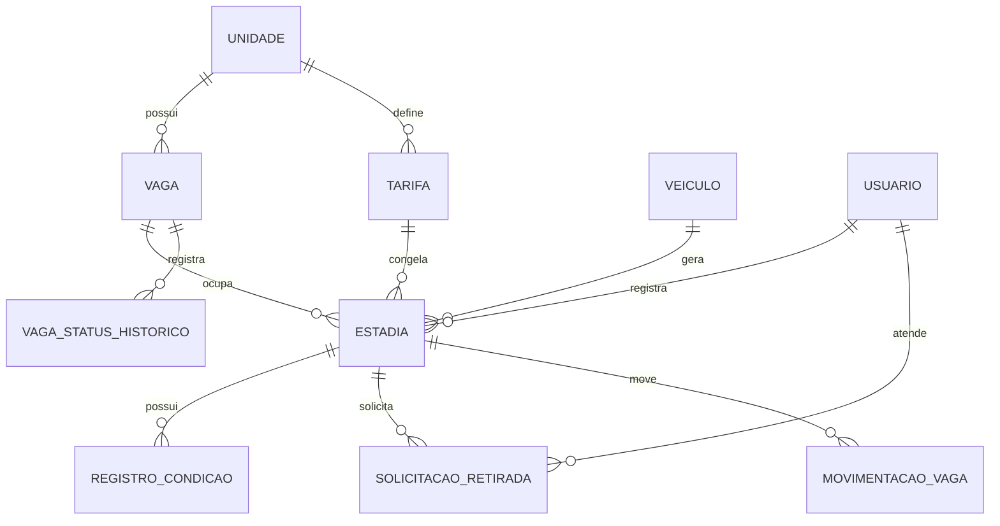

**Figura 5 - Entidades financeiras e de auditoria.** Mostra a cobrança ligada a uma estadia, com um pagamento ativo único (trilha histórica pós-estorno), eventos financeiros (desconto, isenção, estorno), comprovante numerado e fechamento de caixa versionado. O fechamento agrega pagamentos e estornos pela data do evento, sem chave estrangeira, para permitir reabertura e recontagem. A auditoria é transversal e referencia entidades por tipo e id, também sem chave estrangeira, para preservar o histórico mesmo após anonimização.

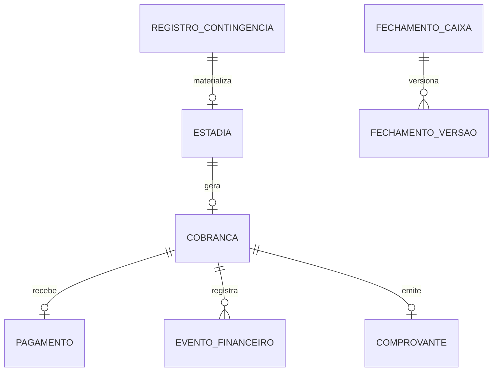

### 5.2 Entidades e relacionamentos

**Figura 6 - Agregados principais.** A classe `Estadia` é a raiz do agregado operacional e mantém as transições de status; `SolicitacaoRetirada` e `RegistroCondicao` vivem dentro do agregado para garantir uma solicitação ativa por vez e a obrigatoriedade das condições. `Cobranca` é um agregado separado, referenciado por `EstadiaId`, e concentra pagamento, desconto, isenção e estorno. Essa divisão orienta os repositórios e as transações de DEC-031.

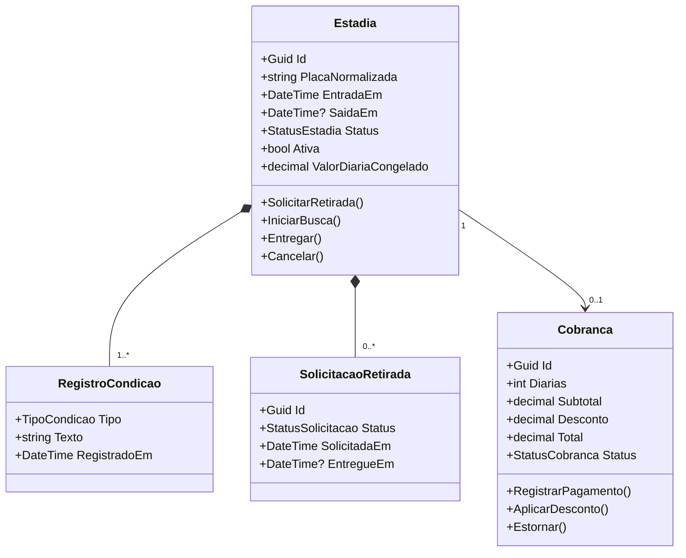

| Entidade | Descrição | Campos principais | Índices/restrições |
| --- | --- | --- | --- |
| `configuracao.Unidade` | Configuração da única unidade | `Id`, `Nome`, `TimeZoneId`, `DescontoMaximoPercentual`, `AtualizadoEm` | `UNIQUE (Singleton)`, `CHECK (Singleton = 1)` |
| `operacao.Vaga` | Vaga física do pátio | `Id`, `UnidadeId`, `Identificador`, `Ativa`, `Estado`, `RowVersion` | `UNIQUE (Identificador)`, `CHECK (Estado IN (0,1))` — 0 Livre, 1 Ocupada |
| `operacao.VagaStatusHistorico` | Vigência de status da vaga | `Id`, `VagaId`, `Ativa`, `IniciadoEm`, `FinalizadoEm` | `IX (VagaId, IniciadoEm)`; usado em RN-015 |
| `configuracao.Tarifa` | Diária com vigência | `Id`, `ValorDiaria`, `InicioVigencia`, `FimVigencia`, `CriadoPor`, `CriadoEm` | `UNIQUE (InicioVigencia)`, `CHECK (FimVigencia IS NULL OR FimVigencia > InicioVigencia)`, `TR_Tarifa_Sobreposicao` (bloqueia sobreposição parcial; `FimVigencia NULL` = infinito) |
| `identidade.Usuario` | Usuário do Identity | `Id`, `Nome`, `Email`, `Ativo`, `DeveTrocarSenha`, `Perfil`, `CriadoEm` | `UNIQUE (Email)`; perfil como role do Identity |
| `operacao.Veiculo` | Veículo identificado pela placa | `Id`, `PlacaNormalizada`, `PlacaOriginal`, `Modelo`, `CriadoEm` | `UNIQUE (PlacaNormalizada)` |
| `operacao.Estadia` | Registro central da operação | `Id`, `VeiculoId`, `PlacaNormalizada`, `Modelo`, `ResponsavelNome`, `ResponsavelDocumentoTipo`, `ResponsavelDocumento`, `ResponsavelRef`, `EntradaEm`, `SaidaEm`, `VagaId`, `Status`, `Ativa`, `TarifaId`, `ValorDiariaCongelado`, `TicketCodigo`, `TicketPerdido`, `ContingenciaId`, `RowVersion` | `UNIQUE (TicketCodigo)`, `UNIQUE filtered (PlacaNormalizada) WHERE Ativa = 1`, `UNIQUE filtered (VagaId) WHERE Ativa = 1`, `IX (EntradaEm)`, `IX (Status, EntradaEm)` |
| `operacao.RegistroCondicao` | Texto de entrada e saída | `Id`, `EstadiaId`, `Tipo`, `Texto`, `UsuarioId`, `RegistradoEm` | `UNIQUE (EstadiaId, Tipo)` |
| `operacao.SolicitacaoRetirada` | Pedido de retirada e tempos | `Id`, `EstadiaId`, `Status`, `SolicitadaEm`, `BuscaIniciadaEm`, `EntregueEm`, `CanceladaEm`, `ManobristaId`, `MotivoCancelamento`, `RowVersion` | `UNIQUE filtered (EstadiaId) WHERE Status IN (0,1)` — 0 Solicitada, 1 EmBusca; `IX (Status, SolicitadaEm)` |
| `operacao.MovimentacaoVaga` | Histórico de troca de vaga | `Id`, `EstadiaId`, `VagaOrigemId`, `VagaDestinoId`, `UsuarioId`, `OcorridoEm` | `IX (EstadiaId, OcorridoEm)` |
| `faturamento.Cobranca` | Cálculo e status financeiro | `Id`, `EstadiaId`, `DuracaoSegundos`, `Diarias`, `ValorUnitario`, `Subtotal`, `Desconto`, `Total`, `Status`, `CriadaEm`, `PagaEm`, `RowVersion` | `UNIQUE (EstadiaId)`, `IX (Status, CriadaEm)`; `Status` inclui `EmAberto`, `Paga`, `Isenta`, `Estornada` (ver Fig.15) |
| `faturamento.Pagamento` | Pagamento integral (trilha) | `Id`, `CobrancaId`, `Valor`, `Forma`, `PagoEm`, `OperadorId`, `Status`, `EstornadoEm` | `UNIQUE filtered (CobrancaId) WHERE Status = 'Ativo'`, `IX (PagoEm, Forma)`; `Status` = `Ativo`/`Estornado` |
| `faturamento.EventoFinanceiro` | Desconto, isenção ou estorno | `Id`, `CobrancaId`, `Tipo`, `Valor`, `Motivo`, `AutorizadorId`, `CriadoEm`, `PagamentoId` | `IX (CobrancaId)`, `IX (Tipo, CriadoEm)` |
| `faturamento.Comprovante` | Documento não fiscal (histórico) | `Id`, `CobrancaId`, `Numero`, `EmitidoEm`, `SnapshotJson`, `OperadorId` | `IX (CobrancaId)`, `UNIQUE (Numero)`; múltiplos por cobrança (pós-estorno), número por `SEQUENCE`; reimpressão mantém número e snapshot |
| `faturamento.FechamentoCaixa` | Fechamento diário | `Id`, `Data`, `Status`, `VersaoAtual`, `Justificativa`, `CriadoPor`, `CriadoEm`, `ReabertoEm`, `ReabertoPor`, `RowVersion` | `UNIQUE (Data)` |
| `faturamento.FechamentoVersao` | Snapshot de cada versão | `Id`, `FechamentoId`, `Versao`, `ValoresEsperadosJson`, `ValoresInformadosJson`, `DivergenciasJson`, `CriadoEm` | `UNIQUE (FechamentoId, Versao)` |
| `auditoria.Auditoria` | Trilha append-only | `Id`, `UsuarioId`, `UsuarioNome`, `Acao`, `Entidade`, `EntidadeId`, `Motivo`, `ValoresAntes`, `ValoresDepois`, `OcorridoEm`, `CorrelationId` | `IX (OcorridoEm)`, `IX (UsuarioId, OcorridoEm)`, `IX (Entidade, EntidadeId)`; trigger bloqueia update/delete |
| `contingencia.RegistroContingencia` | Operação lançada após queda | `Id`, `Tipo`, `PayloadJson`, `HorariosReaisJson`, `Justificativa`, `Status`, `SolicitanteId`, `AprovadorId`, `CriadoEm`, `AprovadoEm`, `ErroMaterializacao` | `IX (Status, CriadoEm)`, `UNIQUE (Tipo, PayloadHash)` para evitar duplicidade |
| `infra.IdempotencyRecord` | Controle de reenvio | `Id`, `Chave`, `CorpoHash`, `StatusCode`, `RespostaJson`, `CriadoEm`, `ExpiraEm` | `UNIQUE (Chave)`, `IX (ExpiraEm)` |

**Observações de modelagem:**

- `Estadia.Ativa` é coluna persistida (`bit`) mantida na mesma transação da transição para `Entregue` ou `Cancelada`; é ela que sustenta os índices filtrados de DEC-007. Não é calculada em query.
- `Pagamento.Status` é `Ativo` ou `Estornado`: a trilha preserva todos os pagamentos; `UX_Pagamento_Ativo` garante no máximo um `Ativo` por `Cobranca`. Após estorno integral, um novo pagamento é nova linha `Ativo` e novo `Comprovante` com novo `Numero` (RF-033). `Cobranca.Status` volta a `EmAberto` ao estornar (sem pagamento ativo) e só então aceita novo `Paga`; o histórico `Estornado` não impede novo registro (C-03).
- `Tarifa`: intervalos são `[InicioVigencia, FimVigencia)`; `FimVigencia NULL` significa vigente até nova tarifa. `TR_Tarifa_Sobreposicao` + `SERIALIZABLE` garantem que não existam dois intervalos com interseção não vazia, inclusive cabeçalho/rodapé parciais (C-02).
- A capacidade da unidade não é armazenada: é `COUNT(Vaga WHERE Ativa = 1)`, evitando divergência (RF-005).
- O `Perfil` não tem tabela própria no MVP: usa as roles do Identity e o mapa de permissões de DEC-016. Se o PRD evoluir para permissões configuráveis, entra a tabela e o mapa vira seed.
- `ResponsavelRef` é um GUID pseudônimo gerado no check-in, usado para conciliação após a anonimização (DEC-028).
- `Comprovante.SnapshotJson` preserva o conteúdo impresso; alterações posteriores na estadia não mudam o documento (RN-025).
- `RegistroCondicao` é único por tipo, garantindo a obrigatoriedade de entrada (RF-017) e saída (RF-026).
- `Estadia.TicketPerdido` guarda `TicketPerdidoEm`, `TicketPerdidoAutorizadorId` e `TicketPerdidoMotivo` (omitidos da tabela por brevidade).

### 5.3 Persistência e migrações

- **Banco:** SQL Server 2022, collation `Latin1_General_100_CI_AS_SC_UTF8`, schemas por módulo, `datetime2(3)` em UTC e `decimal(10,2)` para valores monetários (DEC-013, DEC-026).
- **ORM:** EF Core 10 com `IEntityTypeConfiguration` por entidade, `UseSqlServer` e `EnableRetryOnFailure(3, 5s)` apenas para falhas transitórias. Consultas de leitura usam `AsNoTracking` e projeção direta para DTO.
- **Migrações:** versionadas no projeto Infrastructure, geradas por `dotnet ef migrations add` e aplicadas por bundle no deploy (DEC-008). Cada migração tem nome descritivo e revisão obrigatória de impacto em índices e locks.
- **Seed:** `api --seed` idempotente cria a unidade, o usuário administrador inicial (senha temporária com troca obrigatória) e a tarifa inicial. Vagas só são criadas quando o cliente informar identificadores (QA-003); nenhum identificador é inventado.
- **Rollback:** migrações aditivas e compatíveis com a versão anterior; `Down` implementado apenas quando seguro. Em caso de falha, o deploy para antes de trocar o tráfego.
- **Convenção de nomes:** tabelas no singular, chaves `PK_<Tabela>`, estrangeiras `FK_<Tabela>_<Destino>`, índices `IX_`, únicos `UX_`, checks `CK_`.

### 5.4 Auditoria, histórico e retenção

**O que é auditado (RF-004, RN-009):**

| Ação | Dados registrados |
| --- | --- |
| Desconto e isenção | Valor antes/depois, motivo, autorizador, cobrança e estadia |
| Estorno | Pagamento, valor, motivo, autorizador, cobrança |
| Cancelamento de entrada | Estadia, motivo, autorizador, vaga liberada |
| Reabertura de caixa | Fechamento, versão anterior, justificativa, autorizador |
| Ticket perdido | Estadia, documento conferido, autorizador, motivo |
| Reimpressão de ticket | Estadia, código, usuário, horário |
| Movimentação de vaga | Origem, destino, usuário, horário (RF-018) |
| Aprovação/rejeição de contingência | Registro, justificativa, aprovador |
| Alteração de tarifa e de vaga | Valores antes/depois, usuário |
| Gestão de usuários | Perfil, estado, redefinição de senha (sem registrar a senha) |

**Histórico operacional:** `VagaStatusHistorico`, `MovimentacaoVaga`, `RegistroCondicao`, `SolicitacaoRetirada` e `FechamentoVersao` preservam a evolução necessária para relatórios e conferência. Estadia entregue é somente leitura na API (RF-015).

**Retenção (RNF-010, RN-024):**

| Dado | Prazo | Ação ao expirar |
| --- | --- | --- |
| Nome e documento do responsável (operacional) | 2 anos após a saída | Anonimizar, mantendo `ResponsavelRef` |
| Placa/modelo em registro operacional | 2 anos | Pseudonimizar por `PlacaHash` (HMAC) + `ResponsavelRef`; sem re-identificação |
| Placa em registro financeiro (snapshot comprovante/cobrança) | 5 anos | Preservar `PlacaHash` + dados necessários à obrigação legal |
| Condições do veículo | 2 anos | Anonimizar texto livre |
| Cobrança, pagamento, comprovante | 5 anos | Purga após obrigação legal |
| Auditoria | 5 anos | Purga somente após o prazo |
| Logs de aplicação | 30 dias | Rotação automática |

**Ativação:** `RetentionWorker` com `Retention:Enabled=false` por default (D-03b) e `dry-run` disponível, com registro em auditoria. A ativação em produção depende da validação jurídica (QA-007); relatórios históricos usam `ResponsavelRef`/`PlacaHash` para continuar reconciliando após anonimização.

### 5.5 Concorrência e consistência

**Check-in (RF-012, RN-005, RN-006):** uma única transação:

1. Valida permissão, contrato e tarifa vigente.
2. Executa `UPDATE operacao.Vaga SET Estado = 'Ocupada', RowVersion = ... WHERE Id = @vaga AND Estado = 'Livre'`; zero linhas → `409 VAGA_OCUPADA`.
3. Insere `Estadia` com `Ativa = 1` e `RegistroCondicao` de entrada; violação de `UX_Estadia_PlacaAtiva` → `409 PLACA_COM_ESTADIA_ATIVA` com o ticket existente (RF-009); violação de `UX_Estadia_VagaAtiva` → `409 VAGA_OCUPADA` (RF-012).
4. Insere auditoria e confirma.

**Entrega (RF-020, RN-004):** uma transação valida `SolicitacaoRetirada.Status = 'EmBusca'`, cobrança `Paga` ou `Isenta`, condição de saída existente; grava `SaidaEm`, `Estadia.Status = 'Entregue'`, `Ativa = 0`, `SolicitacaoRetirada.Status = 'Entregue'` e `Vaga.Estado = 'Livre'`. Qualquer inconsistência reverte tudo.

**Pagamento (RF-032, RF-033):** `UPDATE` condicional em `Cobranca` com `WHERE Status = 'EmAberto'`; o índice filtrado `UX_Pagamento_Ativo` impede segundo pagamento `Ativo` mesmo com retry. Retry com mesma `Idempotency-Key` devolve a resposta original. Após estorno, `Pagamento.Status='Estornado'` + `Cobranca.Status='EmAberto'` liberam a inserção de um novo `Pagamento` `Ativo` como evento distinto, e o número do comprovante é obtido da `SEQUENCE` na mesma transação.

**Fechamento (RF-038, RF-039):** a data é a chave; a criação usa `INSERT` e o índice único resolve a corrida. A reabertura grava uma nova `FechamentoVersao` antes de mudar o status, dentro de transação.

**Tarifa (RF-007):** a gravação usa `SERIALIZABLE` e o trigger `TR_Tarifa_Sobreposicao` checa interseção de intervalos `[Inicio,Fim)` antes de gravar e aborta com `CONFLITO_VIGENCIA` se houver cruzamento (inclusive `[01/01,10/01)` × `[05/01,15/01)`); o índice único em `InicioVigencia` é apenas barreira secundária e não substitui o trigger.

**Consistência aceitável:** relatórios e painel são leituras eventualmente consistentes por alguns segundos (polling). Nenhuma decisão de cobrança ou liberação depende de leitura assíncrona.

## 6. Interfaces e contratos

### 6.1 API

Todas as rotas exigem cookie de sessão, exceto login e CSRF. A coluna "Autorização" indica a permissão mínima de DEC-016; `Autenticado` significa qualquer perfil ativo (perfil com `Operacao.Visualizar`), com mascaramento de documento e omissão de valores conforme o perfil. Endpoints marcados "pós-MVP" (Fases 4/5 do §17) não fazem parte do MVP restrito (D-02).

| Método | Rota | Descrição | Autorização | Requisitos |
| --- | --- | --- | --- | --- |
| POST | `/api/v1/auth/login` | Autentica e cria cookie de sessão | Anônimo | RF-001 |
| POST | `/api/v1/auth/logout` | Encerra a sessão e invalida o cookie | Autenticado | RF-001 |
| GET | `/api/v1/auth/me` | Perfil, nome e permissões efetivas | Autenticado | RF-002 |
| GET | `/api/v1/auth/csrf` | Emite cookie `XSRF-TOKEN` | Anônimo | RNF-006 |
| POST | `/api/v1/auth/change-password` | Troca a senha no primeiro acesso | Autenticado | RF-003 |
| GET | `/api/v1/usuarios` | Lista usuários | `Usuarios.Gerenciar` | RF-003 |
| POST | `/api/v1/usuarios` | Cria usuário com senha temporária | `Usuarios.Gerenciar` | RF-003 |
| GET | `/api/v1/usuarios/{id}` | Detalhe do usuário | `Usuarios.Gerenciar` | RF-003 |
| PUT | `/api/v1/usuarios/{id}` | Atualiza nome e perfil | `Usuarios.Gerenciar` | RF-003 |
| POST | `/api/v1/usuarios/{id}/desativacao` | Desativa usuário | `Usuarios.Gerenciar` | RF-003 |
| POST | `/api/v1/usuarios/{id}/reset-senha` | Redefine senha temporária | `Usuarios.Gerenciar` | RF-003 |
| GET | `/api/v1/unidade` | Configuração da unidade e capacidade | Autenticado | RF-005 |
| PUT | `/api/v1/unidade` | Atualiza nome e parâmetros | `Configuracao.Gerenciar` | RF-005 |
| GET | `/api/v1/vagas` | Lista vagas e estado | Autenticado | RF-019 |
| GET | `/api/v1/vagas/mapa` | Mapa com contadores e ocupação | Autenticado | RF-019 |
| GET | `/api/v1/vagas/disponiveis` | Vagas livres para check-in | `Operacao.CheckIn` | RF-008 |
| POST | `/api/v1/vagas` | Cria vaga | `Configuracao.Gerenciar` | RF-005 |
| PUT | `/api/v1/vagas/{id}` | Atualiza identificador | `Configuracao.Gerenciar` | RF-005 |
| POST | `/api/v1/vagas/{id}/desativacao` | Desativa vaga | `Configuracao.Gerenciar` | RF-006 |
| GET | `/api/v1/tarifas` | Histórico de tarifas | Autenticado | RF-007 |
| GET | `/api/v1/tarifas/vigente` | Tarifa vigente | Autenticado | RF-007 |
| POST | `/api/v1/tarifas` | Cadastra nova vigência | `Configuracao.Gerenciar` | RF-007 |
| POST | `/api/v1/estadias` | Check-in com vaga e condição | `Operacao.CheckIn` | RF-008 a RF-013, RF-017 |
| GET | `/api/v1/estadias` | Busca por placa, ticket, nome ou documento | `Operacao.Visualizar` | RF-014 |
| GET | `/api/v1/estadias/{id}` | Detalhe, condições e linha do tempo | `Operacao.Visualizar` | RF-015 |
| GET | `/api/v1/estadias/{id}/ticket` | Payload do ticket e QR | `Operacao.CheckIn` | RF-010 |
| POST | `/api/v1/estadias/{id}/ticket/reimpressao` | Registra reimpressão do ticket — pós-MVP (Fase 4) | `Operacao.CheckIn` | RF-011 |
| POST | `/api/v1/estadias/{id}/cancelamento` | Cancela entrada com autorização | `Financeiro.Autorizar` | RF-016 |
| POST | `/api/v1/estadias/{id}/movimentacao` | Move veículo entre vagas — pós-MVP (Fase 5) | `Operacao.MovimentarVaga` | RF-018 |
| POST | `/api/v1/estadias/{id}/ticket-perdido` | Marca ticket perdido com conferência | `Financeiro.Autorizar` | RF-029 |
| POST | `/api/v1/estadias/{id}/retiradas` | Cria solicitação de retirada | `Retirada.Operar` | RF-021 |
| GET | `/api/v1/retiradas` | Fila por status com tempo de espera | Autenticado | RF-022 |
| POST | `/api/v1/retiradas/{id}/atribuicao` | Atribui manobrista — pós-MVP (Fase 4) | `Retirada.Operar` | RF-024 |
| POST | `/api/v1/retiradas/{id}/inicio-busca` | Transiciona para `EmBusca` | `Retirada.Operar` | RF-023 |
| POST | `/api/v1/retiradas/{id}/entrega` | Confirma entrega e libera vaga | `Retirada.Operar` | RF-023, RF-025 a RF-027 |
| POST | `/api/v1/retiradas/{id}/cancelamento` | Cancela solicitação — pós-MVP (Fase 5) | `Retirada.Operar` | RF-028 |
| GET | `/api/v1/retiradas/historico` | Histórico de entregas e tempos — pós-MVP (Fase 4) | `Relatorios.Visualizar` | RF-044 |
| GET | `/api/v1/estadias/{id}/cobranca` | Cálculo e composição do valor | `Financeiro.VerValores` | RF-030, RF-031 |
| POST | `/api/v1/estadias/{id}/cobranca/desconto` | Aplica desconto com motivo | `Financeiro.Autorizar` | RF-035 |
| POST | `/api/v1/estadias/{id}/cobranca/isencao` | Aplica isenção total | `Financeiro.Autorizar` | RF-035 |
| POST | `/api/v1/estadias/{id}/cobranca/pagamento` | Registra pagamento integral | `Financeiro.Operar` | RF-032, RF-033 |
| POST | `/api/v1/pagamentos/{id}/estorno` | Estorna pagamento integral | `Financeiro.Autorizar` | RF-036 |
| GET | `/api/v1/cobrancas` | Consulta cobranças por período, placa e status | `Financeiro.VerValores` | RF-037 |
| GET | `/api/v1/cobrancas/{id}/comprovante` | Gera comprovante em PDF | `Financeiro.VerValores` | RF-034 |
| POST | `/api/v1/cobrancas/{id}/comprovante/reimpressao` | Registra reimpressão do comprovante | `Financeiro.Operar` | RF-034 |
| GET | `/api/v1/caixa/{data}/apuracao` | Valores esperados por forma de pagamento | `Caixa.Fechar` | RF-038 |
| POST | `/api/v1/caixa/fechamentos` | Registra fechamento diário | `Caixa.Fechar` | RF-038 |
| POST | `/api/v1/caixa/fechamentos/{id}/reabertura` | Reabre com justificativa — pós-MVP (Fase 4) | `Caixa.Reabrir` | RF-039 |
| GET | `/api/v1/caixa/fechamentos` | Lista fechamentos por período | `Caixa.Fechar` | RF-038 |
| GET | `/api/v1/caixa/fechamentos/{id}/csv` | Exporta resumo do fechamento | `Caixa.Fechar` | RF-038, RF-042 |
| GET | `/api/v1/relatorios/operacional` | Ocupação, permanência, picos e tempos | `Relatorios.Visualizar` | RF-041 |
| GET | `/api/v1/relatorios/financeiro` | Faturamento, descontos, estornos e divergências | `Relatorios.Visualizar` | RF-041 |
| GET | `/api/v1/relatorios/entregas` | Entregas por período e placa — pós-MVP (Fase 4) | `Relatorios.Visualizar` | RF-044 |
| GET | `/api/v1/relatorios/{tipo}/csv` | Exporta relatório em CSV | `Relatorios.Exportar` | RF-042 |
| GET | `/api/v1/painel/operacional` | Resumo do pátio, fila e pendências com ETag | Autenticado | RF-040, RF-019 |
| GET | `/api/v1/painel/indicadores` | Indicadores conforme permissão | Autenticado | RF-040 |
| GET | `/api/v1/auditoria` | Consulta a trilha por filtros | `Auditoria.Visualizar` | RF-004 |
| POST | `/api/v1/contingencias` | Registra operação de contingência | `Contingencia.Registrar` | RF-043 |
| GET | `/api/v1/contingencias` | Lista registros pendentes e aprovados | `Contingencia.Aprovar` | RF-043 |
| POST | `/api/v1/contingencias/{id}/aprovacao` | Aprova e materializa a operação | `Contingencia.Aprovar` | RF-043 |
| POST | `/api/v1/contingencias/{id}/rejeicao` | Rejeita com justificativa | `Contingencia.Aprovar` | RF-043 |
| POST | `/api/v1/telemetria/eventos` | Recebe eventos de falha de impressão e erro de tela | Autenticado | RNF-014 |
| GET | `/health/live` | Liveness da API | Rede interna | RNF-004 |
| GET | `/health/ready` | Readiness com verificação do banco | Rede interna | RNF-004 |

### 6.2 Convenções de contrato

- **Formato:** JSON UTF-8, `camelCase`, enums como string PascalCase (`"EmBusca"`), datas ISO 8601 UTC com `Z`, valores monetários como número decimal com duas casas.
- **OpenAPI:** documento gerado no build, versionado como artefato e validado por teste de contrato (DEC-030). Scalar disponível apenas em desenvolvimento/homologação.
- **Sucesso:** `200` para consulta/atualização, `201` com `Location` para criação, `202` para aceite assíncrono (nenhum no MVP), `204` para comandos sem corpo.
- **Erros:** `400 VALIDACAO`, `401 NAO_AUTENTICADO`, `403 SEM_PERMISSAO`, `404 NAO_ENCONTRADO`, `409` para conflito de estado/negócio, `422 REGRA_DE_NEGOCIO`, `429 LIMITE_EXCEDIDO`, `500 ERRO_INTERNO`. Corpo em `ProblemDetails` com `code` e `traceId`.
- **Paginação:** `page` (padrão 1) e `pageSize` (padrão 20, máximo 100); resposta com `items`, `page`, `pageSize`, `totalItems` e `totalPages`.
- **Filtros:** query string tipada (`de`, `ate`, `status`, `placa`, `termo`); intervalos de data interpretados em America/Sao_Paulo e convertidos para UTC.
- **Ordenação:** `sort` com campo e direção (`entradaEm:desc`), restrita a uma lista branca por endpoint.
- **ETag:** `GET /api/v1/painel/operacional` responde `ETag` forte; `If-None-Match` correspondente devolve `304`.
- **Concorrência:** `If-Match` com o `rowVersion` (base64) em atualizações; ausência ou divergência devolve `409 CONCORRENCIA`.
- **Idempotência:** header `Idempotency-Key` obrigatório em `POST /estadias`, `POST .../pagamento`, `POST /caixa/fechamentos` e `POST /contingencias`. Repetição devolve a resposta original com header `Idempotent-Replayed: true`.
- **Rate limiting:** login limitado a 5 tentativas por minuto por IP e 20 por usuário; endpoints gerais a 100 req/s por usuário; telemetria a 10 req/min por usuário.
- **Segurança de resposta:** `Cache-Control: no-store` em dados pessoais e financeiros; `X-Content-Type-Options: nosniff`; CSP restritiva no nginx; HSTS em produção.

### 6.3 Exemplos de payload

**Check-in — requisição** (`POST /api/v1/estadias`, header `Idempotency-Key: 6f1c...`):

```json
{
  "placa": "ABC1D23",
  "modelo": "Toyota Corolla",
  "responsavel": {
    "nome": "Maria Souza",
    "documentoTipo": "CPF",
    "documento": "12345678909"
  },
  "vagaId": "0193f0c2-7c4a-7c1e-9b2a-3f5d8e1a2b3c",
  "condicaoEntrada": "Risco leve no para-choque dianteiro esquerdo"
}
```

**Check-in — resposta `201 Created`:**

```json
{
  "id": "0193f0c2-9a10-7d3b-8c44-1b2c3d4e5f60",
  "entradaEm": "2026-11-08T14:32:10.123Z",
  "vaga": { "id": "0193f0c2-7c4a-7c1e-9b2a-3f5d8e1a2b3c", "identificador": "A-12" },
  "status": "Aberta",
  "ticket": {
    "codigo": "K7M2-9QX4",
    "qrCodePngBase64": "iVBORw0KGgo...",
    "emitidoEm": "2026-11-08T14:32:10.200Z"
  },
  "valorDiariaCongelado": 35.00,
  "tarifaId": "0193f0c2-1111-7222-8333-444455556666"
}
```

**Erro de vaga ocupada — `409 Conflict`:**

```json
{
  "type": "https://estacionamento.local/errors/vaga-ocupada",
  "title": "Vaga ocupada",
  "status": 409,
  "code": "VAGA_OCUPADA",
  "detail": "A vaga A-12 foi ocupada por outro atendente. Selecione outra vaga livre.",
  "traceId": "0HN7GQ2K9L3M1:00000002"
}
```

**Pagamento — requisição:**

```json
{
  "forma": "Pix",
  "valor": 70.00,
  "observacao": null
}
```

**Pagamento — resposta `201 Created`:**

```json
{
  "cobrancaId": "0193f0c2-aaaa-7bbb-8ccc-ddddeeeeffff",
  "status": "Paga",
  "total": 70.00,
  "comprovante": { "numero": 1042, "emitidoEm": "2026-11-08T18:05:44Z" },
  "entregaLiberada": true
}
```

**Fechamento — requisição** (`POST /api/v1/caixa/fechamentos`):

```json
{
  "data": "2026-11-08",
  "valoresInformados": [
    { "forma": "Dinheiro", "valor": 350.00 },
    { "forma": "Debito", "valor": 820.50 },
    { "forma": "Credito", "valor": 1210.00 },
    { "forma": "Pix", "valor": 640.00 }
  ],
  "justificativaDivergencia": null
}
```

### 6.4 Integrações externas

| Integração | Protocolo | Autenticação | Falha/retry | Requisitos |
| --- | --- | --- | --- | --- |
| Impressora térmica 80 mm | Impressão do navegador via driver do SO | Sessão do usuário no balcão | Falha não bloqueia check-in; fallback na tela e telemetria | RF-010, RNF-016 |
| SQL Server 2022 | TDS sobre TLS | Usuário de aplicação com menor privilégio | `EnableRetryOnFailure` para falha transitória; erro claro ao usuário | RNF-005 |
| Storage S3-compatible | HTTPS | Chave de acesso restrita ao bucket de backup | Retry com backoff; alerta se falhar 2 ciclos | RNF-005 |
| OTLP Collector | gRPC/HTTP | Rede interna | Buffer em memória e descarte com log se indisponível | RNF-014 |
| ASP.NET Core Identity | Biblioteca interna | — | — | RF-001, RF-003 |
| CSV | Arquivo `text/csv` | Permissão do endpoint | — | RF-042, RNF-020 |
| OpenAPI | `openapi.json` | — | — | RNF-015 |
| Gateway de pagamento, NFS-e, LPR, cancela | Não previstos | — | — | Fora de escopo (seção 2.3) |

## 7. Fluxos principais

### 7.1 Check-in

**Figura 7 - Sequência de check-in.** Mostra a ordem entre validação, reserva da vaga, criação da estadia, auditoria e impressão. A transação termina antes da impressão: falha de impressora não desfaz o check-in, apenas aciona o fallback (DEC-009). Os índices únicos de DEC-007 são a barreira contra duplo check-in na mesma vaga ou placa.

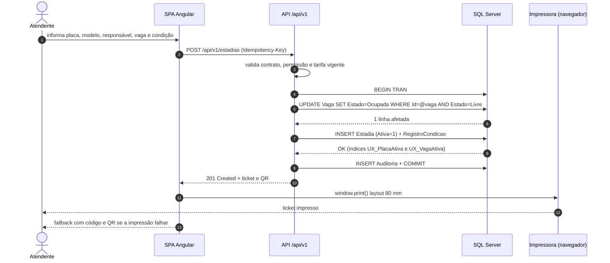

**Regras e erros:**

- Campos obrigatórios vazios ou placa fora dos padrões aceitos → `400 VALIDACAO` (RF-008, RF-009). Placas aceitas: Mercosul (`AAA1A23`) e antiga (`AAA-1234`), normalizadas para maiúsculas sem hífen (RN-005).
- Placa com estadia ativa → `409 PLACA_COM_ESTADIA_ATIVA` com o ticket existente (RF-009).
- Vaga já ocupada ou `UPDATE` sem linhas → `409 VAGA_OCUPADA`; a SPA recarrega as vagas e pede nova seleção (RF-012).
- Nenhuma vaga ativa livre → `409 LOTACAO` antes de abrir transação (RF-013).
- Impressão falhou ou foi cancelada → check-in permanece válido; tela exibe código e QR e oferece reimpressão (RF-010, RNF-016).
- A tarifa é resolvida na entrada e congelada em `Estadia.ValorDiariaCongelado` (RN-002).

### 7.2 Retirada e entrega

**Figura 8 - Sequência de retirada e entrega.** Evidencia a separação entre solicitar, buscar e entregar, e os três bloqueios de liberação: pagamento, condição de saída e status `EmBusca`. A entrega é a única operação que libera a vaga automaticamente (RF-020).

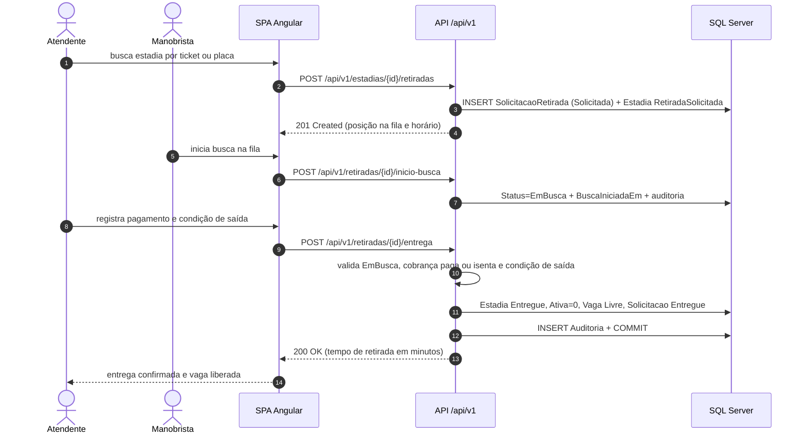

**Regras e erros:**

- Solicitação duplicada ativa → `409 SOLICITACAO_ATIVA_EXISTENTE` (RF-021, índice `UX_Solicitacao_Ativa`).
- Saltos de status (`Solicitada` → `Entregue`) e reversão → `409 TRANSICAO_INVALIDA` (RF-023, RN-011).
- Entrega com cobrança em aberto → `409 PAGAMENTO_PENDENTE` (RF-025).
- Condição de saída vazia → `400 VALIDACAO` (RF-026).
- Cancelamento devolve a estadia para `Aberta` e mantém a vaga ocupada (RF-028).
- O tempo de retirada é `EntregueEm - SolicitadaEm` em minutos, arredondado para baixo (RF-027).

### 7.3 Cobrança e pagamento

**Figura 9 - Sequência de checkout.** Mostra o cálculo determinístico, a autorização de desconto/isenção, o pagamento integral e a emissão do comprovante. O pagamento ocorre antes da entrega; a resposta já informa se a liberação está habilitada (DEC-010, RN-003, RN-004).

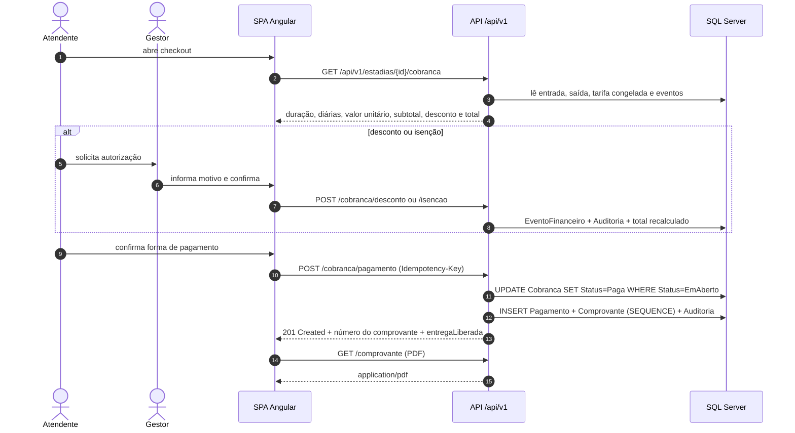

**Regras e erros:**

- `Diarias = max(1, ceil(segundos / 86400))`; 24 h exatas = 1 e 24 h + 1 s = 2 (RN-001, RF-030).
- A composição exibe entrada, saída (ou agora), duração, diárias, valor unitário, subtotal, desconto e total (RF-031).
- Pagamento duplicado → `409 COBRANCA_JA_PAGA`; o único filtrado `UX_Pagamento_Ativo` é a barreira (RF-033). Após estorno, novo `Pagamento` `Ativo` como linha distinta é permitido e gera novo `Comprovante` com novo número.
- Valor diferente do total sem desconto → `422 VALOR_DIVERGENTE` (RF-032).
- Desconto maior que o subtotal → `422 DESCONTO_EXCEDE_SUBTOTAL` (RF-035); isenção total resulta em `Total = 0` e status `Isenta`.
- Estorno é integral, exige `Financeiro.Autorizar`, marca `Pagamento` como `Estornado`, devolve `Cobranca` para `EmAberto` (sem pagamento ativo) e não reverte entrega já realizada (RF-036, RN-010).
- Comprovante é identificado como não fiscal (RNF-021) e mantém o número em reimpressões (RN-025); múltiplos comprovantes históricos podem coexistir para a mesma cobrança, cada um com `Numero` único.

### 7.4 Fechamento diário

**Figura 10 - Sequência de fechamento e reabertura.** Mostra a apuração por data local, a comparação entre esperado e informado, a gravação versionada e o caminho de reabertura restrito ao Administrador. O fechamento pode ocorrer com veículos no pátio, pois eles ainda não são receita (RN-013).

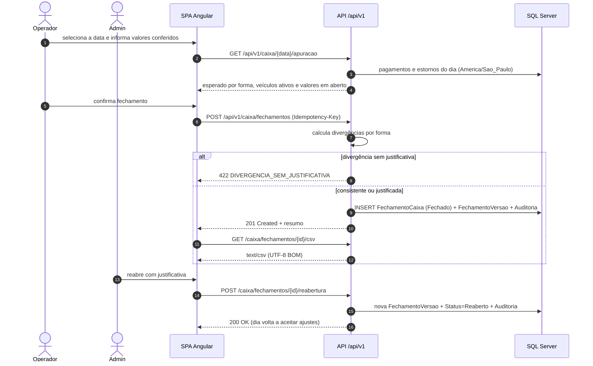

**Regras e erros:**

- Só existe um fechamento por data; segundo `POST` → `409 CAIXA_JA_FECHADO` (RF-038, RN-013).
- Divergência é `informado - esperado` por forma; qualquer valor diferente de zero exige justificativa.
- Reabertura só para Administrador, com motivo, preservando a versão anterior (RF-039, RN-014).
- Pagamento lançado após o fechamento exige reabertura antes de entrar na apuração.
- O CSV usa as colunas do resumo e neutraliza fórmulas (DEC-011).

### 7.5 Ticket perdido

**Figura 11 - Sequência de ticket perdido.** Mostra que a liberação sem ticket não dispensa a conferência do documento nem a autorização de gestor, e que a cobrança permanece inalterada (RN-008). Documento divergente bloqueia o fluxo e escala para o gestor.

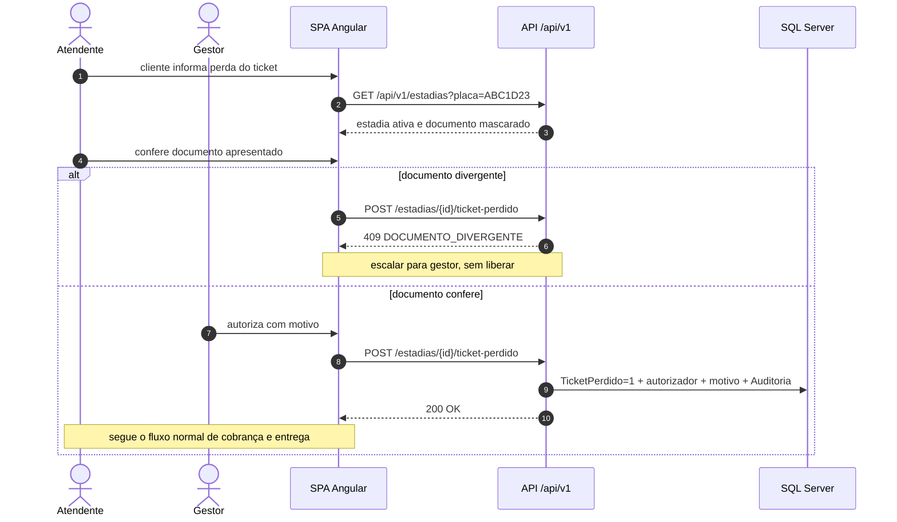

### 7.6 Contingência por falta de internet

**Figura 12 - Sequência de contingência.** Mostra o lançamento posterior com horários reais, a aprovação obrigatória e a materialização da operação. Enquanto não aprovado, o registro não entra em relatórios nem no fechamento (RN-020, RNF-017).

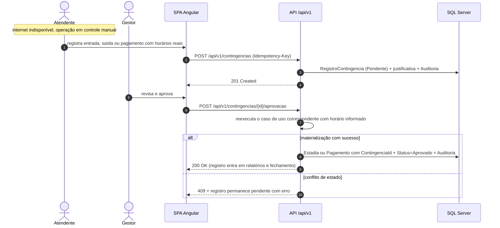

**Regras e erros:**

- Prazo de lançamento: até 24 h e antes do fechamento seguinte (RNF-017); após o fechamento da data, exige reabertura.
- Aprovação por `Contingencia.Aprovar` (Gestor/Financeiro ou Administrador; QA-011 define restrição).
- A materialização é idempotente por `ContingenciaId` e usa a tarifa vigente no horário real informado (RN-002).
- Registro rejeitado permanece armazenado para auditoria e não impacta cálculos.

### 7.7 Estados e transições

**Figura 13 - Ciclo de vida da estadia.** A estadia nasce `Aberta`, entra em retirada, pode voltar a `Aberta` se a solicitação for cancelada, e termina em `Entregue` ou `Cancelada`. Não há transição de `Entregue` para outro estado nem reabertura de estadia (RN-011).

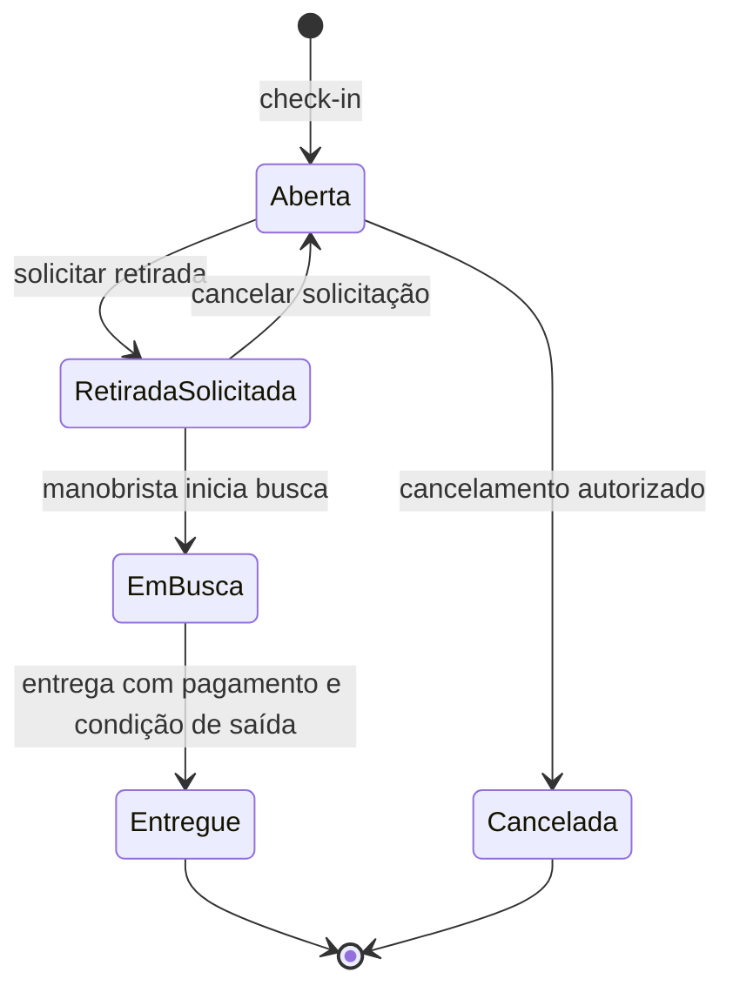

**Figura 14 - Ciclo de vida da solicitação de retirada.** A solicitação é independente da estadia para fins de fila, mas sincronizada na mesma transação. `Cancelada` pode ocorrer antes da entrega, devolvendo a estadia para `Aberta`.

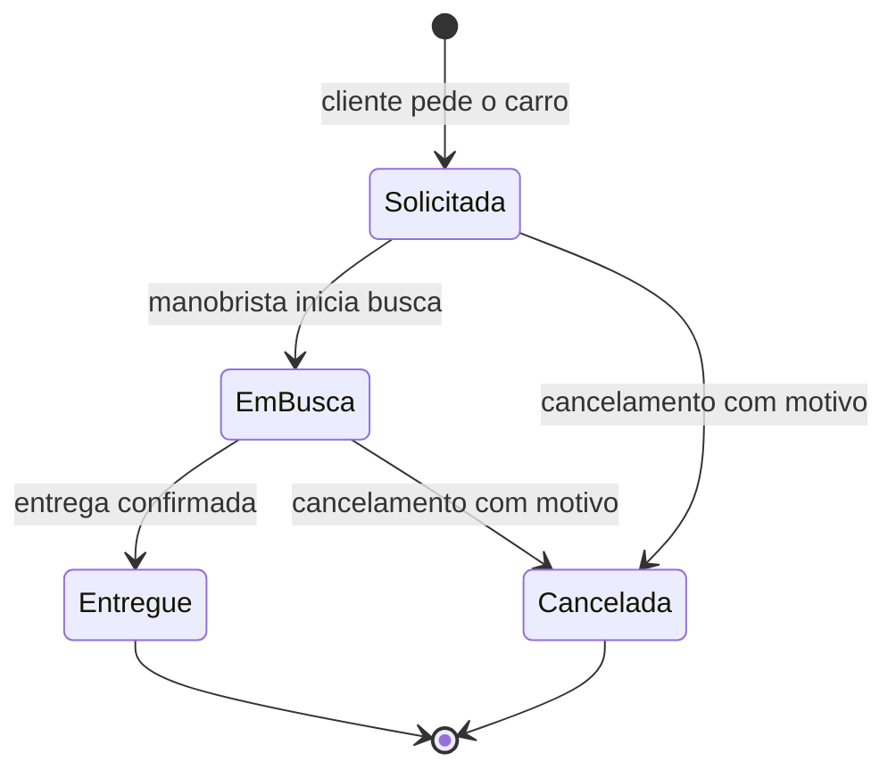

**Figura 15 - Ciclo de vida da cobrança.** Mostra pagamento único ativo, isenção total e estorno integral. Após o estorno, a cobrança retorna a `EmAberto` (sem `Pagamento` ativo) e um novo `Pagamento` `Ativo` é registrado como evento distinto, gerando novo comprovante; o pagamento e o comprovante originais permanecem `Estornado`/históricos (RF-033, RN-010).

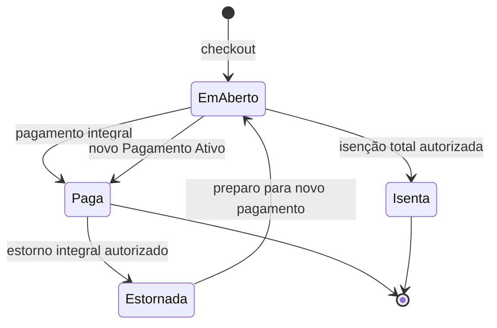

**Figura 16 - Ciclo de vida do fechamento de caixa.** Um fechamento por data; a reabertura preserva a versão anterior e permite novo fechamento com versão incrementada (RF-039, RN-014).

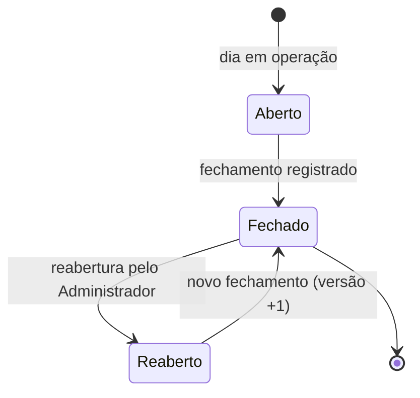

## 8. Segurança

### 8.1 Autenticação

- **Mecanismo:** ASP.NET Core Identity com `SignInManager` e cookie de aplicação `__Host-estacionamento.auth` (`HttpOnly`, `Secure`, `SameSite=Lax`, `Path=/`), expiração deslizante de 30 minutos (RNF-006, DEC-003).
- **Senhas:** hash do Identity (PBKDF2 com HMAC-SHA256, iterações padrão do .NET 10), mínimo de 12 caracteres com maiúscula, minúscula, dígito e símbolo. Nenhuma senha é logada, retornada ou auditada.
- **Primeiro acesso:** usuário criado com senha temporária e `DeveTrocarSenha = true`; qualquer rota exceto `change-password` e `logout` retorna `403 TROCA_DE_SENHA_OBRIGATORIA` até a troca (RF-003).
- **Bloqueio:** 5 tentativas inválidas em 15 minutos; mensagem genérica de credencial inválida, sem revelar existência de e-mail (RF-001).
- **Sessão:** logout invalida o cookie e registra evento; inatividade de 30 minutos expira no servidor. Não há "lembrar-me".
- **Rate limiting:** política de login por IP e por usuário, além do lockout do Identity (seção 6.2).
- **Data Protection:** chaves persistidas em volume compartilhado entre as réplicas e protegidas por permissão de sistema de arquivos; sem elas, cookies de todas as sessões seriam invalidados a cada deploy.
- **Recuperação de senha:** não há autoatendimento no MVP; o Administrador redefine a senha (QTD-04).

### 8.2 Autorização

- **Modelo:** quatro perfis fixos, mapa de permissões em código e policies no servidor (DEC-016). Negação por padrão: todo controller exige autenticação, exceto os explicitamente anônimos (`login` e `csrf`).
- **Aplicação:** `[Authorize(Policy = "...")]` por action; verificação adicional de vínculo do recurso (por exemplo, o manobrista só atualiza solicitação que está na fila) feita no caso de uso, nunca só na UI.
- **Projeção segura:** DTOs de listagem mascaram documento (`***.***.789-09` ou apenas últimos dígitos) e omitem valores financeiros para quem não tem `Financeiro.VerValores` (RNF-009). Busca por nome/documento (RF-014) é restrita a `Financeiro.VerValores` (com mascaramento sem ele); detalhe da estadia (RF-015) usa `Operacao.Visualizar` e omite bloco financeiro sem `Financeiro.VerValores`; ticket (RF-010) exige `Operacao.CheckIn`, de modo que Manobrista não recebe código/QR nem valores.
- **Frontend:** permissões de `GET /auth/me` controlam visibilidade de menu e botões; qualquer tentativa de URL direta recebe `403` do servidor (RF-002).
- **Multi-tenancy:** não aplicável — sistema single-tenant, uma unidade (seção 5.4 do PRD). Não há coluna de tenant nem filtro global; incluir multiempresa exigiria novo modelo e novo TDD.

### 8.3 Segredos e configuração

| Segredo | Armazenamento | Rotação |
| --- | --- | --- |
| Connection string do SQL Server | Variável de ambiente do Compose / GitHub Environment | Ao trocar senha do usuário de banco |
| Chave de assinatura de cookie | Volume de Data Protection | Anual ou em incidente |
| Chave de criptografia de backup | Fora do host, em cofre de senhas | Anual |
| Credenciais do storage de backup | Variável de ambiente restrita ao `backup-worker` | Semestral |
| Certificado TLS | Volume do nginx, renovação automatizada | 90 dias |
| Credenciais de deploy SSH | GitHub Environment | Semestral |

Nenhum segredo é commitado. `appsettings.Development.json` contém apenas valores locais não sensíveis; produção usa variáveis de ambiente. A aplicação falha ao iniciar se uma configuração obrigatória estiver ausente.

### 8.4 Dados sensíveis e LGPD

- **Coleta mínima:** nome, tipo e número do documento, placa, modelo, condições em texto e horários. Não há fotografia, biometria, dado de cartão ou geolocalização (RNF-009).
- **Trânsito:** TLS 1.2+ obrigatório no nginx, HSTS em produção, redirect de HTTP para HTTPS.
- **Repouso:** volume do SQL Server cifrado (LUKS/BitLocker) e backups cifrados com chave separada; TDE habilitado na edição Developer (paridade com Standard) e **obrigatório na Standard licenciada** em produção comercial — **indisponível no Express**, outra razão para descartar Express (DEC-013). Documento é armazenado em coluna comum protegida por esses controles, com acesso restrito ao usuário da aplicação e mascaramento na API (QTD-03 avalia evolução para Always Encrypted).
- **Logs:** política de destructuring remove `documento`, `nome`, `responsavel`, `payload` e `authorization`; teste automatizado verifica que um check-in não gera dado pessoal no log.
- **Direitos do titular:** acesso, correção e informação sobre tratamento são atendidos por consulta administrativa e pela rotina de retenção; exclusão é limitada por obrigação legal (QA-007).
- **Anonimização:** após 2 anos, nome e documento são substituídos e a placa é pseudonimizada (`PlacaHash`), mantendo `ResponsavelRef` + `PlacaHash` para conciliação financeira (DEC-028, D-03b).
- **Base legal:** execução de contrato para operação e obrigação legal para financeiro; condições do veículo sob legítimo interesse com avaliação de impacto. Validação jurídica pendente (QA-007).

### 8.5 Auditoria

A trilha registra ações sensíveis com usuário, data/hora UTC, entidade, motivo, valores antes/depois e correlação (DEC-027). É somente de acréscimo: o usuário de banco da aplicação não tem `UPDATE`/`DELETE`, um trigger bloqueia tentativas e um teste de arquitetura impede `Remove`. A consulta é restrita a `Auditoria.Visualizar` e paginada por período, usuário, ação e entidade. A retenção é de 5 anos (RNF-008).

### 8.6 Ameaças e mitigações

| Ameaça | Vetor | Mitigação |
| --- | --- | --- |
| Força bruta e credential stuffing | Login | Lockout 5/15 min, rate limiting por IP e usuário, mensagem genérica |
| Sequestro de sessão | Cookie | `HttpOnly`, `Secure`, `SameSite=Lax`, expiração curta, rotação de chave |
| CSRF | Requisição forjada | Antiforgery por header em todos os métodos mutantes |
| XSS | Texto de condição e nome | Sanitização do Angular, interpolação sem `innerHTML`, CSP restritiva |
| Injeção de SQL | Filtros e relatórios | EF Core parametrizado; nenhuma concatenação de SQL com entrada |
| IDOR | Troca de id na URL | Policies por permissão + validação de vínculo no caso de uso |
| Fraude interna | Desconto, estorno, ticket perdido | Autorização de gestor, motivo obrigatório, auditoria e relatório de eventos |
| Vazamento por log | Exceções e payloads | Destructuring policy, revisão de logs e teste automatizado |
| Injeção de fórmula em CSV | Exportação | Prefixo `'` em células perigosas (DEC-011) |
| Roubo de backup | Storage | Criptografia, bucket privado e chave separada |
| Enumeração de ticket | Código público | Código aleatório com dígito verificador, conferência de documento |
| Repúdio de ação | Operação sensível | Auditoria transacional com snapshot e correlação |

### 8.7 Cabeçalhos e políticas do nginx

`Strict-Transport-Security: max-age=31536000; includeSubDomains`, `X-Content-Type-Options: nosniff`, `X-Frame-Options: DENY`, `Referrer-Policy: no-referrer`, `Permissions-Policy: geolocation=(), camera=(), microphone=()`, `Content-Security-Policy: default-src 'self'; img-src 'self' data:; style-src 'self' 'unsafe-inline'; script-src 'self'; connect-src 'self'; frame-ancestors 'none'; base-uri 'self'; form-action 'self'`. O `unsafe-inline` de estilo é necessário para o tema do Material; não se aplica a scripts.

## 9. Requisitos não funcionais

| RNF | Meta | Estratégia técnica | Como verificar |
| --- | --- | --- | --- |
| RNF-001 Desempenho | p95 ≤ 2 s no check-in e na busca, com 20 usuários | Índices filtrados, projeções `AsNoTracking`, paginação, compressão Brotli e pool de conexões dimensionado | Teste de carga k6 com 20 VUs por 10 min |
| RNF-002 Relatórios | ≤ 5 s para 12 meses e ≤ 15 s para 5 anos | Índices por data e status, agregação no banco, streaming de CSV, cache de 60 s por combinação de filtros | Teste de carga com base sintética de 5 anos |
| RNF-003 Concorrência | 20 simultâneos, nenhuma dupla ocupação | Índices únicos filtrados, `rowversion`, transações curtas | Teste de integração concorrente e k6 com check-ins na mesma vaga |
| RNF-004 Disponibilidade | 99,5% no horário de operação (janela QA-002 a confirmar; excluir manutenção programada) — MVP acadêmico: só registro de `uptime` sem SLA formal (D-03a) | Host único + 2 réplicas API, health checks, `restart: unless-stopped`; SPOF documentado e aceito no acadêmico (RT-01, D-03a) | Monitoração de `uptime` na janela e alerta de indisponibilidade; segunda VM só em produção comercial (QTD-09) |
| RNF-005 Recuperação | Full diário, log horário, RPO 1 h, RTO 4 h | `backup-worker` (cron+`sqlcmd`, sem Agent) com `BACKUP LOG` horário, cópia externa cifrada e arquivo mensal por 5 anos (C-04) | `RESTORE VERIFYONLY` semanal e restauração trimestral cronometrada |
| RNF-006 Segurança | TLS 1.2+, hash, lockout, sessão 30 min, sem dados em log | Configuração do Identity, nginx e política de logging | Teste de configuração, revisão e teste automatizado de log |
| RNF-007 Autorização | Validação no servidor, negação por padrão | Policies por permissão e testes por perfil | Teste de integração da matriz perfil × rota |
| RNF-008 Auditoria | Append-only, 5 anos, filtros | Trigger, permissões de banco, índices e consulta paginada | Teste que tenta `UPDATE`/`DELETE` e espera erro |
| RNF-009 Privacidade | Minimização, mascaramento, criptografia | Projeções mascaradas, TLS, volume cifrado, política de log | Revisão de DTOs e teste de vazamento em log |
| RNF-010 Retenção | 5 anos financeiro, 2 anos operacional | `RetentionWorker` com dry-run e pseudônimo (`ResponsavelRef`+`PlacaHash`); `Retention:Enabled=false` por default até QA-007 (D-03b) | Teste com relógio falso e validação jurídica |
| RNF-011 Usabilidade | Check-in ≤ 60 s, treinamento ≤ 30 min | Fluxo em uma tela, atalhos por placa, mensagens acionáveis | Teste de usabilidade com operador treinado |
| RNF-012 Acessibilidade | WCAG 2.1 AA nos fluxos principais | Material/CDK, rótulos, foco, contraste, navegação por teclado | axe-core no Playwright + revisão manual |
| RNF-013 Compatibilidade | Chrome, Edge, Firefox, Safari; 360 px | Layout responsivo, testes em Chromium e WebKit | Playwright em dois engines e checklist manual |
| RNF-014 Observabilidade | Logs, health, métricas e alertas | Serilog + OpenTelemetry + Grafana | Teste de alerta e dashboard de falha de impressão |
| RNF-015 Manutenibilidade | OpenAPI atualizado, testes críticos, migrações versionadas | Contrato versionado, testes em camadas, bundle de migração | Pipeline com gates e teste de contrato |
| RNF-016 Impressão | 80 mm, reimpressão e fallback | `window.print` com CSS dedicado e QR na tela | Teste manual com impressora homologada |
| RNF-017 Contingência | Lançamento em 24 h, antes do próximo fechamento | Registro pendente, aprovação e materialização idempotente | Teste E2E de contingência e fechamento |
| RNF-018 Escalabilidade | 500 vagas, 5.000 estadias/mês, 50 usuários | Modelo indexado, paginação e API stateless | Teste de carga com volume projetado |
| RNF-019 Localização | pt-BR, BRL, America/Sao_Paulo, UTC | `Intl` no Angular, `TimeProvider`, conversão na borda | Teste de virada de dia e de horário de verão histórico |
| RNF-020 Exportação | UTF-8 BOM, `;`, colunas estáveis, sem fórmula | CsvHelper + neutralização + cultura pt-BR | Teste de conteúdo e abertura no Excel/LibreOffice |
| RNF-021 Conformidade fiscal | Comprovante não fiscal | Texto fixo "Documento não fiscal" no PDF e na tela | Revisão do template e teste de snapshot |

**Orçamentos de desempenho e índices:**

| Consulta | Índice principal | Orçamento |
| --- | --- | --- |
| Busca de estadia por placa ativa | `UX_Estadia_PlacaAtiva` | < 50 ms |
| Mapa de vagas | `IX_Vaga_Estado_Ativa` | < 100 ms |
| Fila de retiradas | `IX_Solicitacao_Status_SolicitadaEm` | < 100 ms |
| Painel operacional | read model com contadores | < 200 ms |
| Cobranças por período | `IX_Pagamento_PagoEm_Forma` e `IX_Cobranca_Status_CriadaEm` | < 500 ms |
| Relatório de 12 meses | índices por data + agregação | < 5 s |
| Auditoria por período | `IX_Auditoria_OcorridoEm` | < 1 s por página |

**Capacidade:** 500 vagas ativas, 5.000 estadias/mês (~170/dia, ~7/hora no pico) e 50 usuários cadastrados. O dimensionamento do host (4 vCPU/8 GB mínimo) considera API, SQL Server e observabilidade; a recomendação é 8 vCPU/16 GB para margem de pico e backups simultâneos.

## 10. Observabilidade e operação

### 10.1 Logs

- **Formato:** JSON estruturado via Serilog, com `Timestamp`, `Level`, `MessageTemplate`, `Properties`, `TraceId`, `SpanId`, `CorrelationId`, `UserId`, `MachineName` e `Application`.
- **Níveis:** `Information` para início/fim de caso de uso relevante; `Warning` para regra de negócio recusada (vaga ocupada, pagamento pendente); `Error` para exceção não tratada; `Debug` apenas em desenvolvimento.
- **Proibido logar:** nome, documento, placa completa em conjunto com dado pessoal, payload de pagamento, senha, token, connection string. A política de destructuring remove essas propriedades mesmo em log de exceção.
- **Correlação:** `CorrelationId` aceito do header `X-Correlation-Id` ou gerado; devolvido em `ProblemDetails.traceId` e no header de resposta.
- **Retenção:** 30 dias em Loki; arquivos locais com rotação diária e limite de 7 dias. Auditoria é separada e retida por 5 anos (seção 5.4).
- **Eventos de negócio relevantes:** `CheckInRealizado`, `CheckInRecusado`, `RetiradaSolicitada`, `RetiradaEntregue`, `PagamentoRegistrado`, `DescontoAutorizado`, `EstornoRealizado`, `CaixaFechado`, `CaixaReaberto`, `TicketPerdidoAutorizado`, `ContingenciaAprovada`, `ImpressaoFalhou`.

### 10.2 Métricas

| Métrica | Tipo | Uso | Alerta |
| --- | --- | --- | --- |
| `http_server_request_duration_seconds` | histograma | p95 por rota | p95 > 2 s por 5 min |
| `checkins_total` | contador | volume por hora | queda abrupta fora do horário |
| `entregas_total` | contador | volume e vazão | fila > 10 por 15 min |
| `tempo_retirada_segundos` | histograma | OBJ-002/RF-027 | p95 acima da meta definida (QA-001) |
| `impressao_falha_total` | contador | falha de impressora | > 0 em 10 min |
| `caixa_divergencia_total` | contador | OBJ-005 | qualquer divergência sem justificativa |
| `db_connection_pool_busy` | gauge | saturação | > 80% por 5 min |
| `backup_sucesso_timestamp` | gauge | RNF-005 | último backup > 90 min |
| `retention_ultima_execucao` | gauge | RNF-010 | > 48 h (apenas quando `Retention:Enabled=true`; desativado no MVP até QA-007, D-03b) |
| `app_up` | gauge | disponibilidade | 1 min sem `up` |

Dashboards no Grafana: **Operação** (pátio, fila, check-ins/hora, entregas, falhas de impressão), **Negócio** (faturamento líquido, descontos, estornos, divergências), **Plataforma** (latência, erros, pool, disco, backup).

### 10.3 Tracing

OpenTelemetry com instrumentação automática de ASP.NET Core, `HttpClient` e EF Core. Spans nomeados por caso de uso (`CheckIn`, `RegistrarPagamento`, `FecharCaixa`) e atributos não sensíveis (`estadia.id`, `vaga.id`, `perfil`). Amostragem de 100% no MVP (volume baixo), com erros sempre amostrados; revisão se o volume crescer. O `traceId` W3C é propagado ao frontend e aparece na tela de erro.

### 10.4 Health checks

| Endpoint | Verifica | Uso |
| --- | --- | --- |
| `/health/live` | Processo da API responde | Restart do container pelo Docker |
| `/health/ready` | Banco acessível, migrações aplicadas, disco com espaço | Roteamento do nginx e deploy |

Resposta `200` saudável e `503` degradado, com corpo JSON resumido. Os endpoints são restritos à rede interna (nginx não expõe `/health` publicamente).

### 10.5 Backup, restauração e runbook

- **Backup:** full diário às 02:00 e log horário via `backup-worker` cron+`sqlcmd` (sem SQL Server Agent), conforme DEC-020, com camada operacional (7 dias local / 30 dias externo) e arquivo mensal por 5 anos; verificação semanal e restauração trimestral.
- **Restauração:** provisionar VM, instalar Docker, restaurar o último full e os logs até o ponto desejado, subir a stack, validar health e conferir o último fechamento. RTO alvo de 4 h; o tempo real é registrado no teste trimestral.
- **Runbook — banco indisponível:** verificar container e disco, reiniciar o serviço, checar `ready`, comunicar operação e acionar contingência manual.
- **Runbook — impressora indisponível:** usar código/QR na tela, registrar telemetria, reimprimir depois; não bloquear check-in.
- **Runbook — falha de deploy:** manter a versão anterior, executar rollback da imagem e, se a migração for incompatível, restaurar backup e reaplicar o bundle anterior.
- **Runbook — suspeita de vazamento:** revogar sessões, rotacionar segredos, preservar logs e auditoria, acionar o encarregado de dados e seguir o plano de incidentes da LGPD.
- **Runbook — divergência de vaga:** conferir fisicamente, mover veículo com autorização e auditar a correção (R-003).

### 10.6 Alertas e plantão

Alertas no Grafana com notificação por e-mail e, opcionalmente, webhook. São considerados críticos: API indisponível por 2 min, `ready` falhando por 5 min, backup atrasado, disco acima de 85%, erro 5xx acima de 1% por 5 min e falha de impressão recorrente. Alertas de negócio (fila alta, divergência de caixa) são informativos e não acionam plantão.

## 11. Estratégia de testes

### 11.1 Camadas e ferramentas

| Camada | Ferramentas | Escopo | Critério de saída |
| --- | --- | --- | --- |
| Unitário de domínio | MSTest 4.x, `FakeTimeProvider` | Cálculo de diárias, transições, tarifa, desconto, ocupação, política de liberação | ≥ 90% de linhas em `Domain`; todos os casos de borda de RN-001 e RN-011 |
| Unitário de aplicação | MSTest, dublês manuais ou NSubstitute | Handlers, validadores, idempotência, autorização de casos de uso | ≥ 85% de linhas em `Application`; um teste por código de erro |
| Arquitetura | NetArchTest.Rules | Regra de dependência, ausência de `DateTime.Now`, ausência de `Remove` em auditoria, controllers finos | Zero violações |
| Integração | MSTest, `WebApplicationFactory`, Testcontainers, Respawn | API + SQL Server real: índices, concorrência, transações, migrações, autorização | Cenários críticos verdes; nenhum teste dependente de ordem |
| Contrato | Script Node + `openapi.json` | Rotas e campos usados pela SPA | Nenhuma divergência entre interface TS e contrato |
| Componente (frontend) | Vitest, Testing Library, `HttpTestingController` | Serviços de estado, formulários, guards, polling, pipes de fuso e moeda | ≥ 80% de linhas em `core` e componentes críticos |
| E2E | Playwright + axe-core | Login, check-in, retirada, checkout, ticket perdido, fechamento, contingência, permissões | Fluxos críticos verdes em Chromium e WebKit; zero violação axe crítica |
| Carga | k6 | RNF-001, RNF-002, RNF-003 | Metas de p95 e ausência de dupla ocupação |
| Segurança | `dotnet list package --vulnerable`, `npm audit`, CodeQL | Dependências e código | Nenhuma vulnerabilidade alta/crítica sem aceite formal |

### 11.2 Cenários críticos obrigatórios

1. Dois check-ins simultâneos na mesma vaga: exatamente um `201` e um `409 VAGA_OCUPADA`.
2. Dois check-ins simultâneos com a mesma placa: exatamente um `201` e um `409 PLACA_COM_ESTADIA_ATIVA` com o ticket existente.
3. Check-in sem vaga livre retorna `409 LOTACAO` e não cria ticket.
4. Diárias: 1 minuto → 1; 24 h → 1; 24 h + 1 s → 2; 47 h 59 min → 2; 48 h → 2; 48 h + 1 s → 3.
5. Tarifa congelada: alterar a tarifa após o check-in não muda o valor da estadia.
6. Entrega com cobrança em aberto é bloqueada; após pagamento ou isenção, é permitida.
7. Entrega sem condição de saída é bloqueada; condição registrada é obrigatória.
8. Pagamento duplicado sem estorno (segundo `Pagamento` `Ativo`) e retry com a mesma `Idempotency-Key` não geram dois pagamentos `Ativos`.
9. Estorno integral remove o valor do faturamento líquido e mantém a entrega.
10. Fechamento com divergência sem justificativa é recusado; com justificativa, é gravado e versionado.
11. Reabertura por não Administrador retorna `403`; por Administrador, preserva a versão anterior.
12. Ticket perdido com documento divergente não libera; com autorização, mantém o valor da cobrança.
13. Fechamento de caixa considera pagamentos e estornos pela data local de São Paulo.
14. Relatório de 12 meses responde em até 5 s com a base sintética.
15. CSV contém BOM, separador `;`, coluna esperada e célula `=1+1` neutralizada.
16. Manobrista recebe `403` em endpoints financeiros e não vê valores no painel.
17. Contingência pendente não entra em relatório nem em fechamento; aprovada, entra uma única vez.
18. Anonimização após 2 anos remove nome/documento e preserva a conciliação por `ResponsavelRef`.
19. `UPDATE`/`DELETE` em `auditoria.Auditoria` falha no banco.
20. Polling retorna `304` quando nada mudou e `200` após mudança de vaga ou fila.
21. Tarifa com sobreposição parcial `[01/01,10/01)` × `[05/01,15/01)` retorna `409 CONFLITO_VIGENCIA` e não grava; tarifa adjacente `[10/01,20/01)` é aceita.
22. Estorno + novo pagamento: o primeiro `Pagamento` permanece `Estornado`, o segundo `Pagamento` `Ativo` cria nova linha com novo `Comprovante`/`Numero` sequencial e `Cobranca` volta a `Paga`; sem segundo `Ativo` duplicado.

### 11.3 Dados de teste e isolamento

- **Builders:** object mothers por agregado em `tests/backend/Estacionamento.TestSupport`, com valores determinísticos e `TimeProvider` fixo.
- **Banco:** container por coleção de testes, migração aplicada uma vez, `Respawn` limpando tabelas entre testes; nenhum teste usa `EnsureDeleted`.
- **Autenticação:** handler de teste injeta `ClaimsPrincipal` com o perfil desejado; as policies reais continuam ativas.
- **Frontend:** MSW ou `HttpTestingController` para respostas; nenhum teste depende de API real, exceto E2E.
- **E2E:** dados criados por API com `Idempotency-Key` distinta; banco limpo antes da suíte; um usuário por perfil.
- **Dados pessoais:** fixtures usam nomes e documentos fictícios; nenhum dado real em repositório ou log.

### 11.4 Cobertura, qualidade e flakiness

- **Cobertura mínima:** Domain ≥ 90%, Application ≥ 85%, global do backend ≥ 75%; frontend ≥ 80% em `core` e serviços críticos. Cobertura é gate informativo no PR e bloqueante na branch principal.
- **Mutation testing:** não adotado no MVP; reavaliar após estabilização.
- **Tempo de pipeline:** unitários < 3 min, integração < 8 min, E2E < 10 min. Testes lentos são marcados e executados em job separado.
- **Flaky tests:** quarentena de até 7 dias com issue aberta; após o prazo, corrigir ou remover. Retry máximo de 1 em E2E, sem retry em unitários.
- **Acessibilidade:** axe-core em todas as telas principais no E2E; checklist manual de teclado e leitor de tela nos fluxos de check-in, checkout e fechamento.
- **Compatibilidade:** Playwright em Chromium e WebKit; verificação manual em Edge e Firefox a cada release, e em viewport de 360 px.

## 12. Build, deploy e ambientes

### 12.1 Ambientes

| Ambiente | Finalidade | Dados | Composição |
| --- | --- | --- | --- |
| Desenvolvimento | Uso local do time | Sintéticos | Docker Compose com SQL Server, API em watch e Angular `ng serve` com proxy |
| CI | Build e testes | Efêmeros | Runner GitHub com Testcontainers e banco limpo por execução |
| Homologação | Aceite e treinamento | Cópia anonimizada ou sintética | Mesma stack de produção, em VM menor |
| Produção | Operação real | Reais | VM Linux com a stack de DEC-014 |

Homologação espelha produção em versões e configuração, mas usa credenciais e banco distintos. Não há deploy direto para produção sem passar por homologação.

### 12.2 CI/CD

**Workflow `ci.yml` (pull request):**

1. `dotnet restore` e `dotnet build -c Release` com `TreatWarningsAsErrors` para o domínio.
2. Testes de domínio, aplicação e arquitetura.
3. Testes de integração com Testcontainers.
4. Lint, testes e build do Angular; verificação de orçamento de bundle.
5. Teste de contrato OpenAPI × interfaces TypeScript.
6. E2E Playwright contra `docker compose` efêmero.
7. `dotnet list package --vulnerable --include-transitive`, `npm audit --omit=dev` e CodeQL.

**Workflow `release.yml` (tag `v*`):**

1. Repete os gates do CI.
2. Gera migration bundle e `openapi.json` como artefatos.
3. Constrói e publica imagens `api` e `web` no GHCR com tag semântica e digest.
4. Conecta na VM por SSH, baixa a nova versão, executa o bundle de migração e sobe a stack com `docker compose up -d`.
5. Executa smoke test em `/health/ready` e nas rotas de login e painel; em falha, faz rollback para a tag anterior.

**Gates:** nenhum merge com teste vermelho, vulnerabilidade alta/crítica sem aceite, divergência de contrato ou queda de cobertura abaixo do mínimo.

### 12.3 Containerização

- **Imagem da API:** multi-stage (`mcr.microsoft.com/dotnet/sdk:10.0` para build, `mcr.microsoft.com/dotnet/aspnet:10.0` para runtime), usuário não-root, `readOnlyRootFilesystem` quando possível, variáveis de ambiente para configuração.
- **Imagem web:** estágio Node 24 para build Angular e `nginx:1.27-alpine` para servir estáticos e fazer proxy; configuração de TLS e headers versionada em `deploy/nginx`.
- **SQL Server:** imagem oficial 2022 **Developer** para dev/teste, volume nomeado, memória limitada, autenticação SQL com senha forte e usuário de aplicação separado. Em produção comercial, substituir pela Standard licenciada (QTD-13).
- **Observabilidade:** collector, Loki, Tempo, Prometheus e Grafana com volumes próprios e limites de retenção.
- **Backup:** container com `sqlcmd`, `rclone` e cron **externo (sem SQL Server Agent)**; sem porta exposta.

### 12.4 Configuração

Configuração por ambiente em variáveis de ambiente, com validação no startup (`Options` com `ValidateOnStart`). Chaves principais: `ConnectionStrings:Default`, `Identity:CookieExpirationMinutes` (30), `Retention:Enabled` (**default `false`**, D-03b), `Retention:AnonymizeAfterYears` (2), `Retention:PurgeAfterYears` (5), `Reports:MaxRangeYears` (5), `Observability:OtlpEndpoint`, `Backup:StorageBucket`. Segredos nunca em `appsettings.json`; o arquivo contém apenas defaults não sensíveis.

### 12.5 Migrações e rollout

- O bundle de migração roda como etapa explícita antes de subir a nova API (DEC-008).
- A ordem é: backup pré-deploy → bundle → subir nova versão → smoke test → liberar tráfego.
- Estratégia de rollout: `docker compose up -d` com duas réplicas e health check; o nginx só roteia para réplica `ready`.
- Rollback: retornar a tag anterior da imagem; migrações são aditivas para permitir convivência. Se a migração for incompatível, restaurar o backup e reaplicar o bundle anterior, com registro em auditoria e comunicação.
- Janela de manutenção programada é excluída do cálculo de disponibilidade (RNF-004) e comunicada com antecedência.

**Figura 17 - Implantação em produção.** Mostra a topologia da VM única: nginx na borda, duas réplicas de API sem estado, SQL Server com volume persistente, backup externo e stack de observabilidade. A separação entre volume de dados e storage externo é o que sustenta o RPO/RTO de RNF-005.

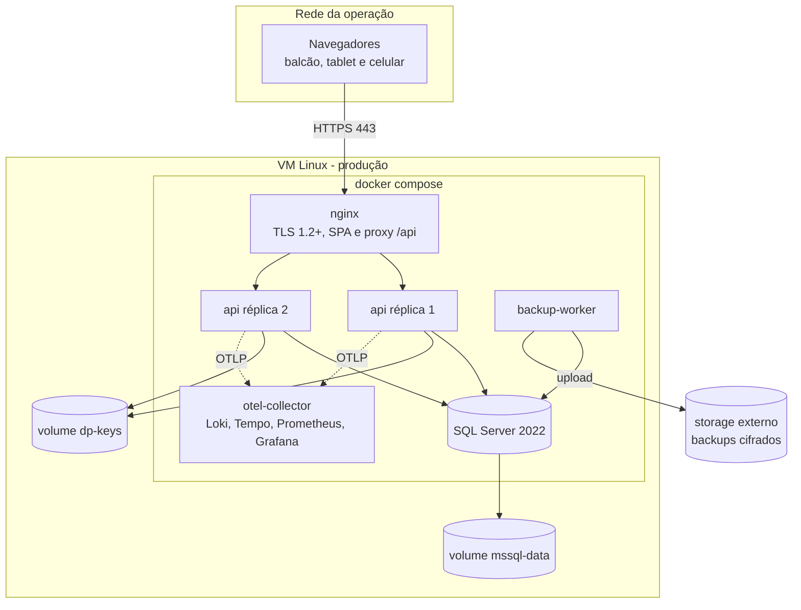

### 12.6 Ambientes de desenvolvimento

`docker compose -f deploy/compose/docker-compose.yml -f deploy/compose/docker-compose.override.yml up` sobe SQL Server, API com hot reload e o collector. O Angular roda com `ng serve` e proxy para `http://localhost:5080`, evitando CORS. O banco de desenvolvimento é descartável; dados reais nunca são usados localmente.

## 13. Dependências e bibliotecas

Versões exatas são fixadas em `Directory.Packages.props` e `package.json` no início da implementação; a tabela registra a linha tecnológica e a justificativa.

| Dependência | Versão | Finalidade | Justificativa | Licença |
| --- | --- | --- | --- | --- |
| .NET SDK / ASP.NET Core | 10.0.x LTS | Runtime e framework web | Stack definida no prompt e suporte de longo prazo | MIT |
| EF Core + SqlServer + Design | 10.0.x | ORM, migrações e provider | Stack declarada; integra com Identity e LINQ | MIT |
| Microsoft.AspNetCore.Identity.EntityFrameworkCore | 10.0.x | Autenticação e usuários | Requisito RF-001/RF-003 | MIT |
| Microsoft.AspNetCore.OpenApi | 10.0.x | Geração do contrato | Nativo do .NET 10, sem Swashbuckle | MIT |
| Scalar.AspNetCore | 2.x | UI do OpenAPI em dev/homologação | Leve e compatível com OpenAPI 3.1 | MIT |
| FluentValidation | 12.x | Validação de comandos | Regras expressivas e mensagens por campo (DEC-022) | Apache-2.0 |
| Serilog.AspNetCore + Sinks | 9.x / 6.x | Log estruturado | Correlação e sinks maduros (DEC-017) | Apache-2.0 |
| OpenTelemetry.Extensions.Hosting + Instrumentations + OTLP | 1.12.x | Traces e métricas | Padrão aberto e exportação OTLP (DEC-017) | Apache-2.0 |
| QRCoder | 1.6.x | QR do ticket | Geração determinística no servidor (DEC-010) | MIT |
| QuestPDF | 2025.x | PDF do comprovante | Layout fluente e fontes embutidas (DEC-010) | Community (validar limite de receita) |
| CsvHelper | 33.x | Exportação CSV | Escaping e cultura pt-BR (DEC-011) | Apache-2.0 / MS-PL |
| HealthChecks.EntityFrameworkCore | 10.0.x | Readiness do banco | Integração nativa com DI e EF | MIT |
| MSTest | 4.x | Testes backend | Exigência do prompt | MIT |
| Microsoft.AspNetCore.Mvc.Testing | 10.0.x | Testes de API em memória de processo | `WebApplicationFactory` oficial | MIT |
| Testcontainers.MsSql | 4.x | SQL Server efêmero nos testes | Isolamento e fidelidade (DEC-018) | MIT |
| Respawn | 6.x | Limpeza do banco entre testes | Evita `EnsureDeleted` e acelera a suíte | MIT |
| NetArchTest.Rules | 1.3.x | Testes de arquitetura | Regra de dependência e proibições | MIT |
| Angular + Angular Material/CDK | 22.x | SPA e componentes acessíveis | Stack do prompt e WCAG AA (DEC-005) | MIT |
| Tailwind CSS | 4.x | Layout utilitário | Stack declarada; produtividade responsiva | MIT |
| lucide-angular | 0.5xx | Ícones | Stack declarada e tree-shaking | ISC |
| RxJS | 7.8.x | Streams e polling | Necessário ao Angular e ao `interval` | Apache-2.0 |
| TypeScript | versão do Angular 22 | Tipagem | Padrão do framework | Apache-2.0 |
| Vitest + @testing-library/angular | 3.x / compatível | Testes de componente | Rapidez e integração com o builder (DEC-019) | MIT |
| Playwright + @axe-core/playwright | 1.5x / 4.x | E2E e acessibilidade | Multi-engine e axe integrado (DEC-019) | Apache-2.0 / MPL-2.0 |
| ESLint + angular-eslint + Prettier | 9.x / 20.x / 3.x | Lint e formatação | Consistência e detecção precoce | MIT |
| k6 | 1.x | Teste de carga | Scripts versionáveis e métricas claras | AGPL-3.0 (uso interno) |
| nginx | 1.27-alpine | TLS, estáticos e proxy | Leve e consolidado | BSD-2-Clause |
| SQL Server 2022 | 2022 CU atual | Banco de dados | Stack declarada e recursos necessários | Proprietária (Developer em dev/teste; Standard licenciada em produção comercial) |
| OTel Collector, Loki, Tempo, Prometheus | versões estáveis atuais | Observabilidade | Stack aberta e leve para um host | Apache-2.0 / AGPL-3.0 |
| Grafana | 11.x | Dashboards e alertas | Interface consolidada | AGPL-3.0 (uso interno) |
| rclone | 1.6x | Cópia de backup para storage | Suporte a S3-compatible e criptografia | MIT |
| Docker Engine + Compose | 27.x / v2 | Containers e orquestração | Simplicidade operacional (DEC-014) | Apache-2.0 |

**Política de dependências:** lockfiles commitados; Dependabot semanal para patches; upgrades de major com PR dedicado e suíte completa; verificação de vulnerabilidades no CI; nenhuma biblioteca sem finalidade e decisão associada; licenças verificadas antes de adicionar (QuestPDF e Grafana exigem atenção). Dependências transitivas são auditadas pelo `dotnet list package --include-transitive` e `npm audit`.

## 14. Riscos técnicos

| ID | Risco | Probabilidade | Impacto | Mitigação | Contingência |
| --- | --- | --- | --- | --- | --- |
| RT-01 | VM única cai e derruba API e banco | Média | Alto | Health checks, restart, backup externo e runbook de reconstrução | Restaurar em VM nova dentro do RTO de 4 h |
| RT-02 | Dupla ocupação de vaga sob concorrência | Baixa | Alto | Índices únicos filtrados + teste concorrente | Corrigir vaga com movimentação auditada |
| RT-03 | Impressão diverge entre navegador e driver | Média | Médio | Homologação com impressora real e fallback na tela | Entregar ticket com código/QR e reimprimir |
| RT-04 | Angular 22 / .NET 10 mudam detalhes entre patch e implementação | Média | Médio | Versões fixadas e upgrade controlado | Ajustar dependências e recompilar |
| RT-05 | Polling sobrecarrega o banco em pico | Baixa | Médio | ETag/304, pausa com aba oculta e índice no read model | Aumentar intervalo para 10 s ou adotar SSE |
| RT-06 | Relatórios de 5 anos excedem 15 s | Média | Médio | Índices por data, agregação no banco e teste com volume | Pré-agregação diária ou cache de relatório |
| RT-07 | Erro de fuso em fechamento e relatório | Média | Alto | UTC no banco, conversão explícita e testes de virada de dia | Reprocessar com correção e reabrir caixa |
| RT-08 | Anonimização quebra conciliação financeira | Média | Alto | `ResponsavelRef`, dry-run e validação jurídica | Restaurar backup e ajustar a rotina |
| RT-09 | QuestPDF com licença incompatível | Baixa | Médio | Validar receita e licença antes do go-live | Trocar por gerador HTML→PDF ou PDFsharp |
| RT-10 | Drift entre contrato OpenAPI e SPA | Média | Médio | Teste de contrato no CI (DEC-030) | Corrigir interface e repetir deploy |
| RT-11 | Backup nunca testado falha na restauração | Média | Alto | `RESTORE VERIFYONLY` semanal e restore trimestral | Restaurar full anterior e reprocessar logs |
| RT-12 | Auditoria cresce sem controle | Baixa | Médio | Índices, retenção de 5 anos e purga agendada | Arquivar em storage e reduzir retenção conforme lei |
| RT-13 | Dados pessoais em log ou exportação | Baixa | Alto | Política de destructuring, mascaramento e testes | Revogar acesso, rotacionar segredos e comunicar incidente |
| RT-14 | Contingência aprovada gera duplicidade | Média | Médio | `ContingenciaId` único, payload hash e idempotência | Rejeitar registro duplicado e reconciliar manualmente |
| RT-15 | Testcontainers indisponível no ambiente do dev | Média | Baixo | Docker Desktop documentado e fallback de banco local | Rodar integração apenas no CI |

## 15. Rastreabilidade PRD → TDD

| Requisito | Seção do TDD | Decisão | Status |
| --- | --- | --- | --- |
| RF-001 | 6.1, 8.1 | DEC-003 | Coberto |
| RF-002 | 8.2 | DEC-016 | Coberto |
| RF-003 | 6.1, 8.1 | DEC-003, DEC-016 | Coberto |
| RF-004 | 5.4, 8.5 | DEC-027 | Coberto |
| RF-005 | 5.2, 6.1 | DEC-013, DEC-031 | Coberto |
| RF-006 | 5.2, 5.5 | DEC-007 | Coberto |
| RF-007 | 5.2, 5.5 | DEC-007, DEC-026 | Coberto |
| RF-008 | 7.1 | DEC-001, DEC-022 | Coberto |
| RF-009 | 5.5, 7.1 | DEC-007 | Coberto |
| RF-010 | 6.1, 7.1 | DEC-006, DEC-009, DEC-010 | Coberto (QA-004) |
| RF-011 | 6.1, 7.1 | DEC-009, DEC-027 | Coberto (pós-MVP — Fase 4) |
| RF-012 | 5.5, 7.1 | DEC-007 | Coberto |
| RF-013 | 7.1 | DEC-007 | Coberto |
| RF-014 | 6.1, 8.2 | DEC-016 | Coberto |
| RF-015 | 5.4, 6.1 | DEC-031 | Coberto |
| RF-016 | 7.7, 8.5 | DEC-027 | Coberto |
| RF-017 | 5.2, 7.1 | DEC-022 | Coberto |
| RF-018 | 5.2, 6.1 | DEC-007, DEC-027 | Coberto (pós-MVP — Fase 5) |
| RF-019 | 4.2, 6.1 | DEC-004 | Coberto |
| RF-020 | 5.5, 7.2 | DEC-007 | Coberto |
| RF-021 | 7.2 | DEC-007 | Coberto |
| RF-022 | 6.1, 7.2 | DEC-004 | Coberto |
| RF-023 | 7.2, 7.7 | DEC-001 | Coberto |
| RF-024 | 6.1 | DEC-016 | Coberto (pós-MVP — Fase 4) |
| RF-025 | 7.2, 7.3 | DEC-001 | Coberto |
| RF-026 | 5.2, 7.2 | DEC-022 | Coberto |
| RF-027 | 5.2, 7.2 | DEC-026 | Coberto |
| RF-028 | 7.7 | DEC-001 | Coberto (pós-MVP — Fase 5) |
| RF-029 | 7.5 | DEC-027 | Coberto |
| RF-030 | 4.3, 7.3 | DEC-001, DEC-026 | Coberto |
| RF-031 | 7.3 | DEC-001 | Coberto |
| RF-032 | 7.3 | DEC-025 | Coberto |
| RF-033 | 5.5, 7.3 | DEC-007, DEC-025 | Coberto |
| RF-034 | 6.1, 7.3 | DEC-010 | Coberto |
| RF-035 | 7.3 | DEC-027 | Coberto (QA-006) |
| RF-036 | 7.3 | DEC-027 | Coberto |
| RF-037 | 6.1 | DEC-031 | Coberto |
| RF-038 | 7.4 | DEC-025, DEC-026 | Coberto |
| RF-039 | 7.4 | DEC-027 | Coberto (pós-MVP — Fase 4) |
| RF-040 | 6.1, 7.1 | DEC-004 | Coberto |
| RF-041 | 9 | DEC-026, DEC-031 | Coberto |
| RF-042 | 6.1, 11 | DEC-011 | Coberto |
| RF-043 | 7.6 | DEC-025 | Coberto (QA-011) |
| RF-044 | 6.1 | DEC-031 | Coberto (pós-MVP — Fase 4) |
| RNF-001 | 9 | DEC-031 | Coberto |
| RNF-002 | 9 | DEC-031 | Coberto |
| RNF-003 | 5.5 | DEC-007 | Coberto |
| RNF-004 | 10, 12 | DEC-014 | Coberto (QA-002) |
| RNF-005 | 10, 12 | DEC-020 | Coberto |
| RNF-006 | 8.1 | DEC-003 | Coberto |
| RNF-007 | 8.2 | DEC-016 | Coberto |
| RNF-008 | 8.5 | DEC-027 | Coberto |
| RNF-009 | 8.4 | DEC-028 | Coberto (QTD-03, QA-007) |
| RNF-010 | 5.4 | DEC-028 | Coberto (QA-007) |
| RNF-011 | 4.5, 7 | DEC-005 | Coberto |
| RNF-012 | 11 | DEC-005, DEC-019 | Coberto |
| RNF-013 | 4.4, 11 | DEC-029 | Coberto |
| RNF-014 | 10 | DEC-017 | Coberto |
| RNF-015 | 4.4, 6.2, 11 | DEC-023, DEC-030 | Coberto |
| RNF-016 | 7.1 | DEC-009 | Coberto (QA-004) |
| RNF-017 | 7.6 | DEC-025 | Coberto |
| RNF-018 | 9 | DEC-013, DEC-031 | Coberto (QA-012) |
| RNF-019 | 4.5 | DEC-026 | Coberto |
| RNF-020 | 6.2 | DEC-011 | Coberto |
| RNF-021 | 6.1, 7.3 | DEC-010 | Coberto |

## 16. Questões em aberto

| ID | Questão | Opções | Responsável | Critério de decisão |
| --- | --- | --- | --- | --- |
| QTD-01 | Qual versão exata do Node.js o Angular 22 exige? | Node 22 LTS ou Node 24 LTS, conforme `engines` do Angular 22 | Tech lead | Build e testes verdes na versão escolhida |
| QTD-02 | A receita anual do cliente se enquadra na licença Community do QuestPDF? | QuestPDF Community ou biblioteca alternativa | Alexandre Rech e jurídico | Licença compatível antes do go-live |
| QTD-03 | O documento do responsável precisa de criptografia em nível de coluna? | Coluna comum + volume cifrado ou Always Encrypted | Segurança e jurídico | Resultado da avaliação de risco LGPD |
| QTD-04 | Haverá autoatendimento de redefinição de senha ou MFA? | Redefinição pelo Administrador (MVP) ou autosserviço | Alexandre Rech | Escopo do MVP e política de segurança |
| QTD-05 | Qual o limite de desconto por perfil? | Percentual fixo, limite por valor ou sem limite | Gestão/financeiro (QA-006) | Regra validada antes do go-live |
| QTD-06 | Qual o volume real de estadias e usuários simultâneos? | 5.000/mês e 20 simultâneos (premissa) ou outro | Operação (QA-012) | Teste de carga com o volume confirmado |
| QTD-07 | Qual provedor de storage externo será usado para backup? | S3, Backblaze B2, MinIO próprio ou outro | TI | Custo, durabilidade e compatibilidade com rclone |
| QTD-08 | Quem gerencia DNS e certificado TLS? | TI interno ou provedor | Alexandre Rech | Renovação automatizada funcionando |
| QTD-09 | A disponibilidade de 99,5% exige segundo host? | Host único com SPOF aceito no MVP acadêmico (D-03a) vs segunda VM em produção comercial | Alexandre Rech | Custo versus meta de RNF-004; janela de operação confirmada (QA-002) |
| QTD-10 | Quem aprova contingência: Gestor/Financeiro, Administrador ou ambos? | Ambos ou somente Administrador | Alexandre Rech (QA-011) | Permissão aplicada no mapa de DEC-016 |
| QTD-11 | Qual o modelo da impressora térmica e ela suporta 80 mm? | Modelo informado pela operação | Operação e TI (QA-004) | Homologação de impressão antes do MVP |
| QTD-12 | Haverá migração de planilhas históricas? | Sem migração (MVP) ou carga assistida | Alexandre Rech (QA-008) | Se sim, novo escopo e script de importação |
| QTD-13 | Aquisição de licença SQL Server Standard para produção comercial | SQL Server Standard licenciada (migração de Developer) | Alexandre Rech | Licença adquirida antes do go-live comercial |

## 17. Roadmap de implementação

Mapeamento PRD §15 → TDD §17 (D-02): **MVP do PRD = Fases 0 a 3**; **Fase 2 do PRD = Fase 4**; **Fase 3 do PRD = Fase 5**. Endpoints e fluxos marcados "pós-MVP" em §6.1 não serão entregues nas Fases 0–3.

| Fase | Entregável | Dependências | Critérios de aceite |
| --- | --- | --- | --- |
| 0 - Fundação | Solução `.slnx`, projetos, pipeline CI, Identity com cookie, migrações, health checks, observabilidade base, layout Angular e tema | DEC-003, DEC-015, DEC-023, DEC-024, DEC-017 | Login/logout, gestão de usuários e troca de senha (RF-001, RF-002, RF-003); pipeline verde; `/health/ready` OK; migração aplicada por bundle |
| 1 - Operação | Unidade, vagas, tarifas, check-in com ticket e QR, busca (RF-014), detalhe (RF-015), cancelamento (RF-016), condição de entrada, painel com polling e mapa de vagas | Fase 0 e DEC-004, DEC-006, DEC-007, DEC-009, DEC-022 | RF-005 a RF-010, RF-012 a RF-017, RF-019, RF-020 aceitos; teste de concorrência verde |
| 2 - Retirada e financeiro | Solicitação, fila, status, entrega, cálculo, desconto, isenção, pagamento, estorno, comprovante e ticket perdido | Fase 1 e DEC-010, DEC-025, DEC-027 | RF-021, RF-022, RF-023, RF-025 a RF-027, RF-029 a RF-037 aceitos; bloqueios de liberação testados |
| 3 - Gestão e conformidade | Fechamento (sem reabertura pós-MVP), relatórios, CSV, auditoria consultável, contingência e retenção (flag desligada) | Fase 2 e DEC-011, DEC-026, DEC-028 | RF-004, RF-038, RF-040 a RF-043 aceitos; relatório de 12 meses < 5 s; CSV validado no Excel |
| 4 - Complementos do PRD (Fase 2 do PRD) | Reimpressão de ticket, atribuição de manobrista, reabertura de caixa e histórico de entregas | Fase 3 | RF-011, RF-024, RF-039 e RF-044 aceitos |
| 5 - Evolução (Fase 3 do PRD) | Movimentação de veículos entre vagas e cancelamento de solicitação de retirada | Fase 4 | RF-018 e RF-028 aceitos com auditoria e testes de transição |

## 18. Glossário

| Termo | Definição |
| --- | --- |
| Agregado | Conjunto de entidades tratado como unidade de consistência, com uma raiz que protege suas invariantes. |
| Append-only | Estrutura em que só se permite inserir e ler; alteração e exclusão são bloqueadas. |
| Clean Architecture | Estilo em que as dependências apontam para dentro, isolando domínio e aplicação de frameworks e banco. |
| DDD | Domain-Driven Design: modelagem orientada ao domínio, com linguagem ubíqua e limites de contexto. |
| ETag | Identificador de versão de um recurso HTTP, usado para evitar transferir corpo quando nada mudou (`304`). |
| GUID v7 | UUID ordenável por tempo, usado como chave primária para melhor localidade de índice. |
| Idempotência | Propriedade de uma operação repetida produzir o mesmo efeito e a mesma resposta. |
| Migration bundle | Executável autocontido que aplica migrações do EF Core em um banco. |
| OTLP | OpenTelemetry Protocol, usado para exportar traces, métricas e logs. |
| Polling | Consulta periódica ao servidor para obter estado atualizado. |
| Read model | Projeção otimizada para leitura, separada do modelo de escrita. |
| RPO | Recovery Point Objective: perda máxima aceitável de dados. |
| RTO | Recovery Time Objective: tempo máximo aceitável de recuperação. |
| Rowversion | Coluna de versão do SQL Server usada para detectar atualização concorrente. |
| Seeder | Rotina idempotente que insere dados iniciais necessários à operação. |
| Signal | Primitiva reativa do Angular para estado e derivação sem `zone.js`. |
| SPA CSR | Single Page Application renderizada no cliente, sem renderização no servidor. |
| Testcontainers | Biblioteca que sobe dependências reais em containers durante os testes. |
| Ubiquitous language | Vocabulário único compartilhado entre negócio e código. |
| Zoneless | Modo do Angular sem `zone.js`, em que a mudança de tela é disparada por signals e eventos explícitos. |

## 19. Anexo A - Registro da entrevista

A entrevista foi conduzida com a ferramenta `question` do ambiente, em cinco rodadas (20 + 3 perguntas). Todas as respostas foram registradas e refletidas no documento; nenhuma pergunta ficou pendente.

| ID | Pergunta | Resposta / Decisão | Decisão gerada | Status |
| --- | --- | --- | --- | --- |
| ENT-001 | Como estruturar os casos de uso dentro de Clean Architecture + DDD? | Casos de uso explícitos, sem MediatR | DEC-001 | Confirmada |
| ENT-002 | Qual estilo de endpoint usar na API? | Controllers MVC com OpenAPI nativo | DEC-002 | Confirmada |
| ENT-003 | Como a SPA transporta a sessão até a API? | Cookie same-site HttpOnly + antiforgery | DEC-003 | Confirmada |
| ENT-004 | Como atualizar painel e fila em até 10 s? | Polling de 5 s com ETag | DEC-004 | Confirmada |
| ENT-005 | Qual base de componentes visuais adotar? | Angular Material + Tailwind + Lucide | DEC-005 | Confirmada |
| ENT-006 | Qual estratégia de chave primária? | GUID v7 + código público curto | DEC-006 | Confirmada |
| ENT-007 | Como impedir dupla ocupação de vaga? | Índice único filtrado + rowversion + transação | DEC-007 | Confirmada |
| ENT-008 | Como aplicar migrações e dados iniciais? | Bundle no deploy + seeder idempotente | DEC-008 | Confirmada |
| ENT-009 | Como imprimir o ticket em 80 mm? | `window.print` com CSS de 80 mm e fallback | DEC-009 | Confirmada |
| ENT-010 | Onde gerar QR e PDF do comprovante? | Servidor com QRCoder + QuestPDF | DEC-010 | Confirmada |
| ENT-011 | Onde gerar o CSV? | Servidor em streaming com neutralização | DEC-011 | Confirmada |
| ENT-012 | Como versionar a API? | Prefixo `/api/v1` | DEC-012 | Confirmada |
| ENT-013 | Qual banco usar em desenvolvimento e testes? | SQL Server 2022 Developer em container (dev/teste; produção comercial exige Standard licenciada) | DEC-013 | Confirmada |
| ENT-014 | Onde hospedar em produção? | VM Linux + Docker Compose + nginx | DEC-014 | Confirmada |
| ENT-015 | Qual ferramenta de CI/CD? | GitHub Actions | DEC-015 | Confirmada |
| ENT-016 | Como materializar a matriz de permissões? | Permissões fixas por perfil em código + policies | DEC-016 | Confirmada |
| ENT-017 | Como atender observabilidade e alertas? | Serilog + OpenTelemetry com OTLP | DEC-017 | Confirmada |
| ENT-018 | Como executar testes de integração? | MSTest + WebApplicationFactory + Testcontainers | DEC-018 | Confirmada |
| ENT-019 | Qual stack de testes de frontend? | Vitest + Testing Library + Playwright | DEC-019 | Confirmada |
| ENT-020 | Como implementar backup e restauração? | Backup via backup-worker com sqlcmd + cron (sem SQL Server Agent): full diário + log horário + storage externo | DEC-020 | Confirmada |
| ENT-021 | Como gerenciar estado no Angular? | Signals + serviços de feature, sem store global | DEC-021 | Confirmada |
| ENT-022 | Qual abordagem de validação de entrada? | FluentValidation por caso de uso | DEC-022 | Confirmada |
| ENT-023 | O resumo das decisões está correto e pode ser consolidado? | Confirmar e escrever | DEC-001 a DEC-031 | Confirmada |

## 20. Referências

- [PRD - Plataforma de Gestão de Estacionamento e Valet](../prd/prd.md) v1.1.
- [Entrevista de requisitos](../entrevista.md).
- [README do projeto](../../README.md) — stack declarada.
- [OpenSpec](../../openspec/config.yaml) — configuração do fluxo de especificação.
- Angular. Documentação oficial de standalone, signals e zoneless: <https://angular.dev>.
- Microsoft. ASP.NET Core, EF Core e Identity: <https://learn.microsoft.com/aspnet/core> e <https://learn.microsoft.com/ef/core>.
- IETF. RFC 9457 - Problem Details for HTTP APIs: <https://www.rfc-editor.org/rfc/rfc9457>.
- OWASP. Application Security Verification Standard e Cheat Sheets: <https://owasp.org>.
- W3C. Web Content Accessibility Guidelines 2.1: <https://www.w3.org/TR/WCAG21/>.
- OpenTelemetry. Especificação e instrumentação .NET: <https://opentelemetry.io/docs/languages/net/>.
- Microsoft. SQL Server backup e restore: <https://learn.microsoft.com/sql/relational-databases/backup-restore/>.
- Playwright e axe-core: <https://playwright.dev> e <https://github.com/dequelabs/axe-core-npm>.

## 21. Changelog

| Versão | Data | Autor | Mudança |
| --- | --- | --- | --- |
| 1.0 | 2026-11-08 | Agente OpenCode | Criação do TDD a partir do PRD v1.1, do README e da entrevista técnica de 23 decisões. |
| 1.1 | 2026-11-08 | Agente OpenCode | Bloco 1 (C-01 e C-04): D-01 — edição Developer dev/teste, produção comercial exige Standard licenciada; Express descartado (sem Agent/TDE, Windows-only, 10 GB); DEC-020 sem SQL Server Agent via backup-worker cron+sqlcmd; distinção entre retenção operacional de backup (7d/30d) e arquivo mensal por 5 anos; remoção de "Jobs SQL" (ENT-020); QTD-13 de licenciamento. |
| 1.2 | 2026-11-08 | Agente OpenCode | Bloco 2 (C-02 e C-03): DEC-007/§5.2/§5.5 — tarifa com trigger TR_Tarifa_Sobreposicao + SERIALIZABLE contra sobreposição parcial (409 CONFLITO_VIGENCIA); pagamento com UX_Pagamento_Ativo filtrado WHERE Status='Ativo', trilha pós-estorno e múltiplos comprovantes por cobrança (novo Numero via SEQUENCE), Fig.15 com retorno Estornada->EmAberto->Paga, cenários 21-22 em §11.2 e remoção de UNIQUE simples em Pagamento/Comprovante. |
| 1.3 | 2026-11-08 | Agente OpenCode | Bloco 3 (A-01 e A-02): D-02 — MVP restrito ao PRD §15 (RF-011/018/024/028/039/044 como pós-MVP Fases 4/5), §2.2 e §17 realinhados, RF-015/016 realocados ao MVP, endpoints pós-MVP marcados em §6.1 e rastreabilidade; DEC-016/§6.1/§8.2 — novo Operacao.Visualizar, busca por nome/documento restrita a Financeiro.VerValores, detalhe sem valores sem VerValores e ticket exigindo Operacao.CheckIn. |
| 1.4 | 2026-11-08 | Agente OpenCode | Bloco 4 (A-03 e A-04): D-03a — RNF-004/DEC-014 medido só na janela de operação QA-002 (excluindo manutenção), MVP acadêmico apenas com uptime sem SLA formal, SPOF aceito (QTD-09 refeita) e cálculo 99,5%×RTO 4h; D-03b — DEC-028/§5.4 com flag Retention:Enabled=false default, separação operacional (2y) × financeiro (5y), placa por PlacaHash (HMAC) + ResponsavelRef, dry-run e alerta desativado até QA-007. |

